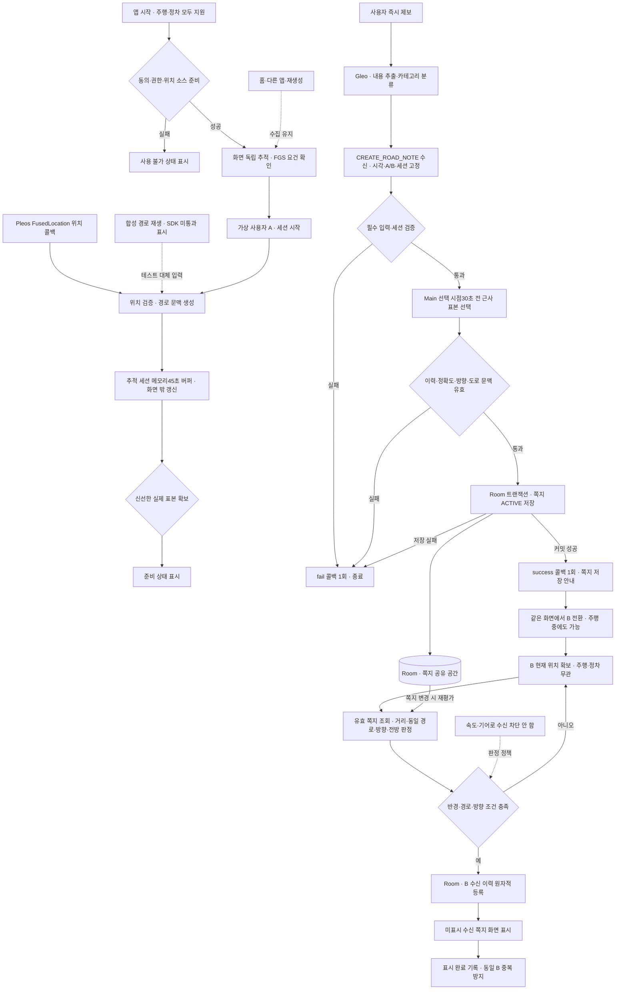
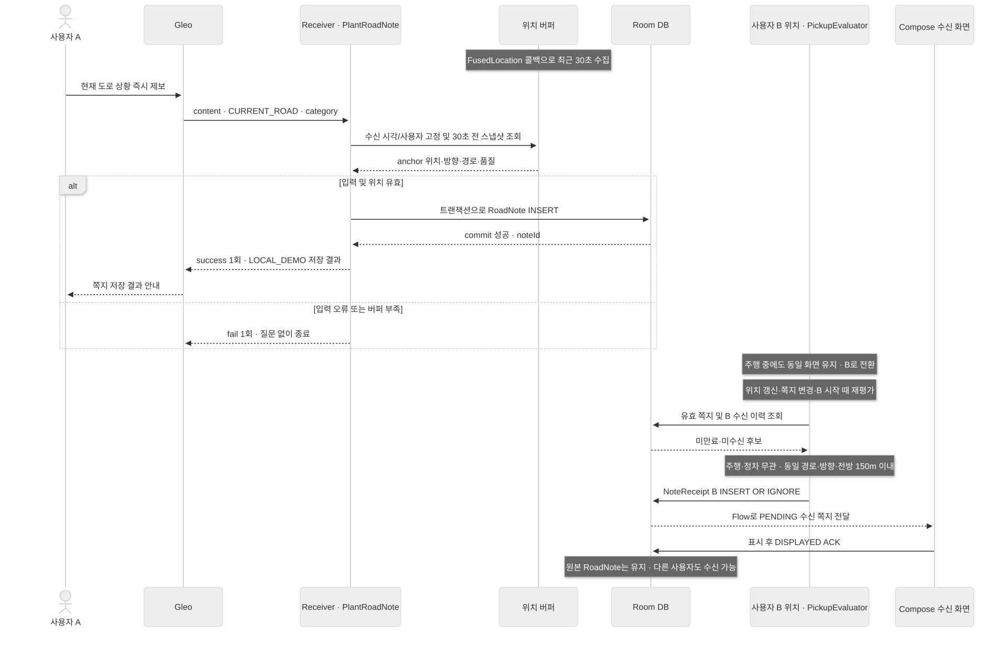
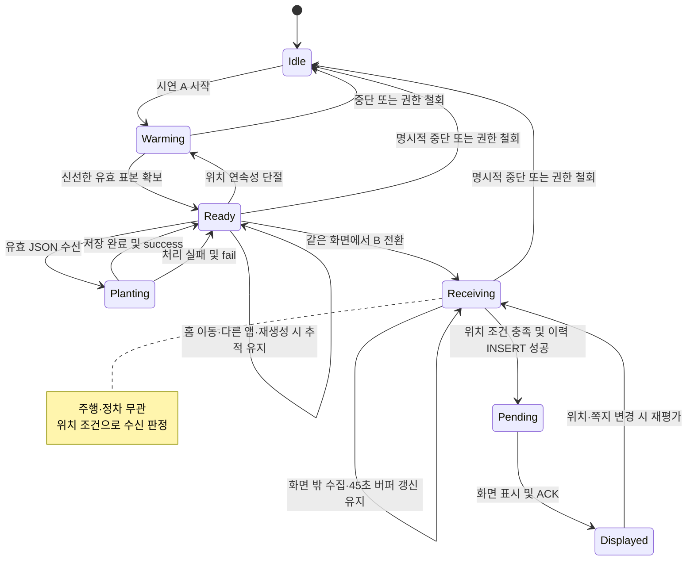

# 즉시 도로 제보 프로토타입 E2E 테크스펙

수정: 2026-11-10. PR #4 후속 합의의 추적 수명은 아래 보강 및 [단계별 최신 계획](https://github.com/jin-kim-240204/hyundai-and-gretel/blob/625a1fb/docs/specs/road-notes/00-overview.md)을 따른다. 화면 이탈 중지 정책은 폐기했으며01단계는 로그 진단으로 바꿨다. 그 밖의 과거 수치·구현 현황은 단계별 스펙과 대조한다.

초기 작성: 2026-11-09. 이 문서는 **제보 → 해당 위치에 쪽지 저장 → 뒤따르는 사용자의 접근 수신**을 구현하기 위한 현행 계획이다. 이전 Sprint 문서의 지명·후속 질문·목격 시각 역산 계획보다 이 문서를 우선한다. 아래 목표 구성은 아직 구현 완료가 아니다.

## 0. 문서 소유권과 브랜치 운영

전체 시스템 설계의 정본은 이 문서 하나다. 도표의 `.mmd` 원본과 `.svg`는 같은 문서의 부속 자산이며 별도 계획 문서가 아니다. Gleo·위치 버퍼 등 기능별 상세 설계/검증은 각 기능 PR에 둔다. 현재 구현 표는 기존 Gleo 기능 브랜치의 상태를 설명하며 설계 브랜치에 앱 기능이 구현됐다는 뜻이 아니다.

- 설계 브랜치: `spec-road-note-system` → `main`으로 문서 전용 PR.
- 기존 음성 기능: `gm/feat-speech-to-text`는 설계 브랜치를 공통 조상으로 포함하고 그 브랜치를 PR base로 사용한다.
- 다음 위치 기능: `ny/feat-fused-location-notes`는 설계 브랜치에서 분기한다. FusedLocation 30초 버퍼·쪽지 저장·접근 이벤트를 구현하는 범위다. Gleo 연결 코드는 기존 음성 기능 PR의 의존성이므로 필요 시 해당 변경을 별도로 통합한다.
- 설계 변경은 설계 브랜치에서만 수정한 뒤 각 기능 브랜치에서 `git merge origin/spec-road-note-system`으로 반영한다. 부모 변경은 자동 전파되지 않는다. 충돌은 해결안을 합의한 뒤 처리한다.
- 설계 PR은 앱 코드가 섞이지 않도록 유지한다. 기능 PR을 설계 브랜치로 바로 merge하면 설계 PR에도 기능 코드가 들어가므로 그렇게 하지 않는다. 설계 PR을 먼저 main에 반영한 뒤 기능 PR base를 main으로 옮겨 기능을 merge한다. 설계 PR squash merge 후에는 공통 조상을 다시 확인한다.
- 향후 설계 수정도 이 정본을 대상으로 별도 문서 PR로 main에 반영하고 기능 브랜치에 동기화한다. 단계별 문서가 전체 정책을 복제/덮어쓰지 않도록 정본 절을 링크한다.

## 1. 이번 제출의 결정과 범위

사용자는 현재 주행 중인 도로에서 목격한 상황을 Gleo에 즉시 제보한다. 앱은 **JSON 수신 시각에서 고정으로 30초 전의 차량 위치**를 찾아 그곳에 쪽지를 남긴다. 이후 같은 경로·진행 방향으로 접근하는 다른 사용자가 해당 위치 근처에 들어오면 쪽지를 받는다.

‘30초 전’은 프로젝트의 배치 정책이다. 실제 목격 시각이나 정확한 위험 지점의 측정값이 아니며, 사용자가 “10초 전”이라고 말해도 이번 버전은 30초를 적용한다. 앱은 ‘수신 30초 전 위치 기준의 근사 제보’로 표시한다. LLM에 시간·좌표·방향 계산을 맡기지 않는다.

| 항목 | 제출 프로토타입 결정 |
|---|---|
| 장소 | CURRENT_ROAD만 지원. NAMED_PLACE는 후속 계획에만 둠 |
| 호출 | CREATE_ROAD_NOTE, 요청 1회당 success/fail 콜백 1회 전송 시도. asking·이어받기 없음 |
| 분류 | LLM이 content에서 WARNING / INFORMATION 선택 |
| 배치 시각 | 앱의 receivedAt 기준 30초 전. 단조시계로 위치 버퍼 조회 |
| 위치 수집 | Pleos FusedLocation SDK 연속 콜백 → 앱 메모리 30초 버퍼 |
| 쪽지 공유 | 앱 내부 Room DB. 서버 없음 |
| 시연 | 노트북 1대, Pleos 에뮬레이터 1대, 앱 1개. 주행 중에도 동일 화면에서 동작. 정차 중에도 가상 사용자 A/B 전환·제보·수신 가능 |
| 줍기 | B의 현재 위치 업데이트 때 접근 판정 → B의 수신 이력 저장 → 화면에 한 번 표시 |
| 화면 | 기존 DO 선언과 동일 UI 유지. 주행 감지로 다른 화면으로 전환/축소하지 않음. 화면 꺼짐 방지는 별도 계획 |
| 제외 | 지명 검색·과거 제보·위치 핀·멀티턴·실차 간 네트워크·카메라·조명·자체 내비·선제 음성 안내 |

A/B는 실제 차량 2대가 아니라 한 앱의 가상 운전자다. Room은 로컬 공유 공간 역할이며 외부 사용자에게 배포하는 서버가 아니다. 두 노트북·두 앱 인스턴스는 각자 별도 DB이므로 이번 구성으로 서로 공유되지 않는다.

## 2. 현재 구현과 목표의 차이

| 영역 | 현재 코드 | 이번에 구현할 목표 |
|---|---|---|
| 앱 | ComponentActivity/Compose 유지 | 구조 유지, 시연 세션·상태 표시 추가 |
| Gleo | 3개 입력 검증, debug는 무저장 preview, release는 내부 수신·로컬 초안 | 시연 빌드에서 실제 Room 심기 처리로 연결. preview와 실행 모드는 명확히 분리 |
| 시간 | Receiver가 receivedAt 기록 | 외부 수신 시각과 별도로 Main 직렬 선택 진입에서 selectedElapsedMillis를 읽어45초 버퍼 조회 |
| 위치 | FusedLocation 의존성/권한/초기화/수집 미구현 | 지원 확인·동의·권한·콜백·버퍼·정리 구현 |
| 저장 | Keystore/AES-GCM 바이너리 DraftStore, 기존 초안 보존 | 합성 시연 전용 Room에 쪽지와 사용자별 수신 이력 저장 |
| 수신 | 접근 판정 없음 | 위치 업데이트마다 후보 쪽지 필터링 및 수신 처리 |
| 주행 표시 | Manifest distractionOptimized=true, 규제 상태 연동 없음 | 기존 동일 화면 유지. 주행 상태에 따른 별도 화면 분기/축소 UI 재도입 없음 |

기존 초안 파일은 Room 쪽지로 자동 전환하지 않는다. 좌표 없는 과거 초안을 이미 심어진 쪽지로 만들지 않으며, 별도 레거시 화면/보관으로 구분한다. Room 기본 저장이 기존 AES-GCM과 같은 암호화 보장을 준다고 가정하지 않는다. 이번 제출 DB는 합성 좌표·시험 문구 전용이며 실위치 영속 저장은 별도 보안 결정 전 열지 않는다.

## 3. 전체 시스템 흐름



[Mermaid 원본](diagrams/prototype-e2e-flow.mmd)

한 에뮬레이터에서 A와 B를 순차 실행하며 주행 중 동작을 메인 시연으로 검증한다. 정차도 지원하며 주행 유지는 기능의 필수 조건이 아니다. A/B 전환은 가상 사용자/경로의 교체이며 차량 정차나 주행 감지에 따른 화면 전환이 아니다. 역할 전환 후에도 Room 쪽지는 남고 위치 버퍼는 섞이지 않는다. 홈 이동·다른 앱 전환·Activity 재생성 중에도 이미 시작한 추적 세션과 위치 수집을 유지한다. 최근45초 버퍼를 화면 밖에서도 계속 갱신하고, 이후 후보 조회·접근 판정·수신 저장도 추적 수명에 연결한다. 화면 복귀는 같은 추적 상태에 재연결한다. 화면 비가시 중에는 표시 완료를 기록하지 않으며 수신된 항목은 복귀 후 표시한다. 강제 종료·프로세스 사망·차량 재시작 자동 복구와 debug 이동 재생 수명은 별도 검토한다.

## 4. 구성 요소와 인터페이스

이름은 구현 책임을 설명하는 제안이다. 별도 네트워크 계층·서비스·서버를 선제 도입하지 않는다.

| 구성 요소 | 입력 → 출력 | 책임·연결 |
|---|---|---|
| DemoSession | 역할/시작/정지 → sessionId, actorId, generation, mode | A/B 전환 직렬화, 수신 순간 역할 고정, 실행 중 전환 차단 |
| LocationSource | FusedLocation 또는 명시적 합성 재생 → LocationSample | 두 소스를 동시에 섞지 않음. source와 측정 품질을 전달 |
| LocationBuffer | 검증된 샘플 → 상태·불변 스냅샷 | 세션별45초 보관, 수신 순간 과거 위치 조회 |
| RoadContextResolver | 좌표·방향 → routeId, direction, progressMeters | 시연 경로 투영. 실제 도로 식별 API로 오해하지 않음 |
| Gleo Receiver/Parser | ACTION_PARAM → 유효 content/category/locationMode | 외부 수신 UTC·사용자/세션 전달, Main 선택 시각은 별도 고정 |
| PlantRoadNote | 검증 입력 + 수신 문맥 → 저장된 noteId 또는 오류 | 위치 선택·품질·Room 트랜잭션. 이후 콜백 생성 |
| NoteRepository/DAO | 생성/유효 후보 조회 → Room 결과·Flow | 로컬 공유 쪽지와 수신 이력, 만료·초기화 관리 |
| PickupEvaluator | B 현재 샘플 + 후보 → 수신 대상 | 동일 도로·방향·전방·거리·자기 제보 제외·중복 제외 |
| ReceiptRepository | noteId/actorId → INSERT 성공 여부 | 복합 키로 사용자별 중복 수신 방지, 전역 쪽지 삭제 안 함 |
| UI 상태 모델 | 세션·버퍼·저장·수신 Flow → Compose | 핵심 상태만 표시. 이번 에뮬레이터 시연에서는 주행 상태로 다른 화면을 표시하지 않음 |

SDK 콜백과 요청은 Main의 같은 실행 문맥에서 추가/정리/선택을 직렬 처리한다. 선택 시각 고정부터 결과 반환까지 suspend하지 않는다. Room 작업은 메인 스레드 밖에서 수행한다. UI는 DB/상태 Flow를 관찰하며 버튼이 DB를 직접 수정하지 않는다.

### 구성 요소 간 주고받는 순서



[크게 보기](diagrams/prototype-e2e-sequence.svg) · [Mermaid 원본](diagrams/prototype-e2e-sequence.mmd)

## 5. 시간·45초 버퍼·배치 위치 정책

2026-11-11 PR #4 버퍼 리뷰 답글로 갱신. 이 절이 앞선30초필수·2초연속성·측정단조시각·accuracy20m 가정보다 우선한다. 과거 예시와 구현현황 표는 당시 기록이며 이번 구현 기준은 이 절이다.

### 5.1 기준 시각

위치의 receivedElapsedMillis는 SDK 콜백 진입에서 찍은 SystemClock.elapsedRealtime() ms이며 측정 시각이 아니다. null에도 같은 수신 시각을 전달한다. SDK timestamp/차량 벽시계/confidence를 단조측정시간/미터 정확도로 변환하지 않는다.

제보의 위치 선택 기준 now는 **Main 직렬 처리에 들어온 순간** 읽고 suspend 없이 즉시 표본을 선택한다. 외부 Receiver 도착 순간과 같다고 설명하지 않는다. 외부 요청이 대기하는 동안 먼저 반영된 새 콜백을 포함할 수 있다. Receiver 진입 시각은 표시·지연 관측 목적으로 별도 보관할 수 있지만 anchor 계산에 넘기지 않는다. 선택 결과는 불변 표본과 offsetMillis=now-표본수신시각이다. 실제 외부 도착 순간 보존이 필요해지면 스냅샷 정책을 별도 합의한다.

### 5.2 보관·선택

- 메모리 시간창45,000ms(경계 포함), 추가/조회에서 초과 표본 제거. 별도 만료 타이머 없음. 화면 밖에서도 추적 세션이 계속 갱신한다.
- 최신 표본 나이0~5,000ms여야 선택 가능. 오래되면 실패만 반환하며45초 내 이력은 유지한다.
- 콜백5초 초과 공백만으로 전체 이력을 지우지 않는다. 신선한 표본이 회복되면 남은 과거 표본을 사용할 수 있다. 예:100~140 수집,146 회복 시 목표116 선택.
- 가장 오래된 표본 나이30초 미만이면 그 실제 표본 선택(첫 표본부터 즉시 제보 가능). 그 외는 목표now-30,000과 가장 가까운 실제 표본, 동률이면 오래된 표본. 목표오차5,000ms까지 허용, 초과면 실패. 보간/임의좌표 대체 없음.
- 음수/미래 시각, 같은/역순 유효 표본은 거절. 같은 좌표라도 다른 시각은 별도 표본.

### 5.3 무효화·세션 수명

null/잘못된 좌표는 버퍼를 비우되 등록을 유지하고 같은 세션의 새 유효 표본으로 복구한다. 목록과 별도로 마지막 수락·무효화 시각을 유지한다. 유효 표본은 두 기준보다 엄격히 나중이어야 한다. 늦은 null이 최신 유효 표본보다 오래되면 무시하고, 같은 시각이면 무효화를 우선한다. 무효화와 같은 시각의 유효 표본도 거절한다. 만료/무효화로 순서 기준을 지우지 않는다.

명시적 중지·SDK 실패·세션 변경·프로세스 사망 시 이력 폐기. 새 세션은 순서 기준도 초기화하고 이전 세대 콜백은 버린다. 홈 이동·다른 앱 전환·Activity 재생성은 초기화 사유가 아니다. 버퍼를 Room이나 서버에 저장하지 않는다. 재시작도 첫 신선한 표본부터 선택 가능하며30초 대기를 강제하지 않는다.

방향·경로 정책과 실제 도로 품질은 해당 기능 단계에서 별도 검토한다. 버퍼 선택 성공만으로 쪽지 저장/수신 조건 전체가 충족된다고 하지 않는다. 기존 SDK 자원 정리 순서를 유지한다.

## 6. 영속 데이터와 갱신 책임

Room 구성은 Database + Entity + DAO로 구현한다. 하나의 DB 인스턴스를 앱 범위에서 공유하고, 저장과 수신 이력 등록의 원자성을 DAO 트랜잭션/고유 키로 확보한다. Room은 로컬 DB 계층이다. [Android Room](https://developer.android.com/training/data-storage/room)

| 저장소 / 데이터 | 필수 정보 | 생성·갱신·삭제 |
|---|---|---|
| 메모리 LocationBuffer | 최근 30초 샘플, 세션·품질·준비 상태 | 위치 콜백 추가, 오래된 샘플 제거. 역할 전환/중단/재시작 시 삭제 |
| 메모리 DemoSession | scenarioId, actorId A/B, sessionId, generation, sourceMode, 실행 상태 | 주행·정차 상태와 무관하게 같은 화면에서 가상 사용자 전환. 재시작 시 시연 재생만 정지 상태로 복귀 |
| Room RoadNote | noteId(UUID), requestId(UNIQUE), scenarioId, authorActorId, content, category, receivedAtUtc, anchorLat/Lon, anchorAccuracy, anchorOffsetMillis, routeId, direction, progressMeters, source, isSynthetic, expiresAtUtc | 심기 트랜잭션에서 1회 생성. 배치 좌표는 이후 변경하지 않음. TTL 10분, 세션 초기화 시 삭제 |
| Room NoteReceipt | scenarioId, noteId, recipientActorId, receivedAtUtc, distanceMeters, displayState(PENDING/DISPLAYED), displayedAtUtc? | 복합 PK(noteId, recipientActorId). 수신 대상이면 INSERT OR IGNORE, 실제 UI 표시 후 DISPLAYED. note 삭제 시 cascade |
| 합성 경로 fixture | scenarioId/routeId/direction, 시간 오프셋별 위경도·progress·accuracy | 저장소 내 시험용 정적 데이터. 실차 이력 아님. A/B 각각 동일 도로의 다른 출발 시점 재생 |
| 기존 DraftStore | 기존 동의·암호화 초안 | 기존 파일 보존. 새 공유 Room 저장과 중복 쓰기하지 않음 |
| 시연 설정 | 화면 유지 선호, 합성 데이터 사용 동의 | 기존 설정 방식 재사용. 위치 권한 허용과 별도로 목적 고지. 초기값 문서화 |

쪽지는 ACTIVE(현재 시각 < expiresAt) / EXPIRED(그 외)로 파생한다. 전역 PICKED 상태는 두지 않는다. B가 줍더라도 쪽지는 남아서 다른 사용자 C도 받을 수 있다. 만료는 쿼리에서 즉시 제외하고, 실제 행 삭제는 세션 시작·새 심기·리셋 시 수행한다. 수신 이력은 쪽지와 함께 정리한다.

데모 TTL은 10분이며 기존 초안의 7일 정책과 독립이다. 벽시계 변경이 감지되면 진행 중 시연을 정지하고 버퍼를 비운 뒤 새 시연 세션을 시작한다. 오래된 scenarioId는 활성 조회에서 제외하고 리셋에서 삭제한다. UTC를 바꿔 시연 시간을 늘리지 않는다.

Room 저장 대상은 합성 시연 데이터로 제한한다. source(SDK/REPLAY)와 isSynthetic을 별개로 기록하여 SDK로 주입한 합성 위치도 구분한다. isSynthetic은 신뢰된 시연 세션 설정에서 정하고 Gleo 입력에서 받지 않는다. SDK 라이브 모드의 원시 궤적은 메모리 버퍼만 사용한다. 실위치가 담긴 제보를 영속화하는 정식 모드는 암호화/동의/보존 정책과 외부 수신자 인증을 구현하기 전 활성화하지 않는다. 로그에는 전체 좌표·발화·실차 식별자를 기본 출력하지 않는다.

## 7. 제보 심기와 콜백 계약

### 7.1 App Schema

이 문서의 JSON은 전체 설계의 스키마 계약이다. 앱의 assets/schema.json은 기능 브랜치에서 이 계약과 일치시킨다. [기존 Gleo 구현의 스키마](https://github.com/jin-kim-240204/hyundai-and-gretel/blob/d19b67f70adbb37f7dfa25af3301899b345ea1f6/app/src/main/assets/schema.json)를 참고하며 30초 배치 로직은 앱 내부에서 수행한다.

<!-- APP_SCHEMA_START -->
```json
{
  "packageName": "com.jinkim.hyundaiAndGretel",
  "invokeWord": "제보",
  "appDescription": "An app for reporting road conditions and sharing them with other drivers.",
  "version": "1.0",
  "actionCalls": [
    {
      "type": "function",
      "function": {
        "component": "service",
        "name": "CREATE_ROAD_NOTE",
        "description": "Report a road condition the user has just observed on the current road.",
        "parameters": {
          "type": "object",
          "properties": {
            "content": {
              "type": "string",
              "description": "The road condition observed by the user."
            },
            "locationMode": {
              "type": "string",
              "enum": [
                "CURRENT_ROAD"
              ],
              "description": "The current road where the user has just observed the reported condition."
            },
            "category": {
              "type": "string",
              "enum": [
                "WARNING",
                "INFORMATION"
              ],
              "description": "The report category classified from the content: WARNING for road hazards or conditions requiring safety precautions, or INFORMATION for other road condition information."
            }
          },
          "required": [
            "content",
            "locationMode",
            "category"
          ]
        }
      }
    }
  ]
}
```
<!-- APP_SCHEMA_END -->

모든 설명은 영어로 유지하고 한국어 invokeWord는 ‘제보’다. content는 trim 후 1~500자, category는 두 enum 중 하나, locationMode는 CURRENT_ROAD다. 모두 필수이며 타입/공백/범위 오류는 fail이다. observedAt·draftId·방향·위경도·사용자 A/B는 Gleo 입력에 없다. 앱이 모르는 과거 필드를 받아도 실행 파라미터에 넣지 않는다. [공식 App Schema 규칙](https://document.pleos.ai/docs/pleos-only/app-integration-guide/guide/app-capability)

### 7.2 심기 처리 순서

1. Receiver에서 ACTION_PARAM과 외부 수신 UTC, actorId/sessionId/generation을 전달하고 앱 내부 requestId를 만든다. Main 직렬 처리 진입에서 단조시각을 읽고 suspend 없이 위치를 선택한다. 외부 도착 시각의 스냅샷을 사용한다고 설명하지 않는다. 외부가 actorId/noteId를 지정하지 못한다.
2. 시연 모드 실행·역할 A·동의·권한·유효 입력을 확인한다. B에서 심기를 요청하면 시연 범위 오류로 fail한다.
3. 30초 전 위치를 선택한다. 경로 밖/저품질/버퍼 미준비면 저장 없이 종료한다.
4. Room 트랜잭션에서 유효 세션 generation을 다시 확인하고 RoadNote를 INSERT한다. 역할 변경/리셋과 쓰기는 같은 세션 직렬화 구간에서 실행한다.
5. 커밋 확인 후에만 success + 저장된 noteId를 반환한다. noteId는 결과 식별자이며 이어받기용 draftId가 아니다. 만료/거리 값은 앱 정책으로 결정한다.
6. 예외/실패/timeout은 fail 1회, 성공 경로와 실패 경로 모두 같은 콜백 전송 지점을 사용한다. 처리 목표는 앱 수신부터 5초 이내이며 버퍼 준비를 기다리지 않는다. 공식 Gleo의 취소 제한은 7초다. [Callback 규칙](https://document.pleos.ai/docs/pleos-only/app-integration-guide/guide/action_callback)

**목표 성공 콜백** — 현재 preview 콜백과 구분한다. `data`는 객체 배열을 JSON 문자열로 넣는다.

```json
{
  "functionName": "CREATE_ROAD_NOTE",
  "status": "success",
  "message": "The road note was saved at the vehicle's location from thirty seconds before the report was received.",
  "mode": "voice",
  "data": "[{\"noteId\":\"<app-issued-uuid>\",\"content\":\"도로에 구덩이가 있음\",\"category\":\"WARNING\",\"locationMode\":\"CURRENT_ROAD\",\"stored\":true,\"scope\":\"LOCAL_DEMO\",\"published\":false,\"anchorOffsetSeconds\":30}]"
}
```

`success`는 같은 앱의 로컬 시연 공간에 쪽지를 실제로 심었다는 의미다. 다른 실차/서버 배포를 의미하지 않으며 published=false다. Gleo의 한국어 최종 발화는 모델 출력이므로 콜백 문장만으로 정확한 문구를 보장하지 않는다. 원하는 의미는 ‘쪽지를 남겼다’이며 추가 질문은 요청하지 않는다.

| 실패 reason 제안 | 조건 | 결과 |
|---|---|---|
| INVALID_INPUT | 필수값/타입/enum 오류 | 저장 안 함, 누락값 질문 안 함 |
| SESSION_NOT_READY | 실행 전·B 역할·세션 변경 | 저장 안 함, 세션 상태 표시 |
| LOCATION_PERMISSION_DENIED / LOCATION_UNAVAILABLE | 권한·프라이버시 차단·미지원·SDK 오류 | 저장 안 함, 적절한 상태 표시 |
| LOCATION_BUFFER_NOT_READY | 유효 이력 없음 | 첫 신선한 표본부터 허용. 없는 좌표를 만들지 않음 |
| LOCATION_QUALITY_LOW / ROAD_CONTEXT_UNKNOWN | 오차·신선도·도로/방향 미확정 | 임의 위치/방향 채우지 않음 |
| SAVE_FAILED / TIMEOUT | DB 오류/처리 기한 초과 | 성공 안내 안 함, 자동 재호출 안 함 |

콜백 발송 후 Gleo 수신/음성 출력까지 완료됐는지는 별도 로그로 확인한다. DB 커밋과 외부 콜백 전달은 하나의 원자적 작업이 아니다. 커밋 후 콜백 전송 실패면 쪽지는 남고 실패를 기록하며 자동으로 삭제하지 않는다. 앱 requestId는 내부 중복 커밋을 막는 키로 사용하되, Gleo의 새로운 재호출은 새로운 요청이다. 외부 요청 ID 계약 없이 모든 재시도까지 exactly-once라고 주장하지 않는다.

## 8. 쪽지 줍기: 언제 누구에게 전달하는가

### 8.1 접근 판정

**주행 중에도 동작해야 하며 정차 중 동작을 금지하지 않는다.** 수신 여부는 속도/기어가 아니라 유효한 현재 위치가 쪽지의 반경·경로·방향·전방 조건을 만족하는지로 결정한다. 반경 경계를 이동해서 통과해야만 하는 것이 아니라, B를 켰을 때 이미 반경 안에 있거나 정차 중 반경 안에 새 쪽지가 생겨도 동일하게 평가한다. 기존 유효 위치·방향 품질 정책은 유지하고, 정차라는 이유만으로 실패시키지 않는다.

B의 새 유효 위치, 활성 쪽지의 추가/변경, B 세션 시작을 트리거로 최신 유효 위치와 쪽지 후보를 결합해 다음 순서로 평가한다. 위치가 바뀌지 않아도 새 쪽지를 받을 수 있도록 Room Flow도 평가를 깨운다. 이번 소규모 시연에서는 메모리/Room 후보 조회로 충분하며 백그라운드 주기 폴링·OS geofence·서버 공간 인덱스는 도입하지 않는다.

1. 활성 scenarioId의 미만료 RoadNote 중 authorActorId != B이고 B 수신 이력이 없는 후보를 조회한다.
2. 같은 routeId·같은 direction인지 확인한다. 후보와 B의 경로 진행값으로 `aheadMeters = note.progressMeters - B.progressMeters`를 계산한다.
3. `0 <= aheadMeters <= 150m`, 위경도 거리도 150m 이하, B 샘플 신선도 2초 이내·accuracy 20m 이하인 후보만 받는다. 이미 지나간 음수 진행값은 제외한다.
4. 여러 후보는 전방 거리 오름차순으로 처리한다. 한 번에 한 쪽지만 핵심 화면에 표시하고 나머지는 PENDING 수신함에서 순차 처리한다. 반복 팝업/음성은 이번 범위에 없다.
5. 조건 충족 시 Room 트랜잭션에서 만료·scenarioId·사용자·중복 여부를 재검증하고 NoteReceipt를 INSERT OR IGNORE한다. 오직 INSERT 성공 때 새 수신 이벤트를 발생시킨다.
6. Compose가 DB의 PENDING을 읽어 표시한다. 최초 실제 렌더 후 DISPLAYED로 기록한다. 프로세스가 표시 전에 종료되면 복귀 후 PENDING을 보여준다. 표시와 DB ACK 사이 종료 시 한 번 더 보일 수 있지만 이력 행은 중복 생성되지 않는다.

실제로 구현할 계산 단위는 미터이며 degree 위경도 차이를 거리로 직접 사용하지 않는다. 경로 투영/거리 함수는 알려진 좌표 fixture로 검증한다.

**routeId와 progressMeters는 합성 시연 경로에서 계산하는 값**이다. FusedLocation 좌표만으로 일반 도로 ID·평행도로·고가/지하를 정확히 구분할 수 있다고 가정하지 않는다. 라이브 실도로 대응은 지도 매칭 근거가 필요하며 이번 제출은 단일 평면 경로로 제한한다. 길을 벗어나거나 두 경로가 모호하면 줍지 않는다.

### 8.2 쪽지와 사용자 상태 전이



[Mermaid 원본](diagrams/prototype-e2e-states.mmd)

별도로 Room 쪽지는 생성 즉시 ACTIVE이고 TTL 이후 EXPIRED다. 수신함의 DISPLAYED는 B에게 보여줬다는 상태이며 원본 쪽지의 만료/삭제 상태와 혼합하지 않는다. B는 30초 버퍼가 찰 때까지 기다리지 않고 **현재의 유효한 위치**만 있으면 줍기를 시작한다.

## 9. FusedLocation 수명·권한·화면 유지

### 위치 수집

FusedLocation 지원 확인 → 목적 동의/권한 → 초기화 → listener 등록 순서로 시작한다. 위치 권한은 `pleos.car.permission.FUSED_LOCATION`이며 dangerous 권한이다. 거절·위치 프라이버시 차단 상태를 분리한다. 임의로 Google FusedLocation의 권한/백그라운드 동작을 Pleos 보장으로 가져오지 않는다. [권한 가이드](https://document.pleos.ai/docs/pleos-only/connect-sdk-pleos/FusedLocation/declaring-permissions)

앱 범위 SDK 인스턴스 1개와 세션별 listener 등록을 관리한다. 중단 시 동일 listener 해제 후 release하며, 새 세션은 새 초기화 절차를 따른다. 화면 크기 변경은 추적 세션을 중복 시작시키지 않도록 Activity보다 긴 앱 범위 소유자가 관리한다. [SDK 초기화·해제](https://document.pleos.ai/docs/pleos-only/connect-sdk-pleos/FusedLocation/initialization-and-release)

사용자가 보이는 화면에서 시작한 수집은 화면과 독립된 추적 세션이 소유한다. 포그라운드 서비스를 우선 검토하되 Android14 서비스 유형·권한·알림 요건과 Pleos 화면 밖 위치 수신을 별도 확인한다. 홈/다른 앱 전환·재생성 중에도 수집과 최근45초 메모리 버퍼 갱신을 유지한다. onStop/onCleared만으로 추적을 정리하지 않는다. 명시적 중지와 역할전환은 이전 세션 콜백 차단·정리를 수행한다. 권한 결과 대기 중의 onStop/재생성은 아직 시작하지 않은 의도를 폐기한다. 강제 종료·차량 재시작 자동 복구는 이번 범위 밖이다.

### 주행 중 동일 화면 유지와 화면 꺼짐 방지

두 기능을 별도로 구현하고 검증한다.

| 구분 | 계획 |
|---|---|
| 주행 중 앱 표시 | 기존 Manifest `distractionOptimized=true` 유지. 현재 MainActivity처럼 동일 UI를 계속 표시하고 주행 감지에 따른 별도 상태 화면/축소 화면을 만들지 않음 |
| 시연 화면 전환 정책 | 주행 상태 변경으로 화면을 교체하지 않음. 같은 화면에서 역할·버퍼·쪽지·수신 결과만 갱신. A/B 전환·초기화는 에뮬레이터 시연 조작이며 차량을 Parking으로 전환할 필요 없음 |
| 화면 꺼짐 방지 | 활성 시연 및 앱이 보이는 동안 Activity Window의 FLAG_KEEP_SCREEN_ON 적용. 중단/비가시/해제 때 원복 |
| 시스템 우선 | Driving view/시스템 오버레이/절전·전원 정책 우회 없음. wake lock·주기적 화면 깨우기 사용 안 함 |

이번 결정은 기존 주행 UI 원복 기록(`docs/work/revert-driving-ui.md`)과 같은 에뮬레이터 관측·시연 정책이다. DO 선언만으로 실제 차량의 규제 준수가 완료되지는 않으며, 정식 배포의 지역/카테고리/ActiveRestrictions 대응은 후속 검증 과제로 분리한다. 이 문서 변경으로 화면 상태 감시나 축소 UI를 다시 구현하지 않는다. [Pleos 주행 규제](https://document.pleos.ai/docs/pleos-only/vehicle-app-developer-guide/driving-restriction-development-guide)

FLAG_KEEP_SCREEN_ON은 보이는 Activity의 화면 유지 수단이며 백그라운드 프로세스·위치 수집 생존을 보장하지 않는다. [Android 화면 유지](https://developer.android.com/develop/background-work/background-tasks/awake/screen-on)

## 10. 노트북 한 대에서 심고 줍기 재현

### 10.1 확정 시연 환경

노트북 1대 + Android Studio/ADB + Pleos 에뮬레이터 1개 + 앱 1개를 사용한다. 에뮬레이터를 주행 상태(예: Drive, 36km/h)로 두고 앱의 같은 화면에서 ‘시연 초기화 / A 시작 / B 시작 / 재생 정지’를 조작한다. 메인 시연은 주행 중에 진행하지만, 가상 사용자 전환·제보·수신에 특정 기어나 양수 속도를 요구하지 않는다. 모든 쪽지는 같은 scenarioId의 Room DB에 저장한다. 시연 로그/상태 화면에는 source가 SDK인지 REPLAY인지 표시한다.

시연 데이터의 경로는 직선 R1 동쪽 방향으로 잡는다. 원점 P0의 시험용 위경도와 1m당 환산/경로 투영 정의를 fixture에 고정하고, 아래 x는 그 경로 위 progressMeters다. A/B 모두 초당 10m(36km/h)로 이동하는 1Hz 합성 경로를 사용한다. ‘현재 위치’와 ‘쪽지 위치’를 같은 축에 표시하는 단순 경로 도식이면 충분하며 외부 지도 SDK·타일 서버는 필수가 아니다.

| 순서 | 조작/입력 | 앱 내부 예상 데이터 | 화면·로그 확인 |
|---|---|---|---|
| 1. 초기화 | 같은 UI에서 새 시연 시작 · 메인 재현은 주행 상태 | 새 scenarioId, DB 기존 시연 삭제, A/B 수신 이력·버퍼 없음 | 쪽지 0 / B 수신 0 |
| 2. A 준비 | A 경로를 x=0에서 시작 | t=30초 x=300, t=60초 x=600, 최근45초 버퍼 | 첫 신선한 표본부터 준비.30초 경과는 과거 배치 시연용 |
| 3. 제보 | A가 계속 이동하는 중 Gleo에 ‘도로에 구덩이가 있어, 제보해줘’ | 로직 전용 재현은 t=60초에 테스트 JSON을 예약 주입. 실제 Gleo는 JSON 수신 순간 r을 기록 | 주행 상태와 같은 UI 유지, 경로 재생을 멈추지 않음 |
| 4. 심기 | 유효 JSON 수신 | 현재 x≈600, 목표 30초 전 x≈300. RoadNote 1행 | 콜백 success, 쪽지 표식 x≈300, offset≈30초 |
| 5. 역할 전환 | 같은 화면에서 A 가상 경로를 종료하고 B 시작 · 주행/정차 모두 가능 | A listener/버퍼 폐기. 쪽지는 유지. B는 x=0에서 시작 | 역할 B, 원본 쪽지 1 / B 수신 0 |
| 6. 접근 | B x=0→140 진행 | 전방 거리 >150m | 수신 없음 |
| 7. 줍기 | B x=150 도달(t≈15초) | 쪽지 x=300까지 150m, 동일 경로·방향. NoteReceipt(B) 1행 | ‘앞쪽 도로에 구덩이’ 쪽지 표시 |
| 8. 중복 확인 | B x=160→300 계속 진행/같은 위치 재입력 | B 수신 행은 계속 1개, 원본 쪽지 유지 | 반복 수신 없음 |
| 9. 재시작 확인 | 앱 종료·재실행 | DB 쪽지/수신 이력 복구, 위치 버퍼는 빈 상태 | 심기 재준비 필요, B가 이미 받은 쪽지는 새 수신 안 됨 |

**시간 재현 규칙:** 위 3번의 정확한 t=60초는 로직 전용 REPLAY 모드에서 `DemoClock`의 해당 tick에 테스트 JSON을 예약 주입하여 재현한다. Receiver/버퍼/TTL/재생에는 같은 시험 시계를 주입하고 경로 재생을 계속한다. 시스템 UTC나 주행 상태는 조작하지 않는다. 실제 Gleo+SDK 시연도 **정지하지 않고 계속 주행**한다. JSON 수신 순간 t=r을 기록하고 기대 위치는 `x=10×(r−30)`으로 계산한다. Gleo 호출 지연으로 x=300에 정확히 심어지지 않는 것은 정상이며, 실제 수신 기준 30초 전을 검증한다. 이후 B 경로는 저장된 anchor를 기준으로 그보다 300m 뒤에서 출발시켜 15초 후 접근하게 한다.

### 10.2 SDK 경로와 재현 가능한 대체 경로

| 모드 | 입력/실행 | 입증하는 범위 |
|---|---|---|
| SDK 통합 시연(우선) | 에뮬레이터 위치 제어로 합성 경로 주입 → 실제 Pleos FusedLocation 콜백 → 버퍼. A 제보는 실제 Gleo 음성 | SDK·Gleo·30초 위치·Room 심기·B 접근 수신의 E2E |
| REPLAY 로직 시연(대체) | 앱 테스트 소스가 동일 fixture/시험 시계 샘플을 제공. Gleo 대신 고정 유효 JSON 주입도 가능 | 버퍼·배치·Room·접근 판정·UI의 결정적 재현. SDK/음성 통과 증거는 아님 |

에뮬레이터의 위치 주입이 Pleos FusedLocation으로 전달되는 API/도구 경로는 아직 확인되지 않았다. Android Emulator의 일반 위치 주입이 Pleos에 그대로 전달된다고 가정하지 않는다. 먼저 경로 두 점을 입력해 onChanged의 위치·시간·방향 변화를 관측하는 짧은 spike를 수행한다. 성공한 명령/설정과 로그를 시연 실행 안내에 고정한다.

주입이 안 되면 REPLAY로 제출 시나리오를 재현하되 화면/영상에 ‘합성 경로·SDK 미통과’를 명시하고 SDK 검증을 NOT_TESTED로 남긴다. 재현용 JSON은 실제 Gleo 수신과 같은 처리 함수를 호출하는 debug 전용 통로로 제한한다. 도구 미확인 상태에서 실행 가능한 ADB 명령을 꾸며 적지 않는다.

### 10.3 시연 성공 기준과 실패 장면

필수 성공 장면은 **A의 현재 표식과 30초 전 쪽지 표식이 다름 → 저장 후 success → B가 멀리 있을 때 수신 없음 → 접근 시 1회 수신 → 원본 쪽지 유지**다. 화면과 Room 행 수, anchorOffsetMillis, 실제 콜백을 함께 확인한다. 지도 그림만 이동시키고 DB를 쓰지 않는 시연은 통과가 아니다.

| 테스트 | 재현 | 기대 결과 |
|---|---|---|
| 짧은 이력 | A 시작10초 안에 신선한 표본으로 제보 | 가장 오래된 실제 표본 선택, 실제 offset 기록.30초 대기 없음 |
| 위치 품질/단절 | null/error/3초 공백/accuracy 50m 입력 | 준비 해제 또는 fail, 현재 위치 대체 없음 |
| 자기 제보 | A로 쪽지 부근 이동 | A는 자기 쪽지를 새로 줍지 않음 |
| 정차 수신 | B가 반경 안의 유효 위치에서 정차한 상태로 시작하거나 새 쪽지 생성 | 속도 0이어도 위치·경로·방향 조건이 맞으면 1회 수신 |
| 반경 밖 정차 | B가 반경 밖에서 정차 | 정차 여부와 무관하게 수신 없음 |
| 반대편 | B를 R1 역방향으로 접근 | 거리 안이어도 수신 없음 |
| 다른 도로 | B를 평행 R2로 접근 | 거리 안이어도 수신 없음. fixture 경로 식별 검증임을 표시 |
| 이미 지난 위치 | B 시작점을 쪽지 앞(progress가 더 큼)으로 배치 | 수신 없음 |
| 만료 | 시험 시계로 TTL 10분 이후 평가 | 원본 쪽지는 후보 제외, 새 수신 없음 |
| 중복 콜백/위치 | 같은 B 위치를 연속 전달 | 수신 행/새 이벤트 1개 |
| 저장 실패 | DAO 오류 주입 | success 없음, 실패 응답 1회 |
| 역할 전환 경합 | 심기 처리 중 B 전환/리셋 시도 | 전환 차단 또는 이전 세션 실패, B 명의 오저장 없음 |
| 주행 화면 유지 | 주행 상태 시작·유지·A/B 전환·제보·수신, 멀티윈도우·앱 이탈 | 주행 상태 변화로 별도 화면 전환/축소 없음. A/B 정보만 같은 UI에서 갱신. 비가시 중 수집 유지·복귀 시 같은 상태 연결. 화면 꺼짐 방지 플래그만 가시성에 따라 원복 |

## 11. 구현 순서와 단계별 완료 조건

| 순서 | 구현할 것 | 선행 입력 / 산출물 | 완료 증거 |
|---|---|---|---|
| 1 | FusedLocation·에뮬레이터 spike, 화면 규제 확인 | 실제 SDK 버전·LocationData 필드·권한·위치 주입 경로·Gleo 가시성 영향 확인 | 합성 경로 변화가 실제 SDK 콜백에 도착한 로그. 안 되면 명시적 대체 경로와 미검증 표시 |
| 2 | 세션·시계·위치 샘플 계약·45초 메모리 버퍼 | 동의/권한/수집 수명, LIVE와 REPLAY 분리 | 45초/5초 경계·공백 이력 유지·null 역전·Main 선택 시각·재시작 단위 테스트 |
| 3 | Room 쪽지/수신 이력·fixture 경로 문맥 | RoadNote/NoteReceipt/DAO, 세션 초기화, TTL·트랜잭션 | 저장/재조회/만료/복합키 중복/cascade/재시작 테스트 |
| 4 | A 심기 유스케이스와 Gleo 연결 | 기존 Parser 유지, Receiver 수신 문맥 → 버퍼 anchor → Room | 실제 저장 후 success, 준비 부족 fail, timeout·콜백 실패 구분. debug preview와 실행 모드 구분 |
| 5 | B 접근 판정·수신함·표시 ACK | 위치 + Room 후보 + 경로 진행값 | 전방 150m·정차/이미 반경 안·쪽지 변경 트리거·동방향·자기 제외·다른 도로·만료·이미 수신 제외 테스트 |
| 6 | 기존 동일 UI 기반 상태/쪽지 표시·keep-screen-on·A/B 시연 컨트롤 | 기존 DO 선언·UI 상태·DB Flow | 주행 중 동일 UI 유지·A/B 전환·전경/배경·분할·회전·화면 꺼짐 방지/원복 실제 증거 |
| 7 | 한 노트북 E2E 시연 패키지 | 두 경로 fixture, 재현 순서, 초기화, 상태/로그 확인 | 심기→저장→B 접근→1회 수신 영상·DB 검증. SDK/Gleo/REPLAY 증거 분리 |

각 단계는 구현 → 해당 단위/통합 검사 → 실제 환경 검토 → 실패 수정 순서로 수행한다. `python3 scripts/verify_harness.py --build` 및 작업별 JSON report를 사용한다. 자동 검사 PASS가 실차/시장 심사 PASS를 의미하지 않는다. 실제 구현 완료 상태는 단계별 작업 기록에서 갱신하며 이 설계 문서만으로 완료 체크하지 않는다.

## 12. 제출 이후 계획과 남은 결정

NAMED_PLACE는 명시 장소 검색·후보 선택·좌표 확정 및 별도 입력 정책을 설계한 뒤 추가한다. DEFERRED·초안 이어받기·과거 목격 시각·사용자 지정 방향은 이번 스키마에 다시 노출하지 않는다.

실제 사용자 간 공유 단계에서는 서버 저장/공간 조회/인증·제보 만료·철회/남용 방지/다른 기기 동기화를 구현한다. 두 노트북 실시간 시연은 그 단계의 선택지다. 현재 Repository의 책임 경계를 활용하되 지금 원격 구현용 추상 계층을 선제 작성하지 않는다.

실제 도로 식별·고가/지하·방향 정확도, 위치 시간의 SDK 심볼 보장, 프라이버시 차단 UX, 공급자 인증을 통한 외부 Gleo 수신, Gleo의 자발적 접근 음성 안내는 추가 확인 과제다. 제출 프로토타입의 ‘줍기’는 화면 수신이며 음성 경고를 보장하지 않는다.

설계에서 고정한 숫자는 합성 시연 정책이며 현장 측정 후 조정한다. 위치·화면·개인정보는 [Pleos 개인정보 설계](https://document.pleos.ai/docs/pleos-only/vehicle-app-planning-guide/security-privacy) 및 공식 가이드에 따라 구현 시 다시 추적한다. 이 문서 개편의 검토/검증 기록은 [prototype-e2e-spec.md](../work/prototype-e2e-spec.md)에 남긴다.

## 13. PR #4 단계별 재구현 계획 보강

최신 작업 순서는 [00 전체 계획](https://github.com/jin-kim-240204/hyundai-and-gretel/blob/625a1fb/docs/specs/road-notes/00-overview.md)과 [01 위치 수집](https://github.com/jin-kim-240204/hyundai-and-gretel/blob/625a1fb/docs/specs/road-notes/01-current-location.md)을 따른다.01은 화면 진단 대신 debug 로그, FGS 요건·수명 확인과 실제 SDK 콜백 수신까지다.02에서 추적 세션의45초 메모리 버퍼 및 제보 신선도를 구현하고 홈 이동/재생성 중 지속 갱신을 검증한다.03~07은 Room→H3→SDK 접근·수신→debug 도구→통합 시연 순이다. Gleo 코드는 별도 PR 소유이며 재작성하지 않는다.

원본·수신이력은 Room, 원시 위치는 메모리 전용이다. 화면이 숨겨져도 버퍼는 현재 시점 기준으로 갱신해야 한다. FGS는 영구 메모리 저장소가 아니며 프로세스 사망 시 버퍼는 소멸한다. 서비스 유형/권한·지속 알림·Pleos 화면 밖 콜백을 실제 환경에서 확인하기 전에는 이 목표를 구현 완료로 판정하지 않는다. 과거 가시 세션 E2E PASS는 이번 화면 독립 추적 검증이 아니다.
