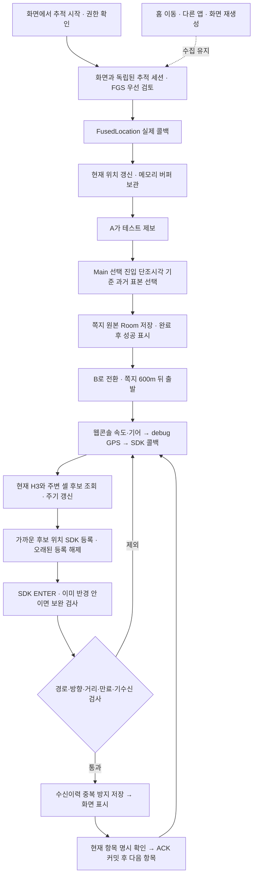

# 위치 쪽지: 함께 구현할 전체 작업 스펙

상태: **05 수정 fdd9bbf 독립 재검토 PASS(사용자 전달) / 06 리뷰이 판단 반영·부모 동기화 후 독립 재검토 대기**. [06 스펙](06-debug-demo-controls.md) · [05 구현 기록](../../work/step05-proximity-receipts-implementation.md). 리뷰어 직접12 JVM PASS·원 ACK 반례 포함, 기존 P2 두 스레드만 해결됐다는 사용자 전달을 기록한다. 실제 기기 검증은 NOT_TESTED이며06 코드는 구현하지 않았다.

## 읽는 순서와 문서 책임

1. 이 문서: 이번 브랜치 범위, 전체 흐름, 단계와 리뷰 기준.
2. [조사·최종 리팩터링 기록](lessons-learned.md): 반복 조사 방지용 근거와 제한.
3. [전체 시스템 정본](../../plans/implementation-plan.md): 앱 전체 맥락. Gleo는 별도 기능 PR 소유.

전체 시스템 정책의 SSoT는 `spec-road-note-system`의 [implementation-plan.md](../../plans/implementation-plan.md)다. 모든 기능 구현 브랜치는 이 설계 브랜치를 공통 기준으로 삼는다. 공통 정책 변경은 설계 브랜치에 별도 커밋·푸시한 뒤 각 기능 브랜치에서 pull/merge하여 반영한다. 부모 변경은 자동 전파되지 않는다. 기능 PR에는 해당 단계의 입출력·동작·검증 스펙을 두며, 공통 정책을 독자적으로 변경하거나 중복 정본을 만들지 않는다. 정책 변경이 필요하면 먼저 설계 브랜치에 반영한다. 이 문서의 수치와 흐름은 공통 정본을 적용하는 작업계획 요약이며 독립적인 정책 권한이 아니다. 기존 정본의 과거 버퍼·접근 세부사항과 최신 합의 사이 불일치는 공통 설계 브랜치에서 정리한 후 해당 단계 구현에 착수한다.

## 목표와 범위

한 노트북·한 Pleos 에뮬레이터에서 A가 도로 상황을 제보하면 지나온 위치에 쪽지를 저장하고, 뒤에서 접근하는 가상 사용자 B가 쪽지를 한 번 받는다. 주행 중 같은 화면에서 동작하며 정차도 허용한다.

포함: FusedLocation 수집, 메모리 위치 버퍼, Room 원본/수신이력, H3 주변 후보, SDK proximity와 앱 조건 검사, MVVM 화면, 작은 debug 패널, 웹콘솔 가상 주행 연동.

제외: Gleo 코드·스키마 재작성, 음성 인식/TTS, 서버 구현, NAMED_PLACE, asking/draft, observedAt 입력, 강제 종료·프로세스 사망·차량 재시작 후 자동 복구, 실차 제품화. 제보는 우선 debug 버튼으로 시작하며 나중에 기존 Gleo PR과 연결할 수 있는 입력 계약만 정한다.

## 메인 흐름

이 도표는 제품 흐름이고 구현 순서는 아래 작은 단계로 나눈다. 외부 GPS 모드에서는 웹콘솔 어댑터 대신 ADB 경로가 SDK 입력을 제공한다.

## 상태·데이터·인터페이스 방향

| 책임 | 소유 데이터와 통신 |
|---|---|
| Compose 화면 | 상태 표시, 사용자 이벤트 전달. SDK/SQL 직접 호출 없음 |
| ViewModel | 필요한 화면 상태와 이벤트 진입점. 추적 수명은 소유하지 않음. 01단계는 좌표 UI 없이 로그로 확인 |
| 위치 어댑터 | SDK 지원·권한·초기화/해제, nullable/error 처리, 위치/접근 이벤트 전달 |
| 세션 조정 | A/B와 세대 식별. 전환 시 버퍼·등록·진행 작업 정리, 늦은 이전 콜백/저장 결과 차단 |
| 메모리 버퍼 | 화면과 독립된 추적 세션의 최근45초 표본. 홈/다른 앱 전환·재생성 중 계속 갱신. 프로세스 종료/명시적 중단 시 소멸 |
| 쪽지 저장소 | 생성과 주변 셀 조회. 초기는 Room, 향후 서버로 교체할 경계 |
| 수신이력 저장소 | noteId+recipientId 유일성, receivedAt·displayedAt(명시 확인 ACK 시각). 자동 composition/노출 ACK 없음. 로컬 유지, 원본과 분리. debug/release에서 recipient 전체 JOIN 한 큐로 legacy/다른 시나리오도 조회·명시 확인 |
| debug 도구 | A/B, 초기화, fixture 제보, 상태 표시, 가상 GPS. debug source set만 실제 구현 |

전체 상태는 최소한 시작 전/권한 필요/수집 중/위치 사용 불가를 구분한다. 저장 중·성공·실패 및 최근 수신은 별도 결과로 표시한다. 세부 sealed class/인터페이스/파일 이름은 각 단계 리뷰에서 결정한다. 참고 구현의 큰 Controller를 그대로 복제하지 않는다.

## 초기 정책 제안 — 이번 리뷰 대상

- 기준 시점: Main 직렬 선택 처리 진입에서 앱 단조시각 고정(외부 Receiver 도착 시각과 구분). 벽시계는 표시/만료, 단조시계는 버퍼 경과 계산에 사용.
- 버퍼45초, 목표30초 전의 최근접 실제 표본. 보간 없음. 이력이 짧으면 가장 오래된 표본 사용, 실제 offset 저장. 첫 신선한 표본부터 제보 가능.
- 빈 버퍼/현재 위치 없음/최근 표본5초 초과면 저장 실패. 충분한 이력에서 목표 오차5초 초과면 실패. 큰 공백·미래 표본·동률 선택의 정확한 경계는 버퍼 단계 스펙에서 예제와 함께 확정.
- 쪽지 원본: 식별자, 요청 중복 키, 작성자/시나리오, content/category, 좌표/H3/경로·방향, 앱 수신·생성·만료시각과 실제 offset. category는 WARNING/INFORMATION. CURRENT_ROAD만 지원. 중복 요청은 재저장하지 않고 충돌은 명시적으로 실패.
- Room 원본과 수신이력은 테이블 분리. 원본 삭제 시 이력 정책, 인덱스·FK·트랜잭션·정렬·시간 단위·만료시간은 저장 단계 스펙에서 결정. DB 버전 스키마는 커밋. 위치 원시 표본은 Room/서버에 저장하지 않음.
- H3 res9·400m 공간 후보는 cover별 Room Flow 관찰(10초 폴링 없음). raw snapshot 직접 소비 금지, 현재 세션/UTC/위치 신선도/거리 재검사 진입점만 사용. 후보 중심은 위도[37.4900,37.5100]/경도[127.0200,127.0500], 검증 여유는위도[37.4800,37.5200]/경도[127.0100,127.0600]. 중심 경계 밖400m 원본도 조회하며03 원본 저장/보존은 제한하지 않는다. 유한 경계 회귀와 전역 무누락 증명을 구분한다.
- 후보는 같은 경로·진행 방향·전방·유효기간 내·타인 작성·미수신 조건으로 축소. 합성 전용 경로/방향 설정과 fixture 투영을 자격으로 사용하며 미터 accuracy를 만들지 않는다. SDK 등록은 실제 거리→noteId 순 최대16개(pending 포함, 공식 한도 아님), 초과 상태 표시. 수신 신선도2초/후보5초를 구분한다.
- 06 시연은 A610m 목표±5m, 실제 anchor에서 B600m 뒤 요청. 두 모드 WEB_CONSOLE/EXTERNAL_ADB 모두 실제 SDK 콜백을 통과하고 직접 REPLAY 제품 대체는 없다.25m/5m/15초 gate는 캐시 배제 휴리스틱이며 실제 측정 인증이 아니다.
- SDK ENTER 후150m 반경과 조건 재검사. 이미 안에 있는 후보/신규 쪽지를 놓치지 않도록 등록·좌표 갱신 시 보완 검사. DB 유일성으로 중복 이벤트도 수신1건 보장. 등록 동기 실패/등록 전후 onError 및 수신 StorageFailure는 현재 수신 세션 Failed 유지·전체 요청 무효화/알려진 ID 정리·미지 tombstone 정책을 따른다. 위치·수락 쓰기·기존 수신함/명시 ACK는 유지하고 위치/DB 신호로 자동 재시도하지 않는다. 명시 stop→새 start에서만 재허용한다.
- 사용자가 화면에서 시작한 추적은 홈 이동·다른 앱 전환·Activity 재생성 중에도 유지한다. 포그라운드 서비스 우선 검토, 유형·권한·Pleos 화면 밖 수신은01단계에서 확인한다. 명시적 중단/역할전환은 SDK·버퍼 격리, 원본·이력 유지. 강제 종료/차량 재시작 자동 복구는 별도 논의. 권한 대기 중 onStop/재생성/중지에서는 아직 시작하지 않은 의도만 폐기한다.
- 원본 생성 성공 후 제보 성공 표시. 입력1회에 최종 결과1회, 추가 질문 없음. 실제 Gleo 응답 연동은 이 브랜치 범위 밖.

## 리뷰와 구현 루프

각 단계는 `NN-<기능>.md` 하나를 만든다. 처음에는 목적/입출력/상태 전이/실패/성공 조건/비범위/작은 검증 예시만 작성한다. 사용자가 스펙을 리뷰하고 진행을 승인하기 전에는 구현하지 않는다.

승인 후 필요한 Android 개념을 FE 개념에 연결해 설명하고, 파일 역할과 데이터 흐름을 먼저 보여준다. 작게 구현→검증→diff 설명→사용자 코드 리뷰→수정→커밋 순으로 진행한다. 한 단계가 크면 더 작게 나눈다. 다음 단계 스펙까지 자동으로 앞서 작성하지 않는다. 커밋·푸시는 해당 리뷰에서 사용자와 합의한 범위로 실행한다.

각 단계 완료 조건: 합의된 동작 확인, 관련 검사 통과, 미검증 명시, 사용자가 주요 흐름을 설명하고 코드 리뷰할 기회 확보. 과거 검증 기록을 새 구현 PASS로 사용하지 않는다.

## 단계별 계획

| 단계 | 작은 구현 목표 | 리뷰·검증 포인트 |
|---|---|---|
| 00 현재 | 전체 계획·조사 인덱스 | 범위/정책/순서 리뷰. 앱 변경 없음 |
| 01 앱과 현재 위치 | 기존 Activity 이해 → 화면 독립 추적·SDK 수신 로그 | FGS 요건·권한 대기 취소·홈/재생성 수집 유지·명시적 중지·콜백 순서·정리 |
| 02 위치 버퍼 | 추적 세션 메모리 보관과 표본 선택 | 첫 표본/짧은 이력/30초 목표/신선도/공백, 화면 밖45초 버퍼 지속 갱신 |
| 03 Room 원본 | 최소 제보 입력→과거 좌표에 쪽지 저장→성공 결과 | 스키마/인덱스/중복·실패·세션 전환 리뷰, 기기 DB 테스트 |
| 04 주변 후보 | H3 변환·인접 셀 조회·주기 갱신 | JNI 패키징과 셀 경계, 앞/뒤·양방향 가까운 순 회귀 |
| 05 접근과 수신 | SDK 등록/해제·ENTER→조건 검사→수신이력·명시 확인 ACK | 반경 밖/안·이미 안·중복・만료·세션 지연 이벤트, 원본/이력 JOIN |
| 06 시연 도구 | 작은 debug 패널과 웹콘솔 GPS 연동 | A/B 격리·mock 권한 실패·release 제외·주행 화면 유지 |
| 07 통합 시연 | A심기→B접근→1회 수신, 재현 안내 | E2E·기존 회귀·debug/release 빌드. 남은 실차/SDK 제한 기록 |

03단계 이후에도 최종 패널 이전에는 필요한 입력 버튼과 값만 최소로 노출한다. 전 단계 코드를 이해한 뒤 책임이 생길 때 분리하며, 파일 수/계층 수를 목표로 삼지 않는다.

## 최종 시연 재현 계획

1. 실제 CarUx 신호로 설정 가능 여부 확인. 명시 확인 reset으로 현재 시나리오만 삭제·새 ID 생성, legacy/다른 시나리오는 보존. 제품 recipient 전체 큐의 기존 PENDING은 같은 화면에서 명시 확인할 수 있으며 시나리오 필터로 숨기지 않는다. A610m 출발 gate 확인 뒤 웹콘솔 D로 주행한다.
2. 30초 전 배치를 보여주려면30초 이상 주행 후 fixture 제보. 대기는 필수 기능 제한이 아니라 시연 데이터 준비다. 첫 표본 제보도 별도 짧게 확인.
3. 원본 좌표와 실제 offset 확인. 수락 쓰기0에서 B로 전환·실제 anchor600m 뒤 목표를 요청한다. 범위 밖 보정 금지. 처음 A610±5m에서 즉시 심었다면 B 요청점5~15m,60초 주행 예시는 anchor약910/B약310m다. 목표와 SDK 수락 좌표 오차를 구분하며 원본·전체 이력은 유지한다.
4. 웹콘솔로 주행. 파란 현재위치와 빨간 쪽지가 같은 기준축에서 표시되고 거리 감소.150m 진입 시 SDK 이벤트와 수신1행·화면 표시와 명시 ‘확인’ ACK를 확인한다. composition/노출만으로 ACK하지 않는다.
5. 같은 반경에서 반복 이벤트/재진입해도 중복 수신 없음. 현재 시나리오만 원자 reset으로 재현. 제품 전체 이력/명시 ACK는 시나리오 생성/reset/활성 없음에도 유지한다. 외부 ADB 입력 경로는 웹콘솔 연결 실패를 숨기는 자동 대체가 아니라 명시적 별도 모드.

03 저장과04 후보 구현·허용검사를 마쳤으며04 수정의 독립 재검토 PASS를 사용자에게 전달받았다. 현재06 수용 반영을 독립 재검토한다.05 리뷰4건 수용을 부모 정본 `fdc51fa`로 별도 커밋·푸시한 뒤 기능 브랜치에 병합했다.05 수정 fdd9bbf의 독립 코드 재검토 PASS를 사용자에게 전달받았으며06 스펙 리뷰를 진행한다. 실제 기기 검증은 별도다.

## PR #4 후속 합의: 수명과 진단

01단계는 실시간 좌표 화면 대신 debug 로그로 SDK 수신을 확인한다. 표시용5초 만료·타이머·테스트는 제거하되02단계 제보 신선도 검사는 유지한다. null/잘못된 좌표에서는 등록을 유지하고 중지만 제공, SDK 실패는 정리 후 명시적 재시도. initialize 직후 등록하며 사전 실험/고정 대기는 추가하지 않는다. 실행 중 문제가 관찰되면 조사·재리뷰한다.

SDK 콜백 진입에서 단조시각을 기록하고 시작/중지/위치/오류를 같은 실행 문맥에서 처리한다. 반영 직전 세션 유효성을 다시 확인한다. 취소는 SDK 오류와 분리, 해제 실패에도 release 시도, 정리 오류로 재활성화하지 않는다. 화면 재생성은 실제로 별도 검증하며 다음 단계에서는 버퍼 유지도 확인한다. 네트워크·오프라인 오류 정책의 정교화는 후속 검토로 남긴다.

Android FGS 요건과 Pleos SDK의 화면 밖 동작은 별도 확인한다. 지속 알림과 최소 시작/중지는 위치 진단 UI 제외와 별개로 필요하다. 01단계 스펙§6의 기술 확인이 실패하면 화면 전용으로 축소해 완료 보고하지 않고 다시 리뷰한다.

06 공통 정책은 부모 `2ca00c0`에 별도 커밋·푸시 후 병합했다. 현재 DO 선언은 없고 이번06 새 선언도 없다. 기본 UI 유지와 CarUx 기능별 제한을 함께 적용한다. NO_SETUP·규제 미연결/오류에서는 역할·모드·출발점/reset/시연 입력 시작을 막고 중지·취소·닫기 및 수락 DB 쓰기는 유지한다. 해제만으로 자동 재개하지 않는다. 문자·탐색 상한은 플랫폼 값을 쓰고 DB/큐 불변·자동 ACK 금지를 지킨다. 구체 적용과 미검증은 [06 요구사항 매핑](06-debug-demo-controls.md#21-요구사항기능별-규제-매핑)을 따른다. 독립 재검토 전 코드를 작성하지 않는다.
