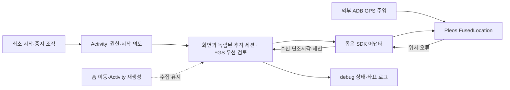

# 01. 화면과 독립된 SDK 위치 수집과 로그 확인

상태: **기존 위치 수집 구현을07 clean HEAD 회귀에 포함 / 실제 SDK·권한·Android 수명은 현 HEAD NOT_TESTED**. 과거 실행 이력과 최신 결과는 [07 기록](../../work/step07-integration-verification.md)에서 구분한다.
상위 계획: [전체 작업계획](00-overview.md). 근거: [조사 기록](lessons-learned.md).
2026-11-10 리뷰의 사용자 최종 답변을 반영했다. 문서 합의와 실제 동작 검증은 구분한다.

## 1. 이번에 만들 결과

앱이 보이는 동안 사용자가 ‘위치 수집 시작’을 요청하고 필요한 권한을 허용하면, Pleos FusedLocation SDK 콜백을 받는다. 수신 좌표와 추적 세션 상태는 **debug 로그**로 확인한다. 임시 실시간 위치 화면과 좌표 표시용 StateFlow는 만들지 않는다.

시작한 수집은 홈 이동·다른 앱 전환·Activity 재생성만으로 멈추지 않는다. 추적 세션은 화면과 독립적으로 유지하고, 사용자가 명시적으로 중지하면 정리한다. 포그라운드 서비스를 우선 구현 후보로 삼되 Android 서비스 요건과 Pleos SDK 화면 밖 수신은 확인 전이다.

이 단계에는 위치 버퍼를 구현하지 않는다. 다음02단계에서 같은 추적 세션이 최근45초 표본을 메모리로 계속 갱신한다. 화면 이탈 전 표본을 보관만 하는 의미가 아니다.

## 2. 범위와 비범위

포함: 최소 시작/중지 조작, 권한 처리, 화면과 독립된 추적 세션, 서비스 유형·권한 검토, 지원 확인·초기화·등록/해제, 좌표/오류 전달, debug 로그, 수명 검증.

제외: 위치 진단 UI·지도·좌표 숨김 타이머·표시용 만료 테스트,45초 버퍼 구현, Room/H3/proximity/쪽지/A/B, 웹콘솔 연동, Gleo, 네트워크·오프라인 오류 정책 정교화, 강제 종료/프로세스 사망/차량 재시작 후 자동 복구. ‘앱을 꺼도’의 이번 범위는 홈 이동·다른 앱 전환이며 강제 종료와 동의어가 아니다. 최근 앱 목록에서 작업 제거·화면 꺼짐·차량 suspend의 보장은 별도 검토한다.

## 3. 책임과 흐름

- Activity는 권한 요청과 아직 시작하지 않은 사용자 의도를 관리한다. 화면 종료로 이미 실행 중인 세션을 종료하지 않는다.
- 추적 세션은 SDK 인스턴스·리스너·작업의 수명을 소유한다. Activity/ViewModel의 onCleared만으로 정리하지 않는다. 화면 복귀/재생성은 기존 상태에 다시 연결한다.
- 어댑터는 이번 단계의 시작·중지·좌표·오류만 노출한다. 접근 API는05단계에서 추가한다.
- StateFlow가 필요하면 추적 상태 공유에 한해 사용한다. 좌표 화면을 만들기 위해 ViewModel/상태 타입을 선제 추가하지 않는다. 기존 lifecycle/coroutines 의존성을 재사용하고 DI·이벤트 버스는 추가하지 않는다.

구체적인 서비스 연결·상태 소유 코드와 타입은 구현 리뷰에서 확인한다. SDK 수명 소유자는 화면과 분리한다는 원칙을 유지한다.

## 4. 권한 대기와 이미 실행 중인 수집을 구분

| 상황 | 정책 |
|---|---|
| 첫 진입 | 수집 중이 아니면 중지. 자동 수집·자동 권한 요청 없음 |
| 화면에서 시작 | 권한·시작 요건 확인 후 추적 세션 시작 |
| 권한 팝업으로 onPause만 발생 | 대기 중 시작 의도 유지 |
| 권한 대기 중 실제 onStop·재생성·명시적 중지 | 대기 중 시작 의도 폐기. 늦은 허용 결과로 시작하지 않음 |
| 일반 팝업 허용 | 현재 화면이 시작 가능한 상태이고 요청이 유효할 때만 기존 시작을 이어감 |
| 거절/다시 묻지 않음 | 수집 안 함. 필요한 권한·설정 안내, 반복 팝업 없음 |
| 설정에서 허용 후 복귀 | 권한만 갱신. 수집이 중지 상태였다면 사용자가 다시 시작 |
| 이미 수집 중 홈 이동/다른 앱 전환/onStop | 세션·리스너 유지. 화면을 가려도 계속 콜백 수신 |
| 이미 수집 중 Activity 재생성 | 동일 추적 세션 유지, SDK 중복 등록 없음. 새 화면은 기존 상태에 연결 |
| 명시적 중지 | 세션 무효화→작업 취소→리스너 해제→release. 재시작 전에는 새 좌표 반영 금지 |

Pleos 권한 팝업이 실제 onStop까지 유발하면 대기 의도는 위 규칙대로 취소하고 허용 후 다시 시작하도록 한다. 관측 없이 팝업 예외를 추가하지 않는다. 화면 복귀 시 새 시작 요청과 기존 실행 상태를 혼동하지 않는다.

## 5. SDK 순서와 내부 상태

권한/서비스 시작 요건 충족→새 SDK 인스턴스 지원 확인→initialize()→**고정 대기 없이 바로 콜백 등록**. SDK1.1.3을 기준으로 공개 API를 대조한다. 별도 사전 연결 실험·1.5초 대기·준비 폴링은 추가하지 않는다. 첫 좌표가 아직 없다는 것만으로 초기화 실패라고 하지 않는다.

[공식 샘플의 initialize/startUpdates](https://github.com/Pleos-Playground/pleos-sample-fusedlocation-app/blob/c955c3a811371892e8803f3b1d9ad3f0426e832c/app/src/main/java/ai/pleos/playground/location/fused/sample/location/FusedLocationClient.kt#L70)는 고정 대기를 두지 않는다. 두 동작은 사용자 조작으로 분리돼 있으므로 초기화 반환 시 내부 연결 완료까지 보장한다는 증거는 아니다. 구현 후 최초 시작/중지 후 재시작에서 문제가 관찰되면 그때 원인과 필요한 대응을 논의한다.

| 내부 상태/입력 | 처리 |
|---|---|
| 중지/준비/대기/수신/미지원 | 상태 로그로 구분. 준비 중 연속 시작은 등록을 늘리지 않음 |
| 유효 좌표 | 위도[-90,90], 경도[-180,180] 유한값만 전달. (0,0)은 임의 거절 안 함 |
| null/비정상 좌표 | 사용 불가 기록, 유효 좌표로 전달 안 함. **등록 유지, 중지만 제공**, 후속 유효 콜백으로 복구 |
| SDK 오류/초기화 실패 | 실패 기록 후 정리. 명시적 재시도는 새 인스턴스로 시작 |
| 사용자 취소/중지 | 실패와 구분. 취소 예외를 잡았다면 CancellationException 재전달 |
| 해제 실패 | release는 계속 시도. 정리 오류는 별도 기록하고 중지 상태를 실패/재시도/활성으로 되돌리지 않음 |

리스너가 살아 있는 null 상태에서 재시도 버튼을 제공하지 않는다. 네트워크·오프라인의 세부 복구 전략은 후속 스펙에서 다루며 지금 발생한 SDK 오류를 무시한다는 뜻은 아니다.

SDK 콜백이 Main에서 호출된다고 가정하지 않는다. 콜백 **진입 시** SystemClock.elapsedRealtime()의 수신 단조시각(ms)을 기록하고 시작/중지/위치/오류에 따른 상태 변경은 같은 실행 문맥에서 순서대로 처리한다. 실제 반영 직전에도 세션 유효성을 검사해 예약 후 중지된 콜백과 이전 세션의 콜백을 버린다. StateFlow의 스레드 안전성만으로 여러 단계 처리 순서가 보장된다고 가정하지 않는다.

동일 리스너 해제와 release는 별도 동작이다. release한 인스턴스는 재사용하지 않는다. SDK timestamp를 수신 단조시각 대신 쓰지 않고 confidence를 미터 정확도로 바꾸지 않는다. 현재 단계에서5초 후 좌표를 숨기거나 만료시키는 작업은 없다. **제보 시 오래된 위치를 차단하는 신선도 검사는02단계에 유지**한다.

## 6. 포그라운드 서비스: 구현 전 요구 대조

현재 targetSdk34/compileSdk35. Android14 대상 FGS는 적절한 서비스 유형·FOREGROUND_SERVICE 및 유형별 권한, 포그라운드 전환과 지속 알림이 필요하다. `location` 유형은 FOREGROUND_SERVICE_LOCATION 외에 Android 위치 사용 설정 및 ACCESS_COARSE_LOCATION 또는 ACCESS_FINE_LOCATION 런타임 요건을 명시한다. **Pleos의 FUSED_LOCATION 권한만으로 이 Android 요건도 충족한다고 간주하지 않는다.**

화면에서 사용자가 시작하는 경로를 기본으로 삼고 백그라운드에서 새 FGS를 자동 시작하지 않는다. 추가 Android 위치 권한은 SDK 권한이라고 오인해 넣지 말고, 서비스 유형 요건에 필요한지 근거와 함께 결정한다. 알림 채널·지속 알림·중지 방법 및 알림 권한 거절 시 동작도 구현 시 대상 OS에서 확인한다. service가 Activity에 바인딩돼 있다는 이유만으로 화면 밖 수명이 보장되는 것은 아니다.

근거: [Android FGS 유형/location](https://developer.android.com/develop/background-work/services/fgs/service-types#location), [백그라운드 시작 제한](https://developer.android.com/develop/background-work/services/fgs/restrictions-bg-start). 공식 요건과 Pleos 환경 동작은 구분한다. SDK의 [권한 문서](https://document.pleos.ai/docs/pleos-only/connect-sdk-pleos/FusedLocation/declaring-permissions)는 Android 일반 위치·백그라운드 정책을 별도 보장하지 않는다.

서비스 유형/권한 조합은 구현 시 먼저 확정·기록하며, 문서와 다른 처리가 필요하거나 화면 밖 콜백이 끊기면 원인을 조사하고 다시 리뷰한다. 화면에서만 동작하는 구현으로 목표 달성을 보고하지 않는다. FGS도 프로세스 불사나 강제 종료 후 자동 복구 보장은 아니다.

## 7. debug 로그 계약과 검증 조건

debug Logcat 태그 `RoadLocation`: 세션 ID, 시작/등록/유효 좌표/사용 불가/오류/중지/정리 이벤트를 구분한다. 좌표와 단조시각은 합성 GPS 검증에만 사용하고 release에는 상세 좌표 로그를 남기지 않는다. 로그 주기를 SDK 주기와 별도로 보장하지 않는다.

아래는 구현 후 검증할 AC이며 현재 PASS 목록이 아니다.

| ID | 확인 조건 | 방법 |
|---|---|---|
| AC-01 | 일반 허용·거절·권한 대기 중 홈 이동/재생성·설정 허용 후 복귀를 구분하고 취소된 시작 의도로 시작 안 함 | 상태 테스트 + 실제 권한 수명 관측 |
| AC-02 | 시작 연타·화면 재생성에 SDK 등록1회, 기존 추적 상태에 다시 연결 | 가짜 어댑터 수명 테스트 + 실제 재생성 별도 실행 |
| AC-03 | 최초 시작과 중지 후 재시작에서 A/B 주입이 실제 SDK 콜백·로그로 대응 | ADB와 로그 대조. 초기화 직후 등록 경로 검증 |
| AC-04 | null/비정상 좌표는 전달 안 함, 등록 유지 후 유효 좌표 복구. 표시용 만료 작업 없음 | 가짜 어댑터 테스트 |
| AC-05 | 미지원·초기화 실패·SDK 오류·사용자 취소 구분. 무한 재시도 없음 | 상태 테스트. 실제 오류 주입은 별도 결과 기록 |
| AC-06 | 명시적 중지/준비 중 취소 뒤 예약된 콜백 무시. 해제 실패에도 release 시도, 중지 상태 유지 | 수명·정리 실패 테스트 |
| AC-07 | 홈/다른 앱 전환 중 SDK 좌표 계속 수신, 화면 복귀가 새 등록/새 세션을 만들지 않음 | 화면 밖에서 서로 다른 GPS 주입·로그 확인 |
| AC-08 | Activity 재생성은 화면 이탈과 별도 실행. 기존 세션·수집 유지, 새 화면 상태 연결 | 실제 재생성 + 세션/등록 횟수 대조 |
| AC-09 | 백그라운드 신규 시작 제한과 FGS 유형·권한·알림 요건 만족 | Manifest/공식 문서 대조 + Pleos 대상 환경 실행 |

02단계에서 AC-07/08에 **화면 밖에서 새 표본이 쌓이고 최근45초 버퍼가 계속 이동**하는 검증을 추가한다. 이번 단계는 버퍼가 없으므로 수집 유지 검증만 수행한다.

ADB는 `adb -s <기기> emu geo fix 127.0276 37.4979`처럼 경도→위도 순서. 주입1Hz 전체 전달을 요구하지 않는다. 좌표가10초 내 관측되지 않으면 실패 원인을 확인하며 이를 곧바로 초기화 실패라고 단정하지 않는다. 화면 값을 직접 바꿔 SDK 검증을 대체하지 않는다.

필요 단위 테스트·debug/release 빌드·lint·harness·IDE 빌드와 에뮬레이터 확인을 진행하고 새 결과를 기록한다. 실제 privacy 차단·연결 장애·스레드·정리 실패와 가짜 입력 테스트는 구분한다. 강제 종료/차량 재시작 복구는 이번 완료 조건 밖이다.

## 8. 리뷰 후 진행

이번 답변 반영 문서 검토→작은 구현 diff와 Android 개념 설명→관련 검증→사용자 코드 리뷰→수정·재검증→커밋 범위 합의→02단계 스펙. 사용자 승인으로01단계만 구현했다. [구현·검증 기록](../../work/step01-location-implementation.md)을 검토하고 코드 리뷰 후 다음 단계로 진행한다.

## 9. 반영한 PR 스레드

[권한 대기·화면 밖 수명](https://github.com/jin-kim-240204/hyundai-and-gretel/pull/4#discussion_r4524038619), [null 상태 재시도](https://github.com/jin-kim-240204/hyundai-and-gretel/pull/4#discussion_r4524078505), [초기화 직후 등록](https://github.com/jin-kim-240204/hyundai-and-gretel/pull/4#discussion_r4524153356), [UI 제외·로그 확인](https://github.com/jin-kim-240204/hyundai-and-gretel/pull/4#discussion_r4524232867), [취소·정리](https://github.com/jin-kim-240204/hyundai-and-gretel/pull/4#discussion_r4524298727), [재생성 유지](https://github.com/jin-kim-240204/hyundai-and-gretel/pull/4#discussion_r4524325262), [콜백 실행 순서](https://github.com/jin-kim-240204/hyundai-and-gretel/pull/4#discussion_r4524365177), [좁은 계약](https://github.com/jin-kim-240204/hyundai-and-gretel/pull/4#discussion_r4524395441).
