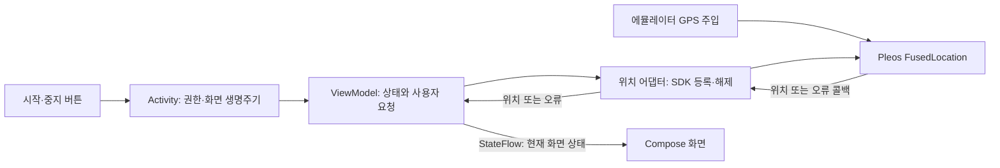

# 01. SDK 현재 위치를 화면에 표시하기

상태: **스펙 초안 / 사용자 리뷰 대기 / 구현 전**.
상위 계획: [전체 작업계획](00-overview.md). 근거: [조사 기록](lessons-learned.md).
전체 계획은 사용자에게 승인받았다. 이번 단계의 세부 정책은 아래 초안을 리뷰한 뒤 확정한다.

## 1. 이번에 만들 결과

사용자가 앱에서 ‘위치 수신 시작’을 누르고 위치 권한을 허용하면, Pleos FusedLocation SDK가 전달한 위도·경도를 화면에서 볼 수 있다. 에뮬레이터에 다른 좌표를 넣으면 화면 값도 바뀐다. 중지하거나 앱 화면을 벗어나면 수신을 정리한다.

여기서 ‘현재 위치’는 GPS를 우리가 계산한다는 뜻이 아니라 **현재 세션에서 SDK로부터 마지막으로 전달받은 유효 좌표**다. 차량 시계·콜백 지연 때문에 측정 시점의 실시간 정확성까지 보장하는 것은 아니다.

성공 예시:

1. ‘위치 수신 시작’ → 필요한 경우 권한 요청 → ‘위치 수신 대기 중’.
2. ADB로 좌표 A 주입 → SDK 콜백 → 화면에 좌표 A 표시.
3. 좌표 B 주입 → 같은 화면에 B 표시.
4. ‘위치 수신 중지’ → 좌표 숨김, 이후 콜백이 와도 화면 값 갱신 안 됨.

## 2. 범위와 비범위

포함: 기존 ComponentActivity/Compose 구조 파악, SDK 의존성·필요 권한, 지원 확인·초기화·등록/해제, 최소 화면과 ViewModel, 상태 전이 검증.

제외:30초 버퍼, Room, H3, 접근 이벤트, 쪽지, A/B, 지도/경로 그림, 웹콘솔 속도 연동, debug 패널, Gleo, 백그라운드 서비스. 이번에는 외부 ADB 주입으로 SDK 연결만 확인한다. SDK를 거치지 않고 화면에 테스트 좌표를 직접 넣어 성공으로 판정하지 않는다.

## 3. 먼저 이해할 구조

- **Activity**: Android가 실행하는 화면의 진입점. 권한 팝업과 화면 시작/종료 신호를 연결한다.
- **ViewModel**: 화면 상태를 관리한다. Compose의 재그리기마다 새로 생성하거나 SDK를 재등록하지 않는다.
- **StateFlow**: 현재 화면 상태를 보관하고 변경을 구독자에게 전달하는 Kotlin 도구. 화면이 읽을 값만 공개하고, 변경은 ViewModel 내부에서 한다.
- **Compose 화면**: 상태를 읽어 텍스트/버튼 표시. SDK나 권한 API를 직접 호출하지 않는다.
- **위치 어댑터**: Pleos SDK 사용법을 한 곳에 둔다. 나중에 단위 테스트에서는 이 경계를 가짜 입력으로 바꿀 수 있다.

이 단계는 Activity / ViewModel / 화면 / SDK 어댑터 정도의 책임이면 충분하다. 별도 UseCase·Repository·DI 프레임워크·공용 이벤트 버스를 선제 도입하지 않는다. 정확한 파일 수와 Kotlin 타입 이름은 구현 리뷰에서 함께 확인한다.

## 4. 화면과 상태

최소 화면은 제목, 현재 상태, 위도·경도, 시작/중지 또는 재시도 버튼으로 구성한다. 현재 테마와 Pleos 기본 레이아웃을 유지하고 전체 디자인 개편은 하지 않는다.

| 상태 | 표시 | 사용자 동작 |
|---|---|---|
| 중지 | ‘위치 수신이 중지되어 있습니다’ | 시작 가능 |
| 권한 필요 | ‘위치 권한이 필요합니다’ | 명시적 버튼으로 권한 요청. 자동 반복 요청 없음 |
| 준비 중 | ‘위치 수신을 준비하고 있습니다’ | 중지 가능, 시작 중복 불가 |
| 대기 중 | ‘위치 수신 대기 중’ | 중지 가능 |
| 수신 중 | 위도·경도와 ‘위치 수신 중’ | 중지 가능 |
| 위치 사용 불가 | ‘위치를 사용할 수 없습니다’와 이유 | 중지 또는 명시적 재시도 |
| 미지원 | ‘이 환경에서는 위치 기능을 지원하지 않습니다’ | 시작 비활성 |

위도·경도는 소수점6자리까지 표시한다. 표시용 반올림과 내부 값은 분리한다. 마지막 유효 콜백 이후5초를 초과하면 좌표를 숨기고 ‘새 위치를 기다리고 있습니다’ 상태로 바꾼다. 이는 **앱의 신선도 정책**이며 실제 측정 정확도 보장이 아니다. 새 유효 콜백이 오면 수신 중으로 복구한다. 첫 콜백 전에는 좌표를 만들어 표시하지 않는다.

### 주요 전이

- 앱 첫 진입 → 중지. 자동 권한 요청·수집 없음.
- 시작 → 권한 확인 → 미허용이면 권한 필요. 허용되면 지원 확인·준비 중 → 콜백 등록 후 대기 중.
- 권한 거절 → 권한 필요 유지, 좌표 없음. 다시 묻지 않음이면 시스템 설정에서 권한을 허용해야 함을 안내. 팝업 재등장 여부를 보장하지 않음.
- 유효 위치 → 수신 중. 위도[-90,90], 경도[-180,180], 유한값만 허용. (0,0)은 실제 좌표일 수 있어 임의로 거절하지 않음.
- null/잘못된 좌표 → 위치 사용 불가, 기존 좌표 숨김. 리스너는 유지하고 후속 유효 위치로 복구 가능.
- SDK 오류/초기화 실패 → 위치 사용 불가, 좌표 제거, SDK 정리. 재시도는 새 세션·새 SDK 인스턴스로 수행. 오류 종류를 추측해 무한 재시도하지 않음.
- 중지/화면 비가시 → 등록 해제·release, 좌표 제거, 중지. 준비 중에 중지해도 나중에 등록이 살아나면 안 됨.
- 화면으로 복귀 → 중지, 사용자가 다시 시작. 권한은 재확인. 화면 재생성도 이번 단계는 중지로 단순화하고 자동 재시작하지 않음.

동시 호출은 중복 등록하지 않는다. 중지 이후 이전 세션의 늦은 콜백은 무시한다. Compose 재구성(상태 변경에 따른 재그리기)은 세션 중지가 아니며 SDK 수명에 영향을 주지 않는다. 상태 구독만 멈춘 것으로 SDK 해제를 대신하지 않는다.

## 5. SDK 계약과 데이터

공식 의무:

- `pleos.car.permission.FUSED_LOCATION` 선언과 런타임 허용 확인. 이 SDK를 Google Fused Location과 혼동하지 않는다. 별도 근거 없이 Android ACCESS_FINE/BACKGROUND 권한을 추가하지 않는다.
- 지원 확인→initialize→위치 리스너 등록. 중단 시 **동일 리스너 해제 후 release**. release 후 재사용하려면 새 인스턴스 생성.
- `onChanged`의 null과 `onError` 처리. 마지막 알려진 위치 조회를 새 측정으로 취급하지 않는다. 이번 단계는 연속 콜백만 사용한다.

공식 문서: [권한](https://document.pleos.ai/docs/pleos-only/connect-sdk-pleos/FusedLocation/declaring-permissions), [생명주기](https://document.pleos.ai/docs/pleos-only/connect-sdk-pleos/FusedLocation/initialization-and-release), [위치 데이터 접근](https://document.pleos.ai/docs/pleos-only/connect-sdk-pleos/FusedLocation/location-data-access), [오류](https://document.pleos.ai/docs/pleos-only/connect-sdk-pleos/FusedLocation/error-handling). 조사 기록의 SDK1.1.3을 우선 참고하며 실제 의존성/API 심볼은 구현 시 대조한다.

어댑터가 전달할 최소 데이터는 위도·경도와 콜백 수신 단조시각이다. 단조시각은 `SystemClock.elapsedRealtime()` 기준 ms로, 차량 날짜 설정과 무관하게 경과시간 비교에 사용한다. 아직 이력이나 SDK 전체 객체를 화면에 전달하지 않는다. SDK confidence를 정확도(m)로 표시하지 않는다.

참고 구현의 고정1.5초 초기화 대기는 SDK 준비 완료의 공식 보장이 아니다. 이번 스펙에서 그대로 채택하지 않는다. 구현 시 실제 공개 초기화 계약을 확인하고, 준비 실패를 상태로 처리한다. 준비 대기 방법에 추가 정책이 필요하면 구현 전에 스펙에 근거와 한계를 추가해 리뷰한다.

## 6. 검증할 조건

다음은 **구현 후** 확인할 성공 조건이다. 현재 통과한 테스트 목록이 아니다.

| ID | 확인할 행동 | 방법 |
|---|---|---|
| AC-01 | 허용 전 위치 API를 호출하지 않고 거절 후 좌표를 표시하지 않음 | 가짜 소스 상태 테스트 + 에뮬레이터 권한 거절 |
| AC-02 | 시작 연타/화면 재그리기에도 세션당 등록1회 | 상태/수명 테스트 |
| AC-03 | SDK 실제 콜백의 A→B가 화면 A→B로 반영 | 에뮬레이터 ADB 주입과 콜백/화면 대조 |
| AC-04 | null/비정상 값과5초 초과 표본은 유효 위치로 표시 안 함, 새 표본으로 복구 | 가짜 소스·제어 가능한 시간으로 단위 테스트 |
| AC-05 | 미지원/초기화 실패/오류가 명시되고 무한 재시도 없음 | 가짜 소스로 상태 테스트. 실제 미지원·오류 주입 여부는 별도 기록 |
| AC-06 | 중지·준비 중 취소·화면 이탈 후 해제, 늦은 콜백 무시, 복귀 시 중지 | 수명 테스트 + 실제 화면 이탈 확인 |
| AC-07 | 재시작에서 새 인스턴스, 권한 재확인, 이전 위치 재표시 없음 | 수명 테스트 + 에뮬레이터 재시작 확인 |

기기 확인에는 경도·위도 순서를 지켜 서로 다른 합성 좌표를 주입한다. 예: `adb -s <기기> emu geo fix 127.0276 37.4979`. 표본 주기1Hz나 주입 횟수와 콜백 횟수 일치를 요구하지 않는다. 10초 안에 화면에 대응 좌표가 오지 않으면 로그/권한/서비스 상태를 확인하고 성공으로 간주하지 않는다.

화면이 비가시여도 권한 팝업 같은 일시적 UI 전환의 수명 동작이 간섭할 수 있으므로 실제 권한 요청→허용 경로를 반드시 확인한다. 가짜 소스 검증은 실제 SDK의 privacy 차단/연결 장애 검증을 대신하지 않는다.

자동검사: 변경 범위에 맞는 단위 테스트, debug/release 빌드, lint, harness 및 IDE 빌드. 에뮬레이터는 필요할 때만 실행하고 실행 부하를 줄이기 위해 중복 빌드를 반복하지 않는다. 상태·코드 리뷰 이후 실행 결과를 작업 기록에 PASS/FAIL/NOT_TESTED로 남긴다.

## 7. 리뷰 후 진행 순서

1. 이번 스펙의 시작/중단 정책과 상태를 사용자와 합의.
2. 기존 Activity/Compose 코드부터 설명하고 최소 변경 경로를 제안.
3. SDK 연결과 상태 표시를 작은 diff로 구현, 필요한 테스트 실행.
4. 사용자와 코드 리뷰 핑퐁, 필요한 수정·재검증.
5. 구현·검증 상태를 정리하고 커밋 범위 합의. 그다음02단계 버퍼 스펙으로 이동.

지금 리뷰할 핵심: **수동 시작, 화면 이탈 시 중지·복귀 시 수동 재시작,5초 신선도 표시**. 이는 단순한 학습/프로토타입 정책이며 공식 SDK 의무와 구분한다.
