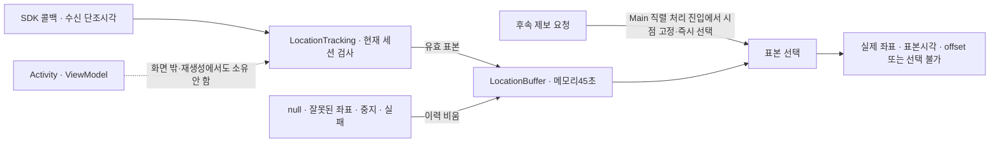

# 02. 추적 세션의 메모리 위치 버퍼와 과거 표본 선택

상태: **기존 버퍼 구현을07 clean HEAD 회귀에 포함 / 실제 화면 밖 SDK·버퍼 갱신은 현 HEAD NOT_TESTED**. [07 기록](../../work/step07-integration-verification.md)을 기준으로 코드 리뷰하며 전체 AC 완료를 선언하지 않는다.
선행: 01단계 구현 리뷰 반영 `fd3140a`. [전체 계획](00-overview.md) · [공통 설계 정본](../../plans/implementation-plan.md) · [조사 기록](lessons-learned.md).

## 1. 이번 결과

서비스가 SDK에서 받은 유효 좌표를 최근45초의 메모리 이력으로 보관한다. 이후 제보 시점이 주어지면 그 시점에서30초 전과 가장 가까운 실제 표본을 선택할 수 있다.30초를 기다리는 제한은 없다. 이력이 짧으면 가장 오래된 실제 표본을 사용한다.

예: 수집 후10초에 제보하면 수집 시작 부근 좌표를 선택하고 실제 offset10초를 반환한다. 수집 후40초에 제보하면 대략10초 시점 좌표를 선택하고 실제 offset약30초를 반환한다. 보간하거나 지도 위 좌표를 새로 계산하지 않는다.

이번 단계는 **표본 보관과 선택 함수 및 추적 연결**까지다. 실제 제보 버튼·JSON·쪽지 생성은03단계 이후다. 실제45초 이력은 시간 길이 기준이지45개 고정 배열이 아니다.

## 2. 확정된 전제와 이번 리뷰의 제안

이미 합의한 방향: 메모리 전용45초, 목표30초, 보간 없음, 짧은 이력도 즉시 선택, 실제 offset 기록, 현재 표본 신선도 검사, 화면 밖 수집/갱신 유지. 기존 작업계획은 신선도5초·목표오차5초를 초기값으로 제안했다.

이번에 확정할 상세 제안:

| 항목 | 제안 |
|---|---|
| 유효 최신 표본 | 조회 시점에서 경과0~5,000ms(양끝 포함) |
| 보관 경계 | 표본 나이45,000ms까지 포함, 초과 제거 |
| 긴 콜백 공백 | 공백만으로 이력을 비우지 않음.45초 내 표본 유지, 최신 신선도와 목표오차 별도 검사 |
| null/잘못된 좌표 | 01단계 UNAVAILABLE 처리와 함께 버퍼 비움. 등록은 유지, 새 유효 표본으로 복구 |
| 같은/역순 시각 | 삽입하지 않음. 같은 좌표라도 시각이 다르면 별도 표본 |
| 목표오차 | 충분한 이력에서는30초 목표와5,000ms 이내 표본만 선택 |
| 동률 | 목표의 앞뒤가 같은 거리면 더 오래된 표본 선택 |
| 만료 정리 | 추가·조회 시 정리. 별도 주기 타이머 없음. 무콜백 중 남은 표본은 조회 시 논리적으로 만료 |

공통 정책의 정본은 설계 브랜치 §5다. 이번 답글의 Main 조회 시각/공백 이력 유지/무효화 순서는 설계 브랜치에서 먼저 반영·커밋 후 기능 브랜치로 동기화한다. 시간 경계는 프로젝트 정책이며 SDK 보장이 아니다.

## 3. 소유권과 MVVM 연결

- FGS가 소유하는 기존 `LocationTracking`에 버퍼를 둔다. ViewModel/Compose는 위치 이력을 소유하거나 SDK를 구독하지 않는다.
- Android를 모르는 작은 `LocationBuffer`가 추가/정리/선택을 맡는다. 기존 `LocationFix`의 위도·경도·receivedElapsedMillis를 재사용하되, null에도 같은 콜백 수신 단조시각을 전달하도록 좁은 콜백 계약을 확장한다. Domain/UseCase/Repository/DB/DI는 추가하지 않는다.
- 현재 Main 실행 문맥에서 세션 검사 후 추가/조회/초기화를 순서대로 처리한다. 다음 제보 요청도 Main 직렬 처리에 들어온 순간 now를 읽고 suspend 없이 즉시 선택한다. 외부 Receiver 도착 시각과 구분한다. 지금 별도 잠금/이벤트 버스를 만들지 않는다.
- 서비스 Binder에는 버퍼 목록이나 수정 함수를 공개하지 않는다. 1단계 리뷰에서 좁힌 상태 연결 계약을 유지한다.
- 새 좌표 UI·버퍼 상태 패널·제보 테스트 버튼은 추가하지 않는다. debug 로그와 단위/기기 검증으로 확인한다.

## 4. 시간과 최소 데이터 계약

단위는 전부 Long ms. `SystemClock.elapsedRealtime()` 기반으로 비교한다. SDK timestampMillis나 차량 날짜를 사용하지 않는다. 콜백 진입에서 찍은 시간은 **수신 시각**이지 GPS 측정 시각이 아니다. 실제 위험 목격 시각을 재구성한다고 설명하지 않는다.

| 값 | 의미 |
|---|---|
| fix.receivedElapsedMillis | 어댑터가 SDK 콜백 진입에서 기록한 시각 |
| nowElapsedMillis | 추가/Main 직렬 조회 처리 진입의 현재 단조시각 |
| targetElapsedMillis | 조회 시각 -30,000 |
| offsetMillis | 조회 시각 -선택 표본 수신 시각 |
| targetErrorMillis | abs(offsetMillis -30,000), 검증/로그용 계산값 |

표본에는 이번에 heading/accuracy/routeId/H3/actorId를 선제 추가하지 않는다. 방향/도로 조건은 후속 단계 계약으로 다룬다. 버퍼 인스턴스는 현재 추적 세션에 한정한다. A/B 전환이 추가되면 기존 세션 종료·새 세션으로 이력을 격리한다.

콜백은 `(fix: LocationFix?, receivedAt: Long)`로 null의 시각도 전달한다. 유효 fix의 기존 시각과 인자는 동일한 한번의 시계 읽기에서 나오며 불일치는 거절한다. 함수 계약은 개념적으로 표본 수락/무효화, `selectAnchor(now)`, 세션 초기화면 충분하다. null 무효화와 새 세션 초기화를 같은 clear로 뭉개지 않는다. 시간은 외부에서 전달해 단위 테스트에 실제 대기가 필요 없게 한다. 성공 결과는 선택한 불변 표본과 실제 offset, 실패는 선택 불가 이유를 구분할 수 있게 한다. 구체 타입 이름은 구현 리뷰에서 결정하며 범용 Result 프레임워크는 만들지 않는다.

## 5. 추가·정리·선택 규칙

### 5.1 추가

1. 현재 세션의 콜백인지 기존01단계 검사를 통과해야 한다. 이전 세션의 늦은 콜백은 버퍼에 닿기 전에 버린다.
2. 좌표는01단계와 같은 유한값/범위 조건. 잘못된 좌표를 버퍼 직접 호출에서도 허용하지 않되 검증식을 복제하지 않는다. 원점(0,0)은 유효하다.
3. 음수 시각 또는 now보다 미래의 표본은 넣지 않는다. 마지막으로 수락한 표본과 같은/역순 시각도 넣지 않는다. 목록 정리 뒤에도 해당 순서 기준은 유지한다. 이미 유효한 이력을 잘못된 시각 입력으로 갱신/정렬하지 않는다.
4. 현재시점 기준45초 초과 표본 제거. 새 표본도 도착이45초보다 늦었다면 보관하지 않는다.5초 넘게 지연된 표본은 과거 이력으로 보관될 수 있지만 제보 신선도 조건을 충족하지 못한다.
5. 수신 공백만으로 이전 이력을 제거하지 않는다. 새 신선한 표본이 오면45초 창 안의 과거 표본을 다시 사용할 수 있다.
6. 표본 추가 뒤 보관창 정리. SDK 콜백 주기를1Hz라고 가정하거나 같은 좌표라는 이유로 정차 표본을 합치지 않는다.

### 5.2 조회

1. Main 직렬 처리 진입에서 now를 한 번 읽고 중간 suspend 없이 선택을 완료한다. 외부 요청이 Main을 기다리는 동안 먼저 반영된 새 표본은 포함할 수 있다. 외부 Receiver 진입 시각을 넘겨 과거 조회하지 않는다. 선택 후 새 콜백이 와도 그 요청 결과는 바뀌지 않는다.03단계에서 저장 동안 유지할 결과는 불변 값으로 넘긴다.
2. 음수 now/최신 표본보다 이전 now면 시간 입력 오류로 실패. 과거 시점을 재조회하는 API가 아니다. 이 오류 때문에 유효 이력을 지우지 않는다.
3. now 기준45초 초과 표본 제거. 없으면 ‘이력 없음’.
4. 최신 표본 나이가5초를 초과하면 ‘현재 위치가 오래됨’. 선택 실패만 반환하고45초 내 이력은 유지한다. null/좌표 오류 후 새 표본이 없을 때도 선택 불가.
5. 가장 오래된 표본의 나이가30초 미만이면 그 표본을 선택. 실제 offset은0~29,999ms. 이는 정상적인 짧은 이력 선택이며 아직 수집하지 않은 위치를 추측하지 않는다.
6. 그 외는 목표(now-30초)와의 절대 시간차가 최소인 표본 선택, 동률이면 오래된 쪽. 오차가5초 이하면 성공, 초과면 ‘목표 근처 표본 없음’. 이 경우 현재 위치로 임의 대체하지 않는다.

‘오래된 위치’ 검사와 ‘목표30초와의 오차’는 다르다. 최신 표본이 신선해도 목표 근처 이력이 없으면 선택할 수 없다. 반대로 첫 표본만 있어도 신선하면 즉시 선택한다.

별도 만료 타이머 없이 추가/조회에서 정리하므로 아무 콜백·조회도 없는 동안에는 만료 표본이 메모리에 잠시 남을 수 있다. 선택에 사용되지는 않는다. 메모리 자체에서45초 되는 순간 반드시 삭제해야 한다면 타이머가 필요한 다른 정책이므로 리뷰에서 결정한다.

### 5.3 null과 늦은 콜백의 순서

null/비정상 좌표에도 콜백 진입의 수신 단조시각을 반드시 전달한다. 버퍼 목록과 별도로 마지막 수락 이벤트 시각을 유지한다. 유효·무효화의 순서 기준을 이 값 하나로 합치며, 유효 표본은 이 기준보다 **엄격히 나중**일 때만 수락한다. 목록 만료/무효화로 순서 기준을 잃지 않는다.

무효 이벤트가 최신 수락 시각보다 오래되면 새 이력을 지우지 않는다. 같은 시각이면 무효화가 우선하며, 무효화와 같은 시각의 유효 콜백은 복구로 보지 않는다. 미래/음수 이벤트 시각은 상태를 바꾸지 않고 거절한다. 새 세션에서만 순서 기준도 초기화하며 세대 검사는 별도로 유지한다. 단일 Main 실행 순서와 콜백 수신 시각 순서의 차이를 이 경계로 처리한다.

## 6. 중단·오류·화면 전환

| 사건 | 버퍼 |
|---|---|
| Activity onStop/홈/다른 앱/재생성 | 그대로 유지, 서비스의 새 표본으로 계속 갱신 |
| 사용자 명시적 중지/서비스 종료/SDK실패 | 즉시 비움, 기존01단계 정리 순서 유지 |
| 새 추적 세션 | 빈 버퍼로 시작, 이전 세션 콜백/결과 재사용 안 함 |
| null/잘못된 좌표 | 비움, 리스너 유지, 후속 유효 표본부터 다시 쌓음 |
| 공백5초 초과 | 45초 내 이력 유지. 최신 표본이 신선해지면 남은 과거 이력으로 다시 선택 |
| 프로세스 사망 | 메모리 소멸. 자동 복구·디스크 저장 없음 |

기존 TrackingStatus는 수집 상태다. 버퍼 표본개수/준비상태와 섞어 새 UI 상태 체계를 만들지 않는다. ‘RECEIVING’이라는 사실만으로 조회 신선도를 보장하지 않는다.

## 7. 경계 예시와 검증 기준

아래 t는 가독성을 위한 초 단위이며 구현·테스트는 ms를 사용한다. 명시한 표본 사이에 긴 공백이 없도록 필요한 중간 표본을 넣는다.

| ID | 입력/상황 | 기대 |
|---|---|---|
| B01 | 표본 없음 | 이력 없음 |
| B02 | 첫 표본 t=100, 조회100 | 그 표본, offset0 |
| B03 | t=100부터110까지1초 간격, 조회110 | t=100, offset10초 |
| B04 | 연속 표본100~140, 조회140 | t=110, offset30초 |
| B05 | 목표110, 후보108과112 동률, 최신140 | t=108, offset32초 |
| B06 | 최신140, 조회145 /145.001 | 정확히5초는 신선도 통과 / 초과면 오래됨. 다른 선택 조건은 별도 적용 |
| B07 | 최신145도 있을 때, now145에서 표본100 /99.999 | 나이45초까지 보관 / 초과 제거 |
| B08 |100~140 이력→6초 공백→146 표본, 조회146 | 목표116 표본 선택, offset30초. 공백 때문에146/offset0으로 바뀌지 않음 |
| B09 | 중복·역순·미래·음수 시각, NaN/범위 밖 좌표 | 추가 거절 또는 위 오류 정책 적용, 유효 표본으로 사용 안 함 |
| B10 | 동일 좌표를 시각100,101에 수신 | 정차 이력2개 유지 |
| B11a | null105→clear→같은 세션 유효106 |106 하나로 복구, 리스너 재등록 없음 |
| B11b | 오류/중지→새 세션→이전 세션의 유효 콜백 | 새 버퍼 변화 없음 |
| B11c | null105 처리 후 늦은 유효104/105, 이후106 |104/105 거절,106만 복구 |
| B11d | 유효106 처리 후 늦은 null105 /동일106 | 늦은105 무시 /동일106은 무효화 우선 |
| B12 | 선택 결과 받은 후 새 표본/clear | 앞서 반환한 값 불변. 새 요청은 현재 세션으로 별도 평가 |
| B13 | 홈/다른 앱·Activity 재생성 | 같은 추적 버퍼가 계속 갱신, 중복 SDK등록 없음 |
| B14 | 차량 날짜·시간대 변경 | 같은 단조시각 입력이면 결과 동일(시스템 시간을 실제로 변경할 필요 없음) |
| B16 | 외부요청140→Main 대기 중 표본141 반영→Main조회142 | now142로 선택. 정상 요청을 now<최신 오류로 처리하지 않음 |
| B17 | 최신140에서 조회146 실패→146 새 표본 추가 | 오래된 위치 실패가 과거 이력을 지우지 않아 목표116을 선택 |
| B15 | 외부 조회 없이 콜백 중단 후45초 초과에 조회 | 이력 없음. stale 표본으로 선택 안 함 |

목표오차5초/초과 검사는 선택 계산을 작은 단위로 따로 검증한다. 예: now160, 표본115/160이면 최신은 신선하지만 목표130 근처 표본이 없어 실패한다. 실제5초·45초 대기 대신 입력 시각으로 경계를 검증한다.

단위: Android 없는 버퍼 경계 테스트와 기존 LocationTrackingTest에 연결/초기화/늦은 콜백 회귀 추가. 기존01단계 회귀 유지.

기기: 실제 SDK에45초 넘는 합성 경로 주입. 추가 시 debug `BUFFER_APPEND`에 size/oldestElapsed/latestElapsed 정도만 남겨 창 이동 확인(전체 좌표 목록 덤프 없음). 화면을 완전히 가린 구간과 재생성을 각각 수행해 같은 세션에서 표본이 추가되고45초보다 오래된 이력이 빠지는지 확인한다. Binder를 테스트용 버퍼 공개 API로 넓히지 않고 로그/내부 계층 검증을 조합한다. 단위의 전체 이력 스냅샷·선택 성공은 기기 로그의 버퍼개수만으로 입증했다고 하지 않는다.

SDK 수신 횟수=주입 횟수 또는 매초 콜백을 요구하지 않는다. 실제 null/error/서비스 장애 검증과 가짜 소스 테스트는 결과를 구분한다. 새 구현의 결과를 기록하고 과거 참고 브랜치 PASS를 복사하지 않는다.

## 8. 구현 순서와 이번 종료 지점

1. 위 상세 제안 리뷰 → 공통 정본 버퍼 절의 낡은 정책 정리(설계 브랜치) → 기능 브랜치 동기화.
2. 작은 순수 버퍼와 경계 테스트 구현·리뷰.
3. 기존 추적 세션 연결과 중지/null/오류 정리, 기존 회귀·기기 확인.
4. 사용자 코드 리뷰·수정·검증 결과 정리. 커밋 범위 합의 후03단계 스펙으로 이동.

후속 사용자 승인으로 이 답글 계약의02단계 구현을 시작했다. 제보 진입점·03단계 구현은 하지 않는다.

## 9. 이번 리뷰 답글 근거

[Main 진입 시각](https://github.com/jin-kim-240204/hyundai-and-gretel/pull/4#discussion_r4526953834), [null 복구·역전](https://github.com/jin-kim-240204/hyundai-and-gretel/pull/4#discussion_r4526954275), [공백 이력 유지](https://github.com/jin-kim-240204/hyundai-and-gretel/pull/4#discussion_r4526954680). 사용자 후속 지시에 따라 이 계약으로02단계만 구현한다. §8의 구현 전 금지는 이번 후속 승인으로 해제되며03단계는 제외한다.
