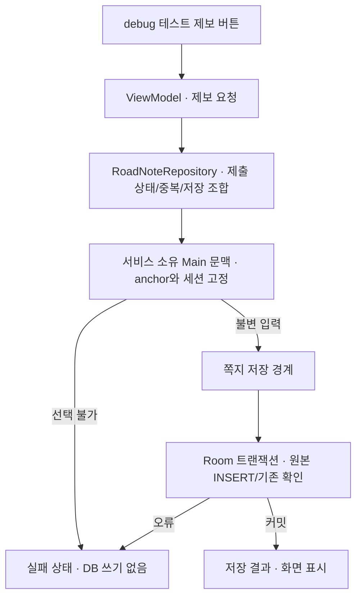

# 03. 과거 위치에 쪽지를 Room으로 저장하기

상태: **스펙 초안 / 사용자 리뷰 대기 / 구현 전**.
선행:01위치 수집·02버퍼·중간 리팩터링46f427a. [전체 계획](00-overview.md) · [공통 정본](../../plans/implementation-plan.md) · [02 버퍼 계약](02-location-buffer.md).

## 1. 이번에 만들 결과

수집 중 ‘구덩이 테스트 제보’를 누르면 Main에서02단계의 실제 과거 좌표를 선택하고 Room에 쪽지 원본1개를 저장한다. **DB 커밋이 성공한 뒤에만** 저장했다고 표시한다. 앱 프로세스가 다시 시작돼도 저장된 원본은 남는다. 위치 버퍼는 계속 메모리 전용이다.

30초를 기다리지 않는다. 수집10초 뒤 제보하면 가장 오래된 실제 표본과 실제 offset약10초를 저장한다. 충분한 이력에서는 Main 선택 진입 시각의30초 전과 가까운 표본을 사용한다. Gleo/LLM에 시각·좌표를 계산시키지 않는다.

이번에는 B 수신, H3 조회, proximity, 음성/Gleo 코드, 서버, 지도, 전체 debug 패널을 만들지 않는다. 테스트 진입은 debug 빌드의 최소 버튼이다. 제보 목록 전체 화면이나 실시간 좌표 화면도 추가하지 않는다.

## 2. 작은 구현 묶음

| 순서 | 구현 | 리뷰할 내용 |
|---|---|---|
| 03-a | 원본 모델·Room Entity/DAO/Database·저장 경계 | 필드 의미·키·중복·트랜잭션·스키마 |
| 03-b | 추적 세션에서 anchor 선택→저장→결과 | Main 시각·불변 입력·서비스 수명·실패 |
| 03-c | debug 제보 버튼과 최소 결과 표시·통합 검증 | 저장 전 성공 금지·중복 클릭·재시작 보존 |

이 스펙을 먼저 합의한 뒤 작은 diff 순서로 구현·코드 리뷰한다. 초안 작성만으로 코드를 시작하지 않는다.

## 3. 상태 소유와 연결 제안

ViewModel은 Repository에 제출하고 상태를 관찰한다. DAO/SDK를 직접 부르지 않는다. Repository는 SDK 구체 타입이나 Activity를 보유하지 않는다. 버퍼를 화면이나 ViewModel로 옮기지 않는다.

**제안:** 서비스가 Repository와 제출 작업의 scope를 소유한다. ViewModel은 서비스 연결에서 제한된 제출/상태 계약을 받아 사용한다. Repository에는 저장 경계와 Main에서 수행할 `captureAnchor` 동작만 연결한다. UI가 사라져도 수락한 저장은 서비스 수명 안에서 처리한다. Binder에는 원시 버퍼/DAO/LocationTracking을 노출하지 않는다. 서비스 의존과 조회·저장의 세부 타입은03-b 코드 리뷰에서 확인한다.

저장 상태는 Idle/Submitting/Saved/Failed 중 하나로 표현하고 UI는 파생한다. isSaving·hasSuccess·hasError를 별도로 맞추지 않는다. 구체적 실패는 화면의 짧은 안내로 변환하며 SQLite 예외 원문·제보 원문은 UI/로그에 노출하지 않는다. SDK 수집 상태와 제출 상태는 서로 다른 상태다.

## 4. 위치와 작업 수명

1. debug 요청은 content/category만 전달하고, 작성자 A·시나리오·합성 여부는 앱의 테스트 문맥에서 결정한다. Gleo 입력/DB/서버 구현은 연결하지 않는다.
2. requestId는 하나의 제출 의도에 한 번 생성해 재시도에도 유지한다. 새 제보 버튼 의도는 새 ID를 사용한다.
3. 기존 requestId가 있으면 원본을 반환하는 경로를 우선 확인한다. 신규 요청의 anchor는 Main 직렬 처리에 들어와 단조시각을 한 번 읽고 suspend 없이 선택한다. 외부 클릭/Receiver 도착 시각과 동일시하지 않는다.
4. 선택 결과·세션 식별·작성자·시나리오·UTC 생성시각을 불변 입력으로 고정한다. 이후 수신된 위치로 저장 좌표를 바꾸지 않는다.
5. Room 쓰기는 suspend DAO/트랜잭션으로 수행한다. SQL/디스크 작업으로 Main을 막지 않는다.
6. 최종 결과는 커밋 여부를 기준으로 정한다. 커밋됐는데 화면이 사라졌다는 이유로 실패라고 표시하거나 다시 INSERT하지 않는다.

한 번에 저장1건만 진행, 중복 클릭은 새 작업을 만들지 않는다. 사용자 중지/SDK 오류가 **선택 전에** 발생하면 신규 제출은 실패한다. **선택 후 DB가 처리 중인 수락 요청은** 고정된 문맥으로 마무리하는 안을 제안한다. 중지 후 새 요청은 받지 않으며 역할 전환/전체 초기화는 저장 중 수행하지 않는다(전환 UI 자체는06단계). 이 정책은 ‘이전 세션 콜백 버림’과 다르며 검토 대상이다. 프로세스가 강제 종료되면 자동 재제출하지 않고, Room의 원자성 및 재실행 시 조회 결과로 판단한다.

## 5. Room v1 원본 데이터 제안

테이블 `road_notes`. SQLite 자동 증가 번호 대신 클라이언트 UUID를 사용해 향후 서버 전환에서도 식별자를 유지한다. 아래 이름은 초안이며 구현 코드의 snake/camel 표기는03-a에서 일관되게 정한다.

| 필드 | 타입·제약 | 의미 |
|---|---|---|
| noteId | String, PK | 쪽지 식별자 |
| requestId | String, UNIQUE NOT NULL | 제출 중복 방지 키. 쪽지 ID와 역할 구분 |
| scenarioId | String, NOT NULL | 합성 시연 데이터 범위 |
| authorId | String, NOT NULL | 이번에는 앱이 결정하는 가상 A |
| content | String, NOT NULL | trim 후1~500자. 이번 fixture는 ‘도로에 구덩이가 있어요’ |
| category | String, NOT NULL | WARNING/INFORMATION만. 모르는 값을 임의 기본값으로 바꾸지 않음 |
| latitude / longitude | Double, NOT NULL | 선택한 실제 표본 좌표. 범위·유한값 검증 |
| anchorOffsetMillis | Long, NOT NULL | 실제 선택 오프셋0~35,000ms. 허용은02선택 결과로 결정 |
| createdAtUtcMillis | Long, NOT NULL | Main에서 제보 입력 고정 시 읽은 UTC. 버퍼 계산용 아님 |
| expiresAtUtcMillis | Long, NOT NULL | 생성UTC+공통 TTL10분. ACTIVE 여부는 계산 |
| source | String, NOT NULL | SDK 등 신뢰된 앱 입력 경로 |
| isSynthetic | Boolean, NOT NULL | 합성 테스트 문맥으로 결정, content에서 추론하지 않음 |

sample 수신 단조시각 자체는 저장하지 않는다. 재부팅을 넘겨 의미가 유지되지 않으며 위치 원시 이력도 저장하지 않는다. createdAt/만료는 벽시계, anchor 선택·offset은 단조시계라는 차이를 유지한다.

인덱스: PK(noteId), UNIQUE(requestId), 시나리오·만료 조회용 복합 인덱스(scenarioId, expiresAtUtcMillis) 제안. DB는 앱 범위1인스턴스, schema export 켜고 `app/schemas/.../1.json`을 버전 관리한다. destructive migration을 기본으로 사용하거나 DB를 열 때마다 지우지 않는다.

### 단계별 확장과 정본 대조

공통 정본은 최종 원본에 H3/경로/방향/진행값·품질 정보를 계획하고 있다. 현재 버퍼에는 좌표/수신시각만 있고 H3/경로 해석은 아직 없다. **이번 v1에는 만들어낸 routeId·방향·accuracy를 채우지 않는다.** 이 필드들은04/05단계 도입 시 계산 가능성과 기존 행 처리 정책을 포함한 Room migration 스펙으로 추가하는 안을 제안한다. 최종 계약에서 삭제한다는 뜻이 아니다.

수신이력 `note_receipts`는 원본과 별개 테이블이며05단계에서 추가한다. 지금 빈 테이블/표시 플래그를 선제 구현하지 않는다. 원본에 picked/receivedBy/displayed 상태를 넣지 않는다. 이 단계적 스키마 도입과 작업 수명 정책은 공통 정본에 반영·동기화한 뒤 구현한다.

## 6. 저장 계약·중복·서버 교체

저장 경계의 입력/출력은 앱의 원본 모델이며 Room Entity/DAO 타입을 ViewModel·추적 코드에 노출하지 않는다. 예상되는 핵심 계약은 `createOrGet(note)`와 식별자 조회다. 향후 서버 구현이 이 경계를 대체하고, 메모리 버퍼와 제출 상태/UI는 유지한다. 이번에는 HTTP/서버·인증·동기화·오프라인 큐를 구현하지 않는다.

별도 Store interface는 서버 교체와 실패 Fake 검증이 실제 필요한 이 경계에만 두는 안을 검토한다. 공통 BaseRepository/Mapper/UseCase는 만들지 않는다. Hilt·Room/KSP 버전은 구현 전 현재 Gradle과 실제 의존성 연결 규모를 대조하고 도입 범위를 코드 리뷰한다. 문서 작성 단계에서 설치하지 않는다.

중복 처리는 한 트랜잭션에서 고유 키로 보장한다. ‘조회 후 없으면 INSERT’만으로 동시 중복을 막았다고 하지 않는다.

- 같은 requestId·같은 제출 내용/작성자/시나리오: 기존 원본 반환. 재시도 시 anchor/생성시각을 새로 계산해 기존 원본을 덮어쓰지 않음.
- 같은 requestId에 다른 content/category/작성자/시나리오: 충돌 실패. 마지막 요청으로 덮어쓰지 않음.
- 서로 다른 요청은 별도 원본. 같은 내용이라는 이유만으로 합치지 않음.
- INSERT IGNORE는 오직 해당 requestId 중복임을 기존 행과 대조한 후 성공 취급. 다른 제약 오류/디스크 오류를 성공으로 바꾸지 않음. REPLACE로 원본을 삭제·재생성하지 않음.

만료 원본은 활성 조회에서 제외하되 중복 요청의 원본 조회와 별개다. 실제 삭제·전체 초기화는 후속 시나리오 정책으로 분리하고 이번 저장 동작마다 임의 삭제하지 않는 안을 제안한다. 벽시계 변경 감지/시나리오 재설정·추가 필드·서버 정책 등 정본과 단계 범위 차이는 리뷰에서 먼저 맞춘다.

## 7. 검증 기준

| ID | 상황 | 기대 |
|---|---|---|
| S01 | 유효 입력·선택 성공 | 원본1행, 좌표·실제offset 일치, 커밋 후 성공 |
| S02 | 빈 버퍼/null 이후/최신 표본 오래됨 | 실패, 행 추가 없음 |
| S03 | 짧은 이력·첫 신선한 표본 |30초 대기 없이 실제offset 저장 |
| S04 | 동일 requestId로 동시 제출 |1행, 동일 원본 ID 반환 |
| S05 | 같은 키·다른 내용/작성자/시나리오 | 충돌, 기존 원본 불변 |
| S06 | 저장 예외·트랜잭션 실패 | 부분 저장/성공 표시 없음, 재시도 가능 |
| S07 | 선택 뒤 새 위치 도착 | 저장 좌표가 새 위치로 바뀌지 않음 |
| S08 | 화면 이탈·재생성 중 저장 | UI가 업무를 소유하지 않아 수락한 작업 유지, 중복 저장 없음 |
| S09 | 중지 전후 제출 | 선택 전 중지는 실패, 선택 후 수락 건은 고정 문맥으로 최종결과 확인 |
| S10 | DB 닫고 다시 열기/프로세스 재실행 | 원본 보존, 위치 버퍼는 새 세션에서 빈 상태 |
| S11 | content/enum/좌표/시간 범위 오류 | 경계에서 거절, 임의 기본값 없음 |
| S12 | TTL 경계 | now<expires는 활성, 같거나 크면 제외. 원본 수신 완료 상태는 생성 안 함 |

순수 검증·중복/실패 Fake 테스트와 실제 Room 계측(고유키·트랜잭션·재열기)을 구분한다. 실기기 통합은 실제SDK버퍼→debug제보→DB재조회와 저장 상태를 확인한다. 기존 위치17개 단위·수명 계측을 회귀로 유지한다. 빌드/계측/스키마 검증이 실제 서버 교체나 실차 안전을 입증하지 않는다.

이번 종료 지점은03스펙 리뷰다. 특히 **v1 필드 범위, 서비스 소유 저장 수명, 선택 후 중지 처리**부터 검토한다.
