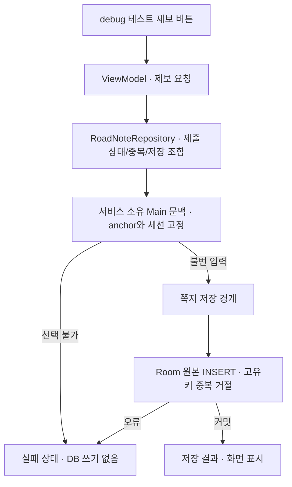

# 03. 과거 위치에 쪽지를 Room으로 저장하기

상태: **03-a/b 구현·리뷰 반영 / 03-c 독립 스펙 리뷰 대기**. [03-a 작업 기록](../../work/step03a-room-storage.md).
선행:01위치 수집·02버퍼·중간 리팩터링46f427a. [전체 계획](00-overview.md) · [공통 정본](../../plans/implementation-plan.md) · [02 버퍼 계약](02-location-buffer.md).

## 1. 이번에 만들 결과

수집 중 ‘구덩이 테스트 제보’를 누르면 Main에서02단계의 실제 과거 좌표를 선택하고 Room에 쪽지 원본1개를 저장한다. **DB 커밋이 성공한 뒤에만** 저장했다고 표시한다. 앱 프로세스가 다시 시작돼도 저장된 원본은 남는다. 위치 버퍼는 계속 메모리 전용이다.

30초를 기다리지 않는다. 수집10초 뒤 제보하면 가장 오래된 실제 표본과 실제 offset약10초를 저장한다. 충분한 이력에서는 Main 선택 진입 시각의30초 전과 가까운 표본을 사용한다. Gleo/LLM에 시각·좌표를 계산시키지 않는다.

이번에는 B 수신, H3 조회, proximity, 음성/Gleo 코드, 서버, 지도, 전체 debug 패널을 만들지 않는다. 테스트 진입은 debug 빌드의 최소 버튼이다. 제보 목록 전체 화면이나 실시간 좌표 화면도 추가하지 않는다.

## 2. 작은 구현 묶음

| 순서 | 구현 | 리뷰할 내용 |
|---|---|---|
| 03-a | 원본 모델·Room Entity/DAO/Database·저장 경계 | 필드 의미·키·중복·트랜잭션·스키마 |
| 03-b | 추적 세션에서 anchor 선택→저장→결과 | Main 시각·불변 입력·서비스 수명·실패 |
| 03-c | debug 제보 버튼과 최소 결과 표시·통합 검증 | 저장 전 성공 금지·중복 클릭·재시작 보존 |

이 스펙을 먼저 합의한 뒤 작은 diff 순서로 구현·코드 리뷰한다. 초안 작성만으로 코드를 시작하지 않는다.

## 3. 상태 소유와 연결 제안

ViewModel은 Repository에 제출하고 상태를 관찰한다. DAO/SDK를 직접 부르지 않는다. Repository는 SDK 구체 타입이나 Activity를 보유하지 않는다. 버퍼를 화면이나 ViewModel로 옮기지 않는다.

**제안:** 서비스가 Repository와 제출 작업의 scope를 소유한다. ViewModel은 서비스 연결에서 제한된 제출/상태 계약을 받아 사용한다. Repository에는 저장 경계와 Main에서 수행할 `captureAnchor` 동작만 연결한다. UI가 사라져도 수락한 저장은 서비스 수명 안에서 처리한다. Binder에는 원시 버퍼/DAO/LocationTracking을 노출하지 않는다. 서비스 의존과 조회·저장의 세부 타입은03-b 코드 리뷰에서 확인한다.

저장 상태는 Idle/Submitting/Saved/Failed 중 하나로 표현하고 UI는 파생한다. isSaving·hasSuccess·hasError를 별도로 맞추지 않는다. 구체적 실패는 화면의 짧은 안내로 변환하며 SQLite 예외 원문·제보 원문은 UI/로그에 노출하지 않는다. SDK 수집 상태와 제출 상태는 서로 다른 상태다.

## 4. 위치와 작업 수명

1. debug 요청은 content/category만 전달하고, 작성자 A는 앱의 테스트 문맥에서 결정한다. Gleo 입력/DB/서버 구현은 연결하지 않는다.
2. noteId UUID는 하나의 제출 의도에 한 번 생성하고 요청 식별에도 사용한다. 제보는 성공 또는 실패로 한 번 끝내고, 사용자 재시도·자동 재시도·재시도 버튼·영속 재시도 큐를 제공하지 않는다. 실패 후 테스트 버튼을 다시 누르면 새 의도·새 ID다. 화면 재생성은 신규 제출을 만들지 않으며 실패 요청을 재개하기 위한 ID/content 보관도 추가하지 않는다. 이미 수락한 작업과 상태 관찰은 서비스 수명 안에서 유지한다. Gleo 연결은 이번 범위 밖이며, 이 정책이 실제 Gleo 대화 종료까지 보장하는 것은 아니다.
3. 같은 noteId는 내용과 무관하게 중복 거절하고 기존 원본을 반환하거나 갱신하지 않는다. 신규 요청의 anchor는 Main 직렬 처리에 들어와 단조시각을 한 번 읽고 suspend 없이 선택한다. 외부 클릭/Receiver 도착 시각과 동일시하지 않는다.
4. 선택 결과·세션 식별·작성자·UTC 생성시각을 불변 입력으로 고정한다. 이후 수신된 위치로 저장 좌표를 바꾸지 않는다.
5. Room 쓰기는 suspend DAO/트랜잭션으로 수행한다. SQL/디스크 작업으로 Main을 막지 않는다.
6. 최종 결과는 커밋 여부를 기준으로 정한다. 커밋됐는데 화면이 사라졌다는 이유로 실패라고 표시하거나 다시 INSERT하지 않는다.

한 번에 저장1건만 진행하고, Submitting 중 연타는 새 작업을 만들지 않는다. 사용자 중지/SDK 오류가 **선택 전에** 발생하면 신규 제출은 실패한다. **anchor와 문맥을 고정해 수락한 저장1건은** 이후 중지/SDK 오류에도 최종 성공·실패 결과 정리까지 마무리한다.

수집 중지와 서비스 종료를 분리한다. 중지/SDK 오류 즉시 SDK 수집·신규 제출은 막지만, 수락한 저장이 남아 있으면 마지막 UI 연결이 해제돼도 서비스 종료를 미룬다. 저장만 남아 있는 동안 foreground/알림을 유지하고 문구를 ‘위치 수집 중’에서 ‘제보 저장 중’으로 바꾼다. 저장의 최종결과 정리 후 foreground/알림 해제와 서비스 종료를 요청한다. 현재 코드의 즉시 stopSelf()/onDestroy→scope.cancel() 경로는03-b에서 이 정책에 맞게 수정해야 한다. 별도 상시 서비스나 Application 전역 scope는 추가하지 않는다.

역할 전환/전체 초기화는 저장 중 수행하지 않는다(전환 UI 자체는06단계). 이 정책은 ‘이전 세션 콜백 버림’과 별개다. 프로세스 강제 종료 후 저장 완료나 자동 재제출은 보장하지 않고, Room의 원자성 및 재실행 시 조회 결과로 판단한다.

## 5. Room v1 원본 데이터 제안

테이블 `road_notes`. SQLite 자동 증가 번호 대신 클라이언트 UUID를 사용해 향후 서버 전환에서도 식별자를 유지한다. 아래 이름은 초안이며 구현 코드의 snake/camel 표기는03-a에서 일관되게 정한다.

| 필드 | 타입·제약 | 의미 |
|---|---|---|
| noteId | String, PK NOT NULL | 제출 의도마다 한 번 생성한 UUID. 쪽지와 요청의 공통 식별자 |
| authorId | String, NOT NULL | 이번에는 앱이 결정하는 가상 A |
| content | String, NOT NULL | trim 후 Unicode 코드 포인트1~500개. 이번 fixture는 ‘도로에 구덩이가 있어요’ |
| category | String, NOT NULL | WARNING/INFORMATION만. 모르는 값을 임의 기본값으로 바꾸지 않음 |
| latitude / longitude | Double, NOT NULL | 선택한 실제 표본 좌표. 범위·유한값 검증 |
| anchorOffsetMillis | Long, NOT NULL | 실제 선택 오프셋0~35,000ms. 허용은02선택 결과로 결정 |
| createdAtUtcMillis | Long, NOT NULL | Main에서 제보 입력 고정 시 읽은 UTC. 버퍼 계산용 아님 |
| expiresAtUtcMillis | Long, NOT NULL | 생성UTC+공통 TTL10분. ACTIVE 여부는 계산 |

### DB 제약과 앱 저장 경계의 책임

DB가 직접 보장하는 것은 PK(noteId), 필수 컬럼 NOT NULL이다. schema export와 실제 Room 계측으로 확인한다. 앱의 모든 원본 쓰기는 공통 저장 경계를 통과하며 아래 불변식은 그 경계의 작은 검증 코드와 직접 호출 테스트로 확인한다. UI에서만 검사하지 않는다. 별도 Validator 인터페이스·추가 계층·SQL CHECK는 선제 도입하지 않는다. 임의 SQL 수정까지 값 범위를 강제한다고 주장하지 않는다.

- content는 trim 후 `text.codePointCount(0, text.length)`로1~500개를 허용한다. UTF-16 단위나 사람이 보는 글자/이모지 묶음 수와는 다르다. 초과하면 거절하며 자동 절삭하지 않는다. trim된 허용 원문은 보존한다.
- category는 WARNING/INFORMATION만 허용하고, 좌표는 유한값이며 위도[-90,90]·경도[-180,180], offset은0~35,000ms 및02선택 계약을 만족해야 한다.
- Main에서 anchor·문맥을 고정할 때 생성 UTC 밀리초를 한 번 읽고, 만료시각은 그 값에600,000ms를 더해 한 곳에서 계산한다. DB 대기시간도 TTL에 포함한다. 저장 경계도 정확한 TTL 관계와 Long 덧셈 범위 초과를 검증하고, INSERT 완료 시각으로 재계산하지 않는다. 중복 거절로 기존 생성·만료시각이 바뀌지 않는다.

source는 입력 경로가 Pleos SDK 하나이고 사용처가 없으므로 v1에서 제외한다. source enum/검증도 만들지 않는다. 실제 여러 경로와 구분할 사용처가 생길 때 도입한다. isSynthetic도 사용처가 없어 최신 리뷰 합의로 제외했다. 이번 저장은 합성 시연 전용이며 서버 자동 업로드는 제공하지 않는다. 실제 데이터와 혼합할 때 식별·보존·이관 정책을 다시 정한다.

sample 수신 단조시각 자체는 저장하지 않는다. 재부팅을 넘겨 의미가 유지되지 않으며 위치 원시 이력도 저장하지 않는다. createdAt/만료는 벽시계, anchor 선택·offset은 단조시계라는 차이를 유지한다.

인덱스는 PK(noteId)만 둔다. 별도 requestId 컬럼·UNIQUE 인덱스는 만들지 않는다. scenarioId와 (scenarioId, expiresAtUtcMillis) 복합 인덱스는06단계로 미루며03단계에서는 시나리오별 데이터 격리·조회·초기화를 제공하지 않는다. DB는 앱 범위1인스턴스, schema export 켜고 `app/schemas/.../1.json`을 버전 관리한다. destructive migration을 기본으로 사용하거나 DB를 열 때마다 지우지 않는다.

### 단계별 확장과 정본 대조

공통 정본은 최종 원본에 H3/경로/방향/진행값·품질 정보를 계획하고 있다. 현재 버퍼에는 좌표/수신시각만 있고 H3/경로 해석은 아직 없다. **이번 v1에는 만들어낸 routeId·방향·accuracy를 채우지 않는다.** 이 필드들은04/05단계 도입 시 계산 가능성과 기존 행 처리 정책을 포함한 Room migration 스펙으로 추가하는 안을 제안한다. 최종 계약에서 삭제한다는 뜻이 아니다.

수신이력 `note_receipts`는 원본과 별개 테이블이며05단계에서 추가한다. 지금 빈 테이블/표시 플래그를 선제 구현하지 않는다. 원본에 picked/receivedBy/displayed 상태를 넣지 않는다. 이 단계적 스키마 도입과 작업 수명 정책은 공통 정본에 반영·동기화한 뒤 구현한다.

## 6. 저장 계약·중복·서버 교체

저장 경계의 입력/출력은 앱 원본 모델이며 Room Entity/DAO 타입을 ViewModel·추적 코드에 노출하지 않는다. 계약은 **단순 생성 `create(note)`와 식별자 조회**다. createOrGet·기존 원본 반환 성공은 제공하지 않는다. 향후 서버 구현이 저장 경계를 대체하되 제출 상태/UI를 유지할 수 있는지는 성공 의미에 따라 다시 검토한다.

이번 Saved는 **로컬 Room 원본 커밋 완료**이며 서버 접수나 다른 사용자에게 공유 완료가 아니다. 서버 도입 때 최종 원본과 성공 기준, Room 제거/조회 캐시/오프라인 제출 여부를 정하고 상태·안내를 재검토한다. 로컬에만 저장된 것을 서버 제보 완료로 안내하지 않는다. 현재 합성 Room 행은 서버에 자동 업로드하지 않는다. 이관 대상·동의·정책은 별도 작업이다. 이번에는 HTTP/서버·인증·동기화·오프라인 큐를 구현하지 않는다.

현재 authorId=A는 시연용이다. 서버 작성자를 사람 계정으로 확정하지 않고 차량 등 어떤 주체를 식별할지와 인증·권한을 서버 설계 때 결정한다. 제공되거나 신뢰할 수 있는 차량 ID가 있다고 가정하지 않는다. 서버는 클라이언트 authorId/차량 ID 문자열만 신뢰하지 않고 확인 가능한 근거·권한으로 작성자를 결정해야 한다. ID를 아는 것과 조회·수정 권한은 별개다. 로그인·차량 식별 API·사용자 테이블/FK는 이번에 추가하지 않는다.

현재 생성·만료시각은 앱이 고정한 UTC 밀리초다. 서버 도입 때 클라이언트 생성시각/서버 접수시각과 만료 기준의 권위를 별도로 결정한다. 서버 시각 필드나 MySQL 물리 타입은 선제 추가하지 않는다. 앱 단조시각을 다른 기기/서버 시각과 비교하지 않는다. 미래 서버도 동일한 trim/코드 포인트 검증을 보장하고 MySQL 문자셋·물리 타입·API 왕복의 한글/이모지 보존을 검증한다.

별도 Store interface는 서버 교체와 실패 Fake 검증이 실제 필요한 이 경계에만 두는 안을 검토한다. 공통 BaseRepository/Mapper/UseCase는 만들지 않는다. Hilt·Room/KSP 버전은 구현 전 현재 Gradle과 실제 의존성 연결 규모를 대조하고 도입 범위를 코드 리뷰한다. 문서 작성 단계에서 설치하지 않는다.

중복·덮어쓰기 방지는 앱 제출 직렬화와 별개로 **저장 경계 자체가 책임진다**.03-a 리뷰에서 PK(noteId)와 INSERT 충돌 처리·트랜잭션 범위를 확인한다. 앱 락이나 사전 조회만으로 동시 중복을 보장하지 않는다.

- 같은 noteId는 제출 내용이 같든 다르든 중복 거절한다. 한 건만 생성되고 나머지는 실패하며 최초 원본은 불변이다.
- 기존 원본을 반환하며 성공 처리하거나 덮어쓰지 않는다. 필드별 동일성 비교·payload 해시도 추가하지 않는다.
- 새 제보 의도는 새 ID다. 같은 내용이라는 이유로 서로 다른 요청을 합치지 않는다.
- 제약 오류 뒤 같은 ID가 있으면 Duplicate, 없거나 확인 조회가 SQLite 오류로 실패하면 StorageFailure다. 이는 원인이 PK임을 엄밀히 판별하는 계약이 아니다. CHECK/추가 UNIQUE/트리거를 도입할 때 원인 분류를 다시 검토한다. 디스크 오류도 성공으로 바꾸지 않는다. REPLACE로 기존 원본을 삭제·재생성하지 않는다.

서버 저장 후 응답 유실이나 동일 요청 재전달이 실제 필요해지면 요청 키 범위·권한·기존 원본 확인 계약을 별도로 정한다. 현재 단순 생성 정책이 서버 응답 유실까지 해결한다고 주장하지 않는다.

만료 원본은 활성 조회에서 제외한다. 중복 ID는 만료 여부와 관계없이 거절한다. 실제 삭제·전체 초기화는 후속 시나리오 정책으로 분리하고 이번 저장 동작마다 임의 삭제하지 않는 안을 제안한다. 벽시계 변경 감지/시나리오 재설정·추가 필드·서버 정책 등 정본과 단계 범위 차이는 리뷰에서 먼저 맞춘다.

## 7. 검증 기준

| ID | 상황 | 기대 |
|---|---|---|
| S01 | 유효 입력·선택 성공 | 원본1행, 좌표·실제offset 일치, 커밋 후 성공 |
| S02 | 빈 버퍼/null 이후/최신 표본 오래됨 | 실패, 행 추가 없음 |
| S03 | 짧은 이력·첫 신선한 표본 |30초 대기 없이 실제offset 저장 |
| S04 | 실제 Room 저장 경계에 같은 noteId·같은 제출 문맥으로 동시 호출 / 앱 진입점 연타 | 저장 경계는 한 건 생성·나머지 중복 거절·DB1행. 별도로 진입점은 수락 작업1건. 연타 차단만으로 DB 중복 보장 입증 금지 |
| S05 | 실제 저장 경계에 같은 noteId·다른 제출 문맥으로 동시 호출 | 한 건만 생성, 나머지는 내용과 무관하게 중복 거절. 최초 원본·생성/만료시각 불변. 문맥 비교 없음 |
| S06 | 저장 예외·트랜잭션 실패 후 재생성/새 제보 | 부분 저장/성공 표시·자동 재제출 없음. 재생성만으로 제출 없음. 이후 명시적 새 제보는 새 ID |
| S07 | 선택 뒤 새 위치 도착 | 저장 좌표가 새 위치로 바뀌지 않음 |
| S08 | 화면 이탈·재생성 중 저장 | UI가 업무를 소유하지 않아 수락한 작업 유지, 중복 저장 없음 |
| S09 | 선택 전 중지 / 선택 후 DB를 대기시킨 상태에서 중지 또는 SDK 오류→마지막 UI 연결 해제→DB 진행 허용 | 선택 전 신규 제출 실패. 선택 후에는 SDK·신규 제출 중지, 저장 중 알림·서비스 유지. 성공이면 원본1행과 최종결과, 실패면 실패 결과를 정리한 뒤 foreground 해제·서비스 종료 요청 |
| S10 | DB 닫고 다시 열기/프로세스 재실행 | 원본 보존, 위치 버퍼는 새 세션에서 빈 상태 |
| S11 | 저장 경계 직접 호출: 빈 내용·500/501 코드 포인트·한글/보조 평면/조합 이모지·category·좌표·offset·시간 관계/덧셈 초과 | 공통 검증으로 잘못된 값 거절, 임의 기본값·절삭 없음. 허용된 trim 원문 보존. PK/UNIQUE/NOT NULL은 스키마·Room 계측으로 별도 확인 |
| S12 | TTL 경계 | expires 직전은 활성, 동일·직후는 제외. 생성+600,000ms 고정 및 중복 요청 후 시각 불변. 원본 수신 완료 상태는 생성 안 함 |

순수 검증·중복/실패 Fake 테스트와 실제 Room 계측(고유키·트랜잭션·재열기)을 구분한다. 실기기 통합은 실제SDK버퍼→debug제보→DB재조회와 저장 상태를 확인한다. 기존 위치17개 단위·수명 계측을 회귀로 유지한다. 빌드/계측/스키마 검증이 실제 서버 교체나 실차 안전을 입증하지 않는다.

현재 종료 지점은03-b 코드 리뷰다. 특히 **v1 필드 범위, 서비스 소유 저장 수명, 선택 후 중지 처리**부터 검토한다.

## 8. PR #4 리뷰 반영 범위와 남은 결정

최신 답변까지 반영했다. 앞선 ‘같은 ID·같은 문맥이면 기존 원본 반환’ 합의는 최신 답변에 따라 **단순 생성·같은 ID는 무조건 중복 거절**로 변경했다. 수명·단발 제출·DB/앱 검증 책임·문자 길이·TTL·source 제외·서버 전환 경계를 본문과 S04/S05/S11/S12에 일치시켰다.

추가 축소 제안도 사용자 확정에 따라 반영했다. UUID 하나인 noteId가 요청·원본 식별을 겸하고 PK로 중복 생성을 막는다. 별도 requestId는 없다. scenarioId와 시나리오/만료 복합 인덱스는06단계로 미룬다.06단계 스펙에서는 Room migration, 기존 행의 시나리오 소속 부여, 기존 합성 데이터의 유지·초기화 정책을 먼저 합의한다. 기존 행을 임의 삭제하거나 소속을 추측하지 않는다.

전체 시스템 공통 정책 변경은 설계 브랜치에서 별도 반영·동기화해야 하므로 공통 정본의03단계 적용 절을 설계 브랜치9081d62에 반영한 뒤 현재 브랜치에 병합했다.03-a 저장 경계는 구현·검증 후 코드 리뷰를 기다린다. 서비스 연결·UI와03전체 실행 검증은03-b/c에서 진행한다.

후속 리뷰: 보존할 기존 DB가 없다는 사용자 확인에 따라 isSynthetic 없는 v1으로 정리한다. 버전 증가·migration·destructive fallback은 추가하지 않는다. 시간 정책은 초로 선언해 TimeUnit.SECONDS.toMillis로 변환하며 SDK/버퍼/DB의 내부 ms 계약은 유지한다.

03-b 구현 결과와 검증 범위는 [작업 기록](../../work/step03-review-and-submission.md)을 참조한다. 화면 ViewModel의 제출 연결과 테스트 버튼은03-c에서 구현한다.

## 9. 다음 검토: 03-c

[03-c debug 제보·결과 연결 스펙](03c-debug-submission-ui.md)을 독립 리뷰한다. 현재 코드 기준03-a/b가 구현되어 있으며 이전의 구현 전/검토 대기 문장은 당시 이력이다. 이번 자율 SDD 운영에서는 독립 스펙 리뷰·리뷰이 판단·반영·재검토 전 구현하지 않는다. 앱/Studio/adb/에뮬레이터/계측 실행은 금지하고 JVM·빌드·정적 검사만 허용한다. 과거 기기 PASS를 새 단계 PASS로 재사용하지 않는다.
