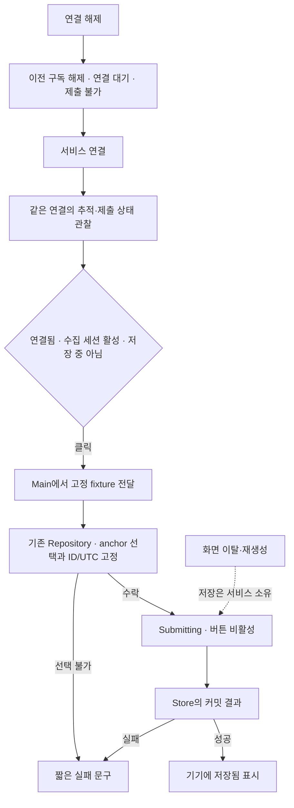

# 03-c. debug 제보 진입과 저장 결과 연결

상태: **독립 리뷰·리뷰이 채택2건 반영 / 독립 재검토 대기 / 구현 금지**. 기준 SHA `8b9504e6cf3cbf96d27a7e3a5b698ff8aec51798`.
상위 계약: [03 저장](03-save-road-note.md), [전체 단계](00-overview.md), [시스템 정본](../../plans/implementation-plan.md).
이번 운영은 스펙→독립 리뷰→리뷰이 판단→반영·재검토 후 구현 순서다. 사용자 대신 독립 검토로 진행하되 이 문서는 아직 승인된 구현 지시가 아니다.

## 1. 목적과 범위

기존 위치 수집 화면에서 debug 빌드에만 ‘구덩이 테스트 제보’ 버튼과 현재 제출 결과를 보인다. 입력은 content=`도로에 구덩이가 있어요`, category=`WARNING`으로 고정한다. content/category 이외의 좌표·시각·작성자·ID를 UI가 만들거나 전달하지 않는다. 현재 서비스의 Repository가 anchor·UTC·ID를 고정하고 Room 커밋 후 Saved를 내는03-a/b 계약을 재사용한다.

이번에는 버튼/상태 관찰 연결만 추가한다. 지도·좌표 실시간 화면·전체 목록·입력 폼·재시도·A/B 전환·경로 주입·전체 debug 패널·서버·Gleo·새 스키마는 제외한다. 06단계 오버레이/와이어프레임을 지금 확정하지 않는다. 주행/정차 모두 같은 앱 화면을 사용하고 기어·속도를 버튼 조건에 추가하지 않는다. 주행 중 OS 규제와 실제 표시 유지가 검증됐다는 주장은 하지 않는다.

## 2. 현재 코드와 필요한 접점

| 현재 | 03-c에서 필요한 변화 |
|---|---|
| LocalBinder가 status/submissionState/submitTestNote를 제공 | 화면 연결에서 제한된 상태·동작만 사용. DAO·Room·buffer·SDK 노출 금지 |
| LocationViewModel은 status만 연결·해제 | 같은 연결의 수집/제출 상태를 함께 관찰하고 제출 동작 전달 |
| LocationView는 상태·콜백을 받는 순수 화면 | debug 슬롯에 표시 상태와 필수 클릭 콜백 전달. 저장 중 기존 시작 버튼도 비활성. ViewModel/서비스 직접 참조 금지 |
| Repository가 Submitting 선설정·단일 저장·결과 보관 | 중복 gate·ID·저장 scope 재구현 금지 |
| 서비스가 수집 종료 후 수락한 저장 완료까지 생존 | 기존 수명·알림 유지. 화면 수명으로 저장 취소 금지 |

흐름은 `debug UI → ViewModel → 연결된 서비스의 제출 계약 → 기존 Repository → Store`다. Binder 직접 사용은 Android 연결부에 한정한다. ViewModel이 Repo를 새로 생성하거나 Activity가 Store를 부르지 않는다.

## 3. 연결·상태의 소유와 전이

서비스의 SubmissionState가 정본이다. 화면은 이를 복사해서 따로 갱신하지 않고 연결된 Flow에서 파생한다. isSaving/hasSuccess/hasError/connected를 각각 수동으로 맞추지 않는다. 연결 없음은 Idle이나 저장 실패로 오인하지 않게 구분한다. 예를 들어 제출 상태 `null`을 연결 없음으로 쓰는 작은 화면 모델이면 충분하다. 구체 타입 이름은 구현 리뷰에서 정하되 서로 다른 연결의 추적/제출 상태를 조합하지 않아야 한다.

- 연결 시 현재 StateFlow 값을 읽는다. 같은 서비스의 Submitting/Saved/Failed는 재생성 뒤에도 재관찰하고, 연결/수집 자체를 이유로 submit하지 않는다.
- 연결 해제 시 이전 서비스 상태 수집을 취소하고 제출 참조를 제거한다. 이전 연결에서 예약·방출한 상태가 새 화면을 덮지 않는다. 이후 이전 Flow를 변경해도 화면은 갱신되지 않는다. 재연결은 새 연결의 현재 값으로 교체한다.
- 기본 상태·연결 대기는 제보 완료/실패가 아니다. 연결 없는 클릭이나 연결 교체 직전 전달 실패는 DB 성공으로 표시하지 않는다. 클릭 직전 현재 연결과 허용 상태를 다시 확인하고, 연결이 없으면 요청을 보내지 않고 연결 대기 표시를 유지한다.
- 서비스가 계속 살아 있는 동안 마지막 결과를 표시하고 다음 명시적 클릭 때 새 요청 상태로 바뀐다. 별도 결과 소비/자동 리셋 타이머/일회성 이벤트 큐는 만들지 않는다.
- 수집도 끝나 서비스가 종료된 뒤 새 서비스에 연결하면 Idle이다. 과거 Saved를 복원하거나 실패로 바꾸지 않는다. Room 원본 보존과 화면의 마지막 결과 보존은 별개다. 프로세스 재실행에서 최근 제보 조회·성공 복원·자동 재제출은 이번 범위가 아니다.
- bind 성공 뒤의 정상 서비스 종료는 onServiceDisconnected 콜백을 보장한다고 가정하지 않는다. 실제 연결된 서비스 객체가 유지되는 bound 수명에서는 그 상태를 계속 관찰한다. 화면 재연결/프로세스 사망의 정확한 Android 콜백 순서는 기기 미검증으로 기록한다.

### 버튼 활성 조건과 요청 정책

연결됨 AND `trackingStatus.isCollecting` AND `submissionState != Submitting`일 때만 활성이다. 시작/준비/첫 표본 대기도 활성 세션이므로 버튼이 켜질 수 있다. 유효 표본이 없거나 stale이면 Repository가 LOCATION_UNAVAILABLE로 거절한다. UI에서30초 타이머·버퍼 길이·별도 신선도 판정을 만들지 않는다. STOPPED/FAILED/UNSUPPORTED, 연결 없음, 저장만 남아 있는 종료 대기에서는 비활성이다.

기존 위치 시작 버튼도 `submissionState != Submitting`을 기존 활성 조건에 추가해 계산한다. 따라서 STOPPED/FAILED+Submitting에는 시작/제보 버튼이 모두 비활성이다. 저장 성공·실패가 정리된 뒤에는 기존 시작 조건에 따라 사용자가 수동으로 시작할 수 있다. 화면 복귀나 저장 완료가 자동 시작을 예약·호출하지 않는다. 별도 시작 대기 플래그·큐·자동 재시작은 만들지 않는다. 현재 서비스가 저장만 남아 있을 때 시작 요청을 무시하는 동작은 유지하고, 화면의 무반응 클릭을 막는 조건만 보완한다.

화면 연타를 막는 표시와 별개로 기존 Repository의 Submitting gate가 최종 중복 수락을 막는다. 실패/성공 후 클릭은 새 의도·새 noteId다. 추가 질문·자동 재시도·‘다시 시도’ 버튼·새 UUID를 이용한 자동 재전송은 없다. 오류로 인한 취소는 기존 전파·finally 계약을 유지한다.

## 4. debug 경계와 최소 UI

debug 컴포넌트·fixture·진단용 문자열은 `src/debug`에 둔다. 동일 이름의 빈 release 슬롯을 `src/release`에 두어 main 화면이 같은 작은 슬롯을 호출하는 방식이 가장 작은 후보이며, 이 정도를 위해 plugin/새 Activity/Navigation/overlay permission은 추가하지 않는다. release stub에는 제보 fixture·버튼·결과 문자열을 넣지 않는다. 기존 서비스의 BuildConfig.DEBUG gate도 유지한다. 구체 파일 수/타입보다 debug 제외와 빌드 가능성을 리뷰한다.

| 상태 | 표시 예시 | 제보 버튼 |
|---|---|---|
| 연결 없음 | 서비스 연결 대기 중 | 비활성 |
| Idle·활성 세션 | 테스트 제보 | 활성 |
| Submitting | 테스트 제보 저장 중… | 비활성·Loading 표시 |
| Saved | 테스트 쪽지를 기기에 저장했어요 | 활성 세션이면 활성 |
| Failed | 아래 실패 안내 | 활성 세션이면 활성 |
| 수집 중지 후 저장 중 | 테스트 제보 저장 중… | 비활성; 기존 알림은 저장 중 유지 |

Saved는 로컬 커밋 완료이며 서버 공유·B 수신 완료·Gleo 응답 성공이 아니다. 원문·전체 좌표·식별자를 UI/새 로그에 나열하지 않는다. 실제 anchor 확인은 순수 테스트/후속 허용된 기기 DB 검증으로 분리한다. 선택 offset을 표시해야 할 필요는 이번 최소 결과에 없으므로 추가하지 않는다.

실패 안내는 LOCATION_UNAVAILABLE→‘최근 위치를 확인할 수 없어요’, INVALID_TIME→‘시각을 확인할 수 없어요’, INVALID_INPUT→‘제보 내용을 확인해주세요’, DUPLICATE→‘이미 처리한 요청이에요’, STORAGE→‘기기에 저장하지 못했어요’, CANCELLED→‘제보 저장이 중단됐어요’로 매핑한다. SQLite/SDK 예외명·원시 메시지·예외 객체는 사용자 문자열에 넣지 않는다. 정상 연결 해제 자체를 CANCELLED로 바꾸지 않는다. 안내는 리소스로 관리한다.

기존 Theme·세로 스크롤·버튼 높이 최소56dp/간격16dp를 초기 프로젝트 선택으로 재사용한다. 이 숫자만으로 Pleos 실물 높이/가이드 도해 준수를 보장하지 않는다. 한손 단일 클릭, 자동 스크롤/화면 전환/장식 애니메이션 없음, 짧은 상태 문구로 설계한다. App window 내에만 두고 Driving view/GNB를 침범하지 않는다. Loading은 수락 직후 상태로 노출하며0.25초 초과 작업을 무응답처럼 보이지 않게 한다. 주간/야간 대비4.5:1·문단3줄·다중창·물리 글자높이·실제 지연/터치 영역은 기기 실행 제한으로 NOT_TESTED다.

## 5. 테스트 경계와 남은 PR 리뷰

### 순수 JVM에서 입증할 계약

1. 실제 production 연결 관찰 로직을 좁은 함수 또는 최소 계약으로 분리해 MutableStateFlow/Fake와 test scheduler로 확인한다. AndroidViewModel을 테스트하기 위해 Robolectric/MockK/Hilt/공통 ConnectionManager를 선제 도입하지 않는다. 테스트에서 Flow 전환 로직을 다시 작성해서 검증하지 않는다.
2. 연결A → 해제 → A 상태 변경 → 스케줄러 소진에서도 연결 대기 유지, 연결B → A 갱신 무시/B 갱신 반영. 입력은 A=RECEIVING/Saved, B=STOPPED/Idle처럼 다르게 두고, A 갱신을 예약한 뒤 연결 교체와 스케줄러 실행 순서를 제어한다. 관찰되는 status/submission은 어느 한 유효 연결의 쌍 또는 연결 없음이어야 하며 A/B 혼합이나 예약 A 상태의 재진입은 허용하지 않는다. StateFlow가 모든 내부 순간값을 노출한다고 가정하거나 최종값만으로 판정하지 않는다. B=STOPPED/Idle에서 클릭하면 제출 호출0회, B를 활성 상태로 바꾼 뒤 클릭하면 A0회/B1회인지 Fake 호출 수로 확인해 제출 참조도 현재 연결을 사용하는지 검증한다. `delay(200)`만으로 구독 종료를 입증하지 않는다. PR [4541836274](https://github.com/jin-kim-240204/hyundai-and-gretel/pull/4#discussion_r4541836274)의 대상이다. 기존 긴 계측의 해당 구독 단언은 중복을 줄이되 SDK 수명 확인은 유지한다(실행 금지).
3. 표시/버튼 조건은 연결 없음·7개 추적 상태·4개 제출 상태에서 확인한다. 특히 STOPPED/FAILED+Submitting에는 기존 시작/제보 모두 비활성, 저장 완료 후 기존 조건에 따른 수동 시작 가능, 완료만으로 시작 호출0회를 확인한다. Submitting 때 콜백 재전달이 와도 store 호출은1회, 완료 전 Saved 없음, 실패/성공 후 새 클릭은 새 의도. Recompose/상태 수집 시작은 submit을 호출하지 않는다.
4. SDK 오류는 기존 LocationSource Fake가 오류 콜백을 발생시키도록 제어한다. 실제 production 수집/저장 종료 판단에 연결하여 수집 정리·새 제출 차단·수락 저장의 완료를 확인한다. 테스트가 서비스 종료 규칙을 자체 복제하는 방식은 허용하지 않는다. 필요하면 서비스의 기존 종료 판단을 작은 순수 함수로 추출하되 범용 coordinator/전역 scope는 만들지 않는다. PR [4541836293](https://github.com/jin-kim-240204/hyundai-and-gretel/pull/4#discussion_r4541836293)의 대상이다. Fake 테스트는 Android started/bound 수명·마지막 unbind 이후 생존을 입증하지 않는다.

### AC와 허용 검증

| ID | 기준 | 이번 허용 근거 / 제한 |
|---|---|---|
| C01 | debug에만 버튼/fixture/표시, release에 노출 없음 | source set 정적 대조, debug/release assemble·packaging 점검; 실제 화면 NOT_TESTED |
| C02 | fixture가 기존 제출 경로에 한 번 전달 | JVM Fake 콜백/Store 호출 수; 실제 Binder/UI 클릭 NOT_TESTED |
| C03 | 저장 전 성공 금지·모든 결과 매핑 | 지연 Fake Store와 순수 상태/문구 매핑 검사; 실제 Room 커밋 NOT_TESTED |
| C04 | 연타·새 의도·재생성 재제출 금지 | production 연결/Repository 테스트; Android 재생성 NOT_TESTED |
| C05 | 다른 상태 A/B 교체·예약 A 갱신 차단·현재 연결 클릭 | scheduler로 관찰 쌍/연결 없음 검증. B중지 클릭0, B활성 클릭A0/B1 |
| C06 | 중지/SDK 오류 뒤 수락 건 유지·새 제출 차단 | 좁은 Fake 오류/Store 및 production 종료 판단; 실제 서비스/알림/SDK 오류 NOT_TESTED |
| C07 | 첫 표본·짧은 이력·stale·불변 anchor | 기존 buffer/Repository JVM 회귀; 실제 GPS NOT_TESTED |
| C08 | 프로세스 재실행 시 원본 보존·버퍼 새 세션 | 스키마/DB 초기화 금지 정적 검토, 계측 코드 compile; 실제 재실행/Room NOT_TESTED |
| C10 | 저장 중 기존 시작도 차단·완료 후 수동 시작만 허용 | STOPPED/FAILED+Submitting 버튼 비활성, 완료 후 기존 시작 조건 및 자동 호출0회 JVM검사; 실제 버튼 NOT_TESTED |
| C09 | 주행/정차 동작과 결과 가독성 | 상태 gate에 속도/기어 조건 없음 정적 검토; 실제 주행 화면/OS 규제/다중창/대비 NOT_TESTED |

허용: `testDebugUnitTest`, `assembleDebug`, `assembleRelease`, `assembleDebugAndroidTest`, `lintDebug`, `verify_harness.py`, 스키마·리소스·diff 정적 검사. 새 계측을 작성/컴파일할 수 있으나 실행하지 않는다. 앱 실행/설치, adb, Studio(build_project 포함), emulator/simulator, GPS주입, connectedAndroidTest, 컴퓨터 UI 조작은 금지다. 과거03-a/b 계측 PASS는 참고 이력이지 새 구현의 런타임 PASS가 아니다. 제한 때문에 남는 NOT_TESTED는 운영 합의대로 별도 남기며 순수/빌드 FAIL은 해결한다.

## 6. 구현 순서와 독립 리뷰 쟁점

독립 스펙 승인 전 아래 작업을 시작하지 않는다.

1. 같은 연결에서 status/submit 상태/동작을 교체하는 ViewModel 연결과 최소 JVM 검증 경계. 기존 tracking 상태/권한 흐름 보존.
2. debug/release 슬롯·fixture·상태/문구·버튼 연결. SDK/DAO 직접 접근 및 결과 복제 없음.
3. 순수 계약 테스트와 SDK Fake 오류 검증, 기존 계측의 관찰 경계 정리·compile. 허용 빌드/정적 검사 후 독립 코드 리뷰.

독립 리뷰에서 먼저 확정할 항목:

- 위의 연결 없음/서비스 종료 뒤 결과 미복원 정책이 기존03의 서비스 소유 결과와 일치하는가. 영속 성공 알림/최근 기록 복원은 이번 범위 밖이라는 해석이 맞는가.
- `isCollecting`에 준비/표본대기가 포함되어 버튼은 활성일 수 있지만 위치가 없으면 실패하는 최소 정책이 적절한가. 임의30초 대기를 추가하지 않는다.
- production을 그대로 검증할 수 있는 최소 연결/종료 판단 추출은 어디까지인가. Fake 증거를 실제 Binder/SDK/서비스 수명으로 확대하지 않아야 한다.

기기 제한 외 외부 차단은 현재 없다.03-c 구현·검증은 아직 수행하지 않았다. 검토 종료 후 조정자가 독립 리뷰어에게 이 문서와 위 쟁점을 전달한다.

## 7. 독립 리뷰 채택 반영

독립 리뷰 대상714387b의 [4542288503](https://github.com/jin-kim-240204/hyundai-and-gretel/pull/4#discussion_r4542288503), [4542288514](https://github.com/jin-kim-240204/hyundai-and-gretel/pull/4#discussion_r4542288514)를 리뷰이 판단에 따라 채택했다. §2/3/5에 저장 중 시작 차단·완료 후 수동 시작만 허용, 서로 다른 A/B 상태·예약 이전 갱신·클릭 대상 검증을 보강했다. 문서 반영이며 실제 테스트나 구현 완료가 아니다. 독립 재검토 전 구현하지 않고 두 스레드는 resolve하지 않는다.
