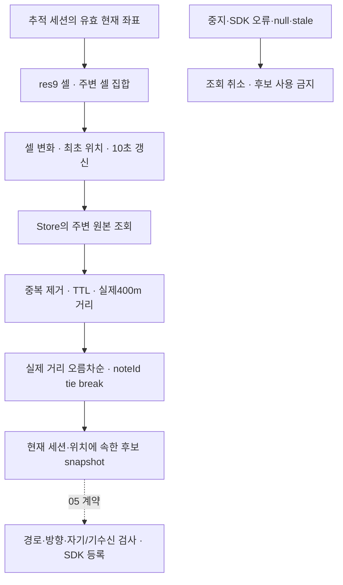

# 04. H3 인덱스와 주변 쪽지 후보 갱신

상태: **독립 스펙 리뷰 대기 / 코드·의존성 변경 금지**. 기준899fd88.03-c는 독립 코드 재검토에서 blocker0이며 기기 검증은 여전히 NOT_TESTED다.
정본: [시스템 설계](../../plans/implementation-plan.md), [전체 단계](00-overview.md), [03 저장](03-save-road-note.md), [조사 교훈](lessons-learned.md).

## 1. 만들 결과와 단계 경계

유효한 현재 좌표에서 H3 res9 주변 셀을 계산해 Room 원본을 조회하고, 실제 거리400m 이하·미만료인 후보를 가까운 순으로 제공한다. 현재 셀 변화와 약10초 갱신으로 정지 중 새 원본도 반영한다. 기존45초 메모리 버퍼·30초 anchor·5초 신선도·고정TTL600초·noteId PK 단순 생성·동일ID거절·자동재시도없음·수락 저장 수명은 유지한다.

04 출력은 **공간 후보**이지 수신 대상 확정이 아니다.05가 경로/진행방향/전방/작성자/기수신과150m 조건을 검증하고 proximity를 등록한다.04에서는 SDK proximity·ENTER/EXIT·수신이력·표시ACK·16개 등록 제한·B 전환·웹콘솔·새 지도/UI·Gleo·서버를 구현하지 않는다. 실제 도로 식별이나 H3만으로 같은 도로/방향임을 보장하지 않는다.

현재03에는 좌표/offset/UTC만 있고 routeId·direction·progress·accuracy가 없다.04에서 계산 가능한 **H3 인덱스만** 저장 확장하고 경로/방향/품질 필드는05에서 입력 근거·migration을 별도 합의한다. 현재 좌표만 보고 쪽지 작성 당시 방향을 만들어 저장하지 않는다. 이 단계 구분은 독립 리뷰에서 먼저 확인한다.

## 2. 조회 계약과 상태 소유

- Store에 셀집합/조회UTC로 원본 목록을 얻는 좁은 suspend 조회 계약을 추가한다. Entity/DAO/H3Core는 서비스/ViewModel에 노출하지 않는다. 공통 BaseRepository/네트워크 인터페이스/캐시 프레임워크는 없다. 기존 create/findById 계약을 보존한다.
- 후보 갱신 작업은 추적 서비스 수명에 속한다. 같은 목록을 화면/ViewModel/서비스에서 각각 수집하지 않는다.04는 불필요한 화면을 추가하지 않고 이후05가 읽을 상태만 제공한다.
- 상태는 WaitingForLocation / Loading / Ready(snapshot) / Failed(reason)처럼 사용 가능 여부가 하나로 드러나게 한다. snapshot은 조회세션·셀집합·사용한좌표·원본목록·조회UTC/수신단조시각을 포함하는 불변 결과다. 구체 타입은 구현 리뷰에서 최소화한다.
- 실패는 성공한 빈 후보와 다르다. 실패/위치 없음에서 이전 셀의 Ready를 유지하지 않는다. 마지막 성공 결과를 보관하더라도 사용 가능 후보로 노출하지 않는다. 실패 원인은 H3_UNAVAILABLE / INDEX_ERROR / STORAGE_ERROR 수준으로 분리하고 debug에 작업명·예외타입만 기록한다.

## 3. 셀 범위와 경계 누락 방지

H3는 res9로 고정한다. 셀 ID는 H3 표준 주소 문자열이며 외부/UI가 입력하지 않고 검증된 좌표에서 앱이 계산한다. 평균 셀 면적/평균 변 길이를400m 반경 보장이나 일정한 셀 지름으로 사용하지 않는다. gridDisk의 k도 미터가 아니다.

초기안은 ae11722의 서울 고정 시연 영역 최적화를 재사용한다: 현재 좌표를 중심으로400m 원을 포함하는 보수적 평면 사각형을 구성하고 `polygonToCells` 중심 포함 셀에 `gridDisk(cell,1)`을 더해 경계를 넓힌다. 현재 셀도 반드시 포함하고 중복 제거·정렬한다. 지원 영역은 합성 서울 시연 경로와 그 주변400m로 한정하고 계산의 지리적 전제를 코드/테스트에 명시한다. 이 근사를 전국/날짜변경선/극지/오각형 전역 보장으로 확대하지 않는다. 지원 영역 밖은 명시적 제외/위치 사용 불가이며 조용히 다른 알고리즘으로 대체하지 않는다.

이 방식의 경계 보장은 아직 검증되지 않았다. 구현 중 실제H3 JVM을 사용해 시연 영역의 셀 경계·꼭짓점 인근·400m 원 둘레·대각선·반경 안/밖 좌표의 cell 포함 여부를 확인한다. 구현자가 편한 몇 중심점만 검사하지 않고 경로 구간을 가로지르는 격자/경계 기반 fixture와 전체 좌표 거리 oracle을 대조한다. 누락이 나오면 cover를 보수적으로 확장해 수정하고 근거를 남긴다. 여분 후보는 허용하되400m 이내 유효 원본 누락은 허용하지 않는다. 단순 평균 변 길이로 k를 선택하는 대안은 채택하지 않는다.

이후 조회 결과는 위경도 기반 지표거리로 다시 필터한다. 거리는 검증된 좌표의 haversine 등 하나의 순수 함수로 계산하며 `distance <= 400m`을 포함한다. H3 결과 순서·셀 중심 거리·문자열 순서는 실제 근접 순서가 아니다.400m는 프로젝트 후보 정책이며 SDK 반경150m와 분리한다. 구면/평면 도로 고도 차이는 지원하지 않는다.

## 4. 갱신 시점·동시성과 만료

- 첫 유효 위치와 셀 변경에 즉시 조회한다. 같은 셀에서도10초 간격으로 재조회해 정차 중 새 쪽지를 반영한다. 기간은 TimeUnit.SECONDS.toMillis(10)로 선언하고 경과 판단은 단조시계다. OS/백그라운드 스케줄러가 정확히10초를 보장한다고 주장하지 않는다.
- 위치 콜백은 모두 기존 버퍼로 전달한다. 후보 조회만 최신 위치로 합치며 기록 이벤트를 conflate하지 않는다. 단일 순차 조회 작업을 두고 셀 변경 시 이전 요청을 취소/세대 무효화한다. 취소된 SQLite 호출이 즉시 끝난다고 가정하지 않고 결과 적용 직전 현재 세션·조회 키를 확인한다. 동시에 여러 폴링 루프를 만들지 않는다.
- 같은 셀 안에서 이동하면 DB 재조회 전에도 보유 원본과 최신 위치로 거리·순서를 재계산한다. cover가 현재 중심에서 달라지면 셀 같음만으로 이전 cover를 신뢰하지 않고 cover 키 변경도 조회를 깨운다. 따라서 셀 내부400m 경계 이동으로 누락을 만들지 않는다.
- 같은 앱의 원본 커밋 성공은 현재 조회 무효화/즉시 갱신 신호가 될 수 있다. 하지만 이 신호가 없어도10초 갱신은 있어야 한다. 첫 구현은 단일 타이머+셀/cover 변경으로 충분하며 Flow/타이머를 중복 도입하지 않는다. 최악 갱신 지연은 DB 처리·스케줄링을 더한 값이다.
- TTL 판정에는 매 조회/재평가 시 UTC를 새로 읽고 `nowUtc < expiresAt`만 활성이다. 같은 셀·좌표라도 만료된 원본은 사용 가능 snapshot에서 제거한다. 다음 타이머까지 최대10초간 지나간TTL을 유효 후보로 사용하는 것은 금지하며, 가장 가까운 만료까지의 취소 가능한 wake-up 또는 소비 시 유효성 재판정으로 보장한다.05도 등록/수신 직전에 독립 재검사해야 한다.
- 새 좌표의 신선도는 수신단조시각 기준5초 이내다. 콜백이 없어도 stale 시점에는 WaitingForLocation으로 전환하고 후보 사용을 막는다. 타이머/만료wake-up은 추적 세션이 소유하며 중지·재시작·null/잘못된 좌표·SDK 오류 뒤 이전 결과가 복구되지 않는다. SDK 수집/수락 저장 종료 정책을 후보 작업 취소와 혼동하지 않는다.

## 5. 가까운 순과 방향의 책임

04는400m 내 원본을 **실제 거리 오름차순→noteId**로 정렬하고 임의16개로 자르지 않는다. 앞/뒤·동/역방향 이동에서도 가까운 원본이 먼저이며 위경도나 progress의 단순 오름차순을 거리로 사용하지 않는다. 반대 방향·이미 지난 원본도04공간 후보에 남을 수 있음을 계약에 명시한다.

05에서 도로 문맥이 확정되면 같은 경로·방향을 검사하고 `aheadMeters=(noteProgress-currentProgress)*directionSign`으로 전방만 남긴 뒤 전방거리 오름차순으로 등록한다. ae11722의 역방향 먼 쪽지 우선 버그와 수정 교훈을 재사용하며 정/역방향·동거리 tie를 회귀로 둔다. 방향을 모르면 임의 FORWARD로 채우지 않는다.04가 후보에 넣었다는 사실은05 수신 허가가 아니다.

## 6. Room v2와 기존 원본

이미 새 원본을 저장할 수 있는03이 있으므로 이전의 ‘사용 DB 없음’ 승인을 재사용하지 않는다. v1 export를 보존하고 **v2 명시적 migration**으로 nullable `h3CellId TEXT`와 이 컬럼 조회 인덱스를 추가한다. 전체 원본·ID·좌표·내용·UTC는 보존하며 destructive migration/앱 시작 시 삭제/같은버전 덮어쓰기를 금지한다. 필드는 Entity 내부 파생 인덱스이며 현재 RoadNote/화면 입력9개 필드의 의미는 유지한다.

- 신규 create는 저장 경계에서 좌표 검증 후 H3를 계산해 INSERT에 함께 넣는다. 외부가 임의 H3를 지정하지 않는다. H3 계산/로딩 실패는 INSERT 전 명시적 실패이며 성공을 반환하지 않는다. 기존 저장 실패 결과와 debug 진단으로 구분 가능한 최소 연결만 검토한다.
- 기존 v1 행은 h3CellId=null로 남긴다. 후보 SQL은 `h3CellId IN(cells) OR h3CellId IS NULL`와 미만료 조건으로 가져오고, null 행은 조회 매핑에서 좌표→H3를 계산해 cover와 실제 거리로 필터한다. 후속 무조건 전체 backfill/변경 트랜잭션은 추가하지 않는다. legacy 수가 작다는 프로토타입 한계이며 서버/대용량 전환 때 backfill을 별도 설계한다.
- null legacy를 조용히 제외하지 않는다. invalid 좌표/손상된 행은 오류로 식별하고 Ready(empty)로 숨기지 않는다. 기존 findById는 만료/인덱스 여부와 관계없이 원본 조회를 유지한다.
- SQL 조회에 셀수/입력크기 상한을 둬 SQLite bind 제한을 넘기지 않게 한다. 고정 서울 cover의 최대 크기를 JVM fixture로 확인하고, 범위 초과는 후보 사용 불가로 기록한다. 잘못 잘라 일부 셀만 조회하지 않는다.
- routeId/direction/progress/accuracy, scenarioId, receipts 테이블은 이번에 추가하지 않는다. 필요해지는05/06 스펙에서 기존 행 처리까지 결정한다. 신규 인덱스 추가가 서버 API/공간 인덱스/인증을 구현했다는 의미는 아니다.

## 7. H3 Java/JNI 도입과 실패

참고 버전 com.uber:h3:4.5.1을 우선 후보로 삼되 이 문서 단계에서는 설치하지 않는다. 구현 직전 공식 배포물/API와 현재 Gradle/Kotlin/Java/ABI를 대조해 버전을 고정한다. H3Core 생성·latLngToCell·polygonToCells·gridDisk가 실제 선택 artifact에 존재하는지 확인한다. 생성/네이티브 로딩은 필요한 시점에 수행하고 지원되지 않으면 H3_UNAVAILABLE로 처리해 앱/기존 SDK 수집 전체를 시작 불가로 만들지 않는다. VM Error 전부를 삼키지 않고 네이티브 로딩의 예상 LinkageError/초기화 실패 경계만 다룬다. 좌표/내용은 오류 로그에 넣지 않는다.

과거4.5.1의 Android .so는 JAR 리소스에 있어 일반 dependency 선언만으로 APK의 lib/ABI에 들어가지 않았다. 선택 artifact를 정적으로 열어 Android ABI별 라이브러리·ELF 아키텍처를 확인하고, 필요한 .so만 generated jniLibs로 복사·APK merge에 연결한다. 예전의 android-arm64→arm64-v8a, android-arm→armeabi-v7a 매핑은 실제 artifact와 맞을 때만 재사용한다. Linux/macOS/Windows용 라이브러리를 Android JNI로 잘못 포장하거나 배포폴더 전체를 소스에 복사하지 않는다. 네이티브 생성 task는 debug/release 빌드와 입력/출력이 연결돼야 한다.

지원 ABI는 실제 .so가 있는 Android ABI만 선언한다. SDK/앱이 지원하던 ABI와 달라지는 점은 독립 구현 리뷰에서 확인한다. ABI 필터로 빌드만 통과시켜 설치 가능한 기기를 묵시적으로 줄이지 않는다. APK zip의 lib/<abi>/*.so 포함과 ELF/의존 라이브러리 정적 검사는 가능하지만 Android 동적 로딩·JNI 호출·16KB page size·에뮬레이터 기동 성공은 이번 실행 금지로 NOT_TESTED다. host JVM native 성공을 Android JNI PASS로 확대하지 않는다.

## 8. 검증과 단계별 종료 조건

| ID | 검증할 계약 | 허용 근거와 제한 |
|---|---|---|
| H01 | 실제H3 res9 인코딩/유효셀·왕복, 입력 거절 | host JVM native/공식 artifact; Android JNI NOT_TESTED |
| H02 | 경계·꼭짓점·대각선·400m 안/동일/밖 누락/오검출 | 서울fixture H3cover vs 전체좌표 거리oracle JVM. 영역/표본한계 기록 |
| H03 | 정지·같은셀 새원본·셀/cover 변경·단일10초루프 | FakeStore/test scheduler, 정확한OS타이밍은NOT_TESTED |
| H04 | A세션느린조회→B세션·중지·null·stale·오류 | 결과적용직전세션키/JVM, 이전결과재진입없음 |
| H05 | TTL직전/동일/후·새좌표없음·조회실패 | 가짜UTC/단조시계·wake-up/소비검사, Failed와Ready(empty)구분 |
| H06 | 거리정렬·정/역이동·tie·중복셀 | 거리oracle/순수JVM; 방향수신조건은05범위 |
| H07 | v1→v2 보존·legacy null 조회·신규H3검증 | migration SQL/export 정적·계측코드작성/compile; 실제Room/migration NOT_TESTED |
| H08 | debug/release Android .so 패키징·ELF/ABI | assemble+zip/ELF정적; AndroidJNI·page size실로드 NOT_TESTED |
| H09 | 실패/취소·legacy오류·셀상한·재시작 | FakeH3/Store·스케줄러, 기존36개회귀; 실제SDK/Binder NOT_TESTED |

스펙 독립 리뷰→리뷰이 판단→반영·재검토 전 코드/의존성 변경 금지다. 이후04-a H3 경계/패키징,04-b v2 저장/조회,04-c 세션 후보 갱신 순으로 작은 구현·독립 리뷰를 진행한다. 같은 범위 내 회귀가 실패하면 수정 후 영향 검사만 재실행한다.04의 완성은 허용된 코드/검사와 런타임 미검증을 구분한 보고이며05수신/06시연 완료가 아니다.

## 9. 독립 리뷰 쟁점

1. 보수적 사각형 중심cover+이웃링의 서울 경계 보장을 어떤 fixture/oracle 범위로 승인할지. 부족하면 더 보수적인 cover로 수정하고 단순평균셀크기 보장은 금지한다.
2.04는 H3만 영속화하고 경로/방향 메타데이터는05로 미루는 범위가 정본 단계별 계약과 맞는지. 실제 방향 추정 근거 없는 기본값은 없다.
3. nullable 기존행을 보존·조회시인덱싱하는 최소 migration과 신규 저장의 H3실패 정책. 향후크기증가시 backfill이 필요하다는 한계를 허용할지.
4. 정본의 과거 ‘주기폴링 도입하지 않음’ 설명은 overview/참고구현의 ‘H3+10초’ 최신 논의와 상충한다. 본 스펙은 최신04논의안을 제안하며 채택 후 정본 부모브랜치에 별도 동기화해야 한다. 이번 스펙만으로 공통 정본을 몰래 바꾸지 않는다.

앱/설치/Studio/adb/기기/에뮬레이터/시뮬레이터/GPS주입/계측 실행은 금지다. 문서 작성 단계의 새코드/JNI/Room/성능 PASS는 없다. 스펙 게시 후 조정자의 독립 리뷰를 기다린다.
