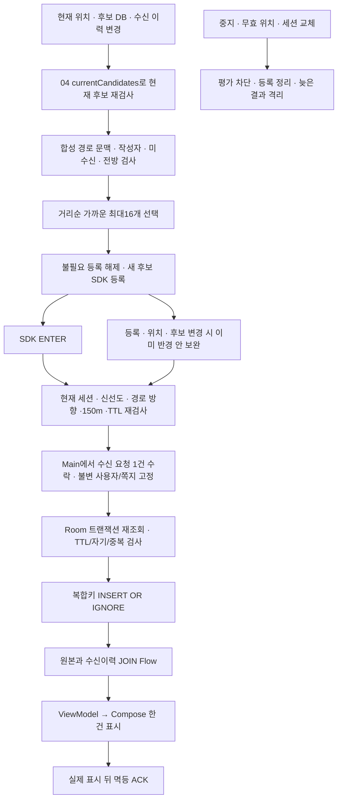

# 05. 접근 감지와 사용자별 쪽지 수신

상태: **독립 스펙 리뷰 요청 / 구현 전**. 기준 코드 `21783e9`. 04 수정의 독립 재검토 PASS·P2 resolve는 사용자 전달 결과이며 실제 기기 검증 완료를 뜻하지 않는다.

정본은 [전체 시스템 설계](../../plans/implementation-plan.md)(원격 `spec-road-note-system`의 `2ef41ce`와 대조), 단계는 [00](00-overview.md), 선행 계약은 [03](03-save-road-note.md)·[04](04-nearby-candidates.md), 과거 조사 근거는 [ae11722 교훈](lessons-learned.md)이다. 이 문서는 단계별 제안이다. §10의 정본 충돌을 확정·부모 브랜치 반영하기 전 구현하지 않는다.

## 1. 결과와 범위

합성 경로의 타인 쪽지에 접근하면 SDK ENTER 또는 이미 반경 안 보완 평가로 수신 조건을 확인한다. Room에 사용자별 이력을 한 행 저장하고 수신함에 표시한 뒤 ACK한다. 주행·정차 모두 허용하며 속도/기어를 수신 조건으로 삼지 않는다.

포함: 합성 경로 문맥, 원본 메타데이터 확장, 가까운16개 proximity 등록/해제, 앱 조건 재검사, 수신 트랜잭션·JOIN·표시 ACK, 최소 수신 표시 계약. 제외: 06 역할 전환 UI/전체 디버그 패널/GPS 주입/웹콘솔 어댑터/시나리오 초기화, Gleo/TTS, 서버, 지도 매칭, 실제 도로 품질 보장, 프로세스 사망 뒤 자동 추적 복구. 새 라이브러리·일반 이벤트 버스·Domain/UseCase 계층은 요구하지 않는다.

## 2. SDK 근거와 어댑터 수명

확인일 2026-11-12. 설치된 `ai.pleos.playground:FusedLocation:1.1.3` sources.jar의 FusedLocation/ProximityAlertRequest/ProximityAlertListener/ProximityAlertEvent/LocationServiceManager 원문을 읽었다. 버전 고정 소스의 계약과 웹 가이드·과거 기기 관측을 구분한다.

| 확인한 실제 API | 이번 사용 계약 |
|---|---|
| `isSupported(): Boolean`, `initialize()`, `release()` | 지원 확인 → 초기화 → 위치/접근 등록 → 접근 해제 → 동일 위치 리스너 해제 → release. release 뒤 재사용하지 않고 새 인스턴스 |
| `addProximityAlert(request, listener): Unit` | 반환은 등록 완료가 아님. `onRegistered(alertId: String)`에서만 등록 완료 기록 |
| `ProximityAlertRequest(latitude: Double, longitude: Double, radiusMeters: Float, transitionTypes: Set<ProximityTransition>)` | 쪽지 좌표, `150f`, ENTER 요청. 좌표 유한/범위, 양수 유한 반경, 비어 있지 않은 전이 집합 검증 |
| `ProximityAlertListener.onTransition(event)`, `onError(exception)` | event는 alertId와 ENTER/EXIT만 제공. 이벤트 좌표/시각/방향/정확도 없음. 현재 앱 위치로 다시 검사 |
| `removeProximityAlert(alertId): Unit` | onRegistered의 ID로 제거. 서버 제거 완료 ACK는 없음. 미지/이미 제거 ID는 권한 확인 뒤 무시하는 소스 계약 |
| `LocationData` | latitude/longitude/altitude/heading/confidence/timestampMillis. 미터 accuracy 없음. confidence의 단위/heading 신뢰도를 추정하지 않음 |

등록/해제 모두 `pleos.car.permission.FUSED_LOCATION` dangerous 권한이 필요하고 SecurityException이 가능하다. 기존 권한 흐름을 사용하며 ACCESS_FINE_LOCATION/Google geofence 권한을 새로 요구하지 않는다. 웹 권한 표에는 위치 API만 열거되지만 1.1.3의 add/remove 양쪽 @RequiresPermission과 권한 검사도 확인했다.

기존 PleosLocationSource가 추적 세션의 SDK 인스턴스를 소유한다. 같은 인스턴스에 좁은 접근 등록/해제 계약만 추가하는 방향을 우선한다. 서비스를 위한 두 번째 SDK 연결이나 화면 소유 SDK는 만들지 않는다. 초기화 직후 등록하는 기존 순서·SDK 미지원 false/초기화 예외·null 무효화·finally release를 보존한다. 접근 기능만 실패하면 쪽지 수신 상태를 실패로 알리고 위치 수집/이미 수락된03 저장을 임의 중단하지 않는다. 위치 SDK 자체 오류는 기존 중지 정책을 따른다.

공식 원문: [초기화/해제](https://document.pleos.ai/docs/pleos-only/connect-sdk-pleos/FusedLocation/initialization-and-release), [권한](https://document.pleos.ai/docs/pleos-only/connect-sdk-pleos/FusedLocation/declaring-permissions), [위치 콜백](https://document.pleos.ai/docs/pleos-only/connect-sdk-pleos/FusedLocation/location-data-access), [오류 처리](https://document.pleos.ai/docs/pleos-only/connect-sdk-pleos/FusedLocation/error-handling). 웹 가이드는 proximity 상세를 설명하지 않으므로 실제 심볼은 위 배포물 소스로 보완했다. ae11722의 ENTER/EXIT 관측은 이번 코드 PASS가 아니다.

## 3. 합성 경로·방향의 입력 근거

현재 LocationFix/버퍼에는 좌표와 SDK 콜백 진입 단조시각만 있다. heading/accuracy를 복원하거나 임의 기본값으로 저장하지 않는다. 최소 프로토타입은 **고정 합성 경로 설정**을 입력으로 받는다. 이는 차량 실제 진행 방향 측정이 아니다. 06이 GPS 재생과 동일한 경로 설정을 공급하고 방향 변경은 새 세션으로 처리한다. 외부 GPS라도 이 설정이 없으면 수신 불가다.

리뷰 제안 fixture: R1은 위도37.5000, 경도127.0200~127.0500인 동서 직선. 동쪽이 증가하는 progress를 갖는다. R2 평행 경로/역방향은 부정 fixture이며 실제 도로 ID가 아니다. P0=(37.5000,127.0200), R=6,371,000m에서 `x=R*cos(lat0)*(lon-lon0)`, `y=R*(lat-lat0)`(각도 rad), progress=x. 선분 양 끝 범위와 수직 거리 `abs(y)<=20m`를 모두 만족해야 투영 성공이다. 20m는 **경로 허용 띠**로 제안하며 GPS accuracy가 아니다. 후보 반경은 기존 haversine 함수를 그대로 사용한다. 교차/다중 경로에 모호하게 매칭되면 거절한다. 일반 경로 엔진은 만들지 않는다.

- 신뢰된 앱 내부 합성 세션 설정: actorId(현재 A, 수신자 B), routeId, direction(+1 동쪽/-1 서쪽), 추적 session. SDK/Gleo/화면 발화에서 임의 입력받지 않는다. 05는 테스트/Fake에서 이 설정을 주입하고 실앱 기본은 기존 A/R1/+1로 고정하는 안이다. B UI는06에서 제공한다. B 동작의 실제 앱 E2E는 그 전까지 미완료다.
- 원본 경로 문맥: **선택된 과거 anchor 좌표**를 세션의 합성 경로에 투영한다. 현재 좌표의 progress를 복사하지 않는다. direction은 수락 시 고정된 합성 세션 방향이며 SDK heading이 아니다. 설정이 과거 버퍼와 다를 수 없도록 경로/방향 변경 때 버퍼와 추적 세션을 재시작한다.
- 문맥을 못 정하면 원본 저장 자체를 막지 않는다.03 계약에 맞춰 원본은 저장하되 메타데이터를 모두 null로 두고05 수신에는 부적격이다. 저장 성공과 수신 가능 상태를 구분한다. 없는 방향을 만들어 기존 원본을 채우지 않는다.
- 전방 거리: `ahead=(note.progressMeters-current.progressMeters)*directionSign`. routeId·direction 일치가 먼저다. 역방향도 이 부호를 적용한다. 실제 거리 오름차순/noteId로 선택하고 전방은 수신 자격 검사에 사용한다.

## 4. 04 소비와 등록 집합

서비스 Main에서 `currentCandidates()`만 소비한다. raw Ready는 갱신 신호일 뿐 후보로 직접 사용하지 않는다. 결과 null은 사용 불가, 빈 목록은 정상 빈 결과다. 현재 session/위치 일치·5초 신선도·현재 UTC TTL·400m 재검사는04가 담당하며05는 별도로 수신 조건을 재검사한다. 위치·04 상태·현재 수신자 이력 변경이 등록과 보완 평가를 깨운다. 쪽지 생성/수신 뒤 Room Flow도 신호가 되므로 이동 없는 상태에서도 동작한다.10초 폴링 없음.

현재 합성 경로 문맥이 유효하고 메타데이터 완비, 동일 routeId/direction, ahead>=0, 타인 작성·미수신인 후보를 거리 오름차순→noteId로 정렬해 **최대16개** 등록 대상 집합으로 정한다.16은 앱 상한이며 SDK 최대 지원 수라는 뜻이 아니다. 초과 개수는 상태로 남기며 뒤 후보는 위치/후보 변경 때 재선정한다. 150m 밖이지만400m 이내인 전방 쪽지를 미리 등록한다. 같은 대상은 재등록하지 않는다.

각 등록은 쪽지/추적세션/소유 SDK 인스턴스와 결합한 개별 요청 객체로 식별한다. pending도16개 슬롯에 포함한다. 제거할 대상부터 무효화·해제를 요청하고 빈 슬롯에만 등록한다. 등록 호출 중 동기 예외, onError, 중복 onRegistered/ENTER도 처리한다. 요청별 객체는 비동기 SDK 요청을 식별하기 위한 최소 상태이며 범용 세대 매니저를 만들지 않는다.

등록 대기 중 대상이 사라지면 tombstone으로 무효화하고 늦은 onRegistered에서 **그 요청의 소유 SDK**에 ID를 제거한다. 다른 새 요청의 같은 noteId를 제거하면 안 된다. ID가 아직 없으면 제거할 수 없으므로 슬롯을 재사용하지 않고 대기 상태를 노출한다. onError 또는 늦은 ID 제거 처리까지 슬롯을 유지하며 무한 재시도/추가 등록으로 한도를 넘기지 않는다. 대기 영구 정체는 명시적 추적 재시작으로 해소한다. 세션 종료 시 release가 SDK 내부 pending/등록도 정리하는 소스 계약을 사용하고, release 후 늦은 콜백에서는 SDK 호출 없이 앱 반영을 차단한다.

remove는 원격 완료 ACK가 없어서 물리적 원격 동시16개를 보장한다고 하지 않는다. 앱의 유효 pending+등록16개가 상한이다. 동기 해제 예외는 진단 후 새 등록을 차단하고 재시작 필요 상태로 전환하며 다른 ID 해제·위치 리스너 해제·release는 계속 시도한다. 접근 오류를 보완 경로로 조용히 숨기지 않는다.

## 5. ENTER와 이미 반경 안 보완

같은 판정 함수를 SDK ENTER, 등록 성공, 유효 위치 갱신,04 후보 갱신, 수신이력 갱신에서 호출한다. SDK가 이미 안에 있는 등록의 ENTER를 보장한다고 가정하지 않는다. 보완은 현재 선택16개에만 적용하며 실제 SDK 등록이 성공한 대상에 한정한다. SDK 등록 실패를 가짜 SDK 성공으로 우회하지 않는다. EXIT는 수신 이력을 지우거나 재수신 가능 상태로 만들지 않는다.

수신 수락 직전 Main에서 중간 suspend 없이 다음을 전부 검사한다.

1. 요청 자체가 현재 유효 등록이고 추적세션·actor/경로 설정이 현재와 일치한다.04 소비 결과에 해당 noteId가 남아 있는지 다시 확인한다.
2. 현재 위치 존재, 콜백 단조시각이 미래가 아니며 **2초 이내**(정본§8.1의 수신 기준; 후보의5초와 구분). 원시 위치 콜백은 느릴 수 있으므로 수신 지연을 실패로 오인하지 않는다. 늦은 ENTER만으로 신선도를 갱신하지 않는다.
3. 현재와 원본 경로 문맥이 완비·동일 routeId/direction, `0<=ahead<=150m`, 실제 haversine 거리<=150m. 경계150 포함, 지나친 음수 제외. 정차는 유효 설정·신선한 위치가 있으면 허용한다.
4. 현재 UTC<expiresAt(동일 시각은 만료), 작성자!=수신자, 기존 수신 없음. TTL은03 생성+600초 그대로다.
5. 같은 사용자/쪽지의 진행 중 요청이 없으면 불변 입력을 고정하고 수신 쓰기 한 건을 수락한다. 등록은 해제 대상으로 돌려 중복 이벤트를 줄이되 최종 중복 보장은 DB가 담당한다.

정본의 accuracy<=20m는 SDK/현재 버퍼로 판정할 근거가 없으므로 구현 완료 조건으로 충족했다고 간주하지 않는다. §10 제안을 독립 리뷰에서 확정하기 전 이 조건을 삭제한 코드도 작성하지 않는다.

## 6. Room v3와 legacy 보존

v2부터 영속 DB가 있을 수 있다. v1/v2 수정이나 destructive fallback 없이 **2→3 명시 migration**, 신규 설치 v3 schema export를 추가할 계획이다. v1→2→3 경로도 검사한다. 실제 스키마/코드는 이번 문서 작업에서 만들지 않는다.

| 테이블/필드 | 제약·처리 |
|---|---|
| road_notes 기존 필드·h3CellId | 값/PK/TTL 보존. H3 nullable legacy 처리도04 유지 |
| road_notes.routeId TEXT?, direction INTEGER?, progressMeters REAL? | 모두 null 또는 전부 유효(+1/-1, 유한 progress, 알려진 fixture 투영과 일치). migration은 세 필드를 null로 추가. 기존 행 방향/경로를 추정해 backfill하지 않음 |
| note_receipts.noteId TEXT, recipientId TEXT | 복합 PK(noteId,recipientId), NOT NULL. noteId FK→road_notes.noteId ON DELETE CASCADE. PK 앞부분으로 FK 검색 지원 |
| receivedAtUtcMillis INTEGER, distanceMeters REAL | 수신 커밋 시각과 수락 평가 거리(유한0..150) 저장. 수락 평가 기준 UTC는 트랜잭션에서 만료 재검사; 실제 커밋 직후 시각 보장은 아님 |
| displayedAtUtcMillis INTEGER? | null=PENDING, 값 있음=DISPLAYED 파생. 별도 displayState 불필요. ACK 재호출로 최초 값을 덮어쓰지 않음 |
| 수신 인덱스 | (recipientId,displayedAtUtcMillis,receivedAtUtcMillis,noteId), 사용자별 pending/이력 정렬용 |

기존 v1/v2 원본은03 findById/보존을 유지하고04 공간 후보에도 남을 수 있으나 경로 메타데이터 부족으로05 등록/수신에서는 제외한다. 신규 잘못된 부분 메타데이터/NaN/좌표와 모순은 저장 경계에서 명시 오류로 처리한다. DB legacy 전체 null을 손상으로 취급하지 않는다. routeId/progress는 서버 전환 시에도 원본 저장/조회 계약의 부가 필드이며 사용자별 이력을 원본에 합치지 않는다.

scenarioId/시나리오 인덱스/리셋은06 소유다.05는 단일 합성 데이터셋으로 동작하고 자동 삭제·기존 행 시나리오 부여 없음.06은 이 원본/이력 구조를 보존하는3→다음 버전 계획과 이력의 시나리오 JOIN 범위를 별도 리뷰해야 한다.

### 수신 트랜잭션

저장 경계는 noteId/recipientId·고정 경로/방향/평가 위치·거리의 입력을 검증한다. 트랜잭션 안에서 원본을 다시 읽고 현재 UTC의 TTL·타인 작성·메타데이터 일치·전방/거리·기수신을 확인한 뒤 INSERT OR IGNORE한다. 원본을 이벤트가 가진 오래된 객체만으로 신뢰하지 않는다. insert 행 ID가 -1이면 AlreadyReceived, 새 행이면 Received, 없거나 만료/조건 불일치면 Ineligible, DB 예외면 StorageFailure로 구분한다. IGNORE를 모든 DB 오류를 숨기는 성공으로 사용하지 않는다. FK/조회와 insert는 같은 Room 트랜잭션에 둔다.

Main 수락 시점이 위치/세션 자격의 선형화 시점이다. DB 대기 중 지나가거나 역할이 바뀌었다고 수락한 쓰기를 다른 사용자로 바꾸지 않는다. TTL은 DB에서 다시 검사하므로 대기 중 만료되면 수신하지 않는다. 이미 수락한 쓰기는03처럼 서비스 소유로 최종결과까지 처리하고 신규 수신은 중지한다. 새 수신자가 된 뒤 이전 작업 결과로 현재 UI/등록/오류 상태를 덮어쓰지 않는다. ACK 쓰기도 수락했다면 같은 수명 원칙을 따른다. 서비스 종료 판단은 제보 저장뿐 아니라 수락한 수신/ACK 쓰기까지 idle인지 확인한다. 무한 재시도·프로세스 종료 후 쓰기 보장은 없다.

## 7. 수신함 JOIN과 ACK

수신 저장/조회는 로컬 사용자 이력 책임으로 분리하되 필요한 작은 Store/Repository만 둔다. 원본 저장·주변 조회의 향후 서버 경계와 receipts 로컬 경계를 혼동하지 않는다. 현재 ViewModel → 서비스 세션/저장 경계 구조를 유지하고 Compose가 DAO/SDK를 호출하지 않는다.

`note_receipts INNER JOIN road_notes ON noteId` 한 observable query로 원본+recipientId+receivedAt+distance+displayedAt를 읽는다. 조회 후 noteId별 N+1 findById 금지. recipientId로 한정하고 receivedAt 오름차순→noteId로 결정적 정렬한다. 수신 여부는 TTL과 무관한 이력이며 원본이 만료되어도 기록/ACK를 자동 삭제하지 않는다. 이미 수신했지만 표시 전 만료된 PENDING은 과거 수신임을 드러내는 표시로 처리하며 새 위험 경고처럼 표현하지 않는다. 원본 실제 삭제 시 FK CASCADE. 자동 만료 청소/삭제 UI는05에서 추가하지 않는다.

핵심 화면은 현재 수신자 PENDING의 맨 앞 한 건만 표시한다. Compose가 실제 composition 적용 후 해당 항목 키로 ViewModel에 ACK 이벤트를 보내고, 저장 경계는 `(noteId,recipientId)`가 존재하고 displayedAt IS NULL일 때만 갱신한다. 화면의 단순 상태 조회/재구성 시작을 ACK로 간주하지 않는다. displayedAt은 수신 시각보다 작지 않게 기록하고 실패하면 PENDING 유지·명시 오류, 자동 재시도하지 않는다. 화면 재진입/사용자 명시 재시도로 다시 ACK할 수 있다.

화면이 없으면 저장된 PENDING 유지. 실제 표시~DB ACK 사이 프로세스 종료 시 다시 표시될 수 있다. **수신 DB 행은 최대1회, 화면 표시는 정확히1회 보장 아님**. 프로세스 복귀 시 수신함은 조회 가능하나 추적 자동 재시작은 없다. 가청 알림/TTS/차량 팝업은 도입하지 않는다.

## 8. 취소·지연 콜백·실패 상태

모든 SDK 콜백은 수신 직후 서비스 Main으로 전달하고 **실제 처리 직전** 등록 요청 객체·소유 SDK·추적세션·수신자 설정이 현재인지 검사한다. 같은 noteId/같은 추적세션을 재사용했어도 취소된 등록/관찰은 되살아나지 않아야 한다.04의 `21783e9`처럼 관찰 coroutine 자신의 context.ensureActive와 기존 업무 키 검사를 유지한다. 서비스 scope나 이미 교체된 B Job을 검사해 이전 A를 통과시키지 않는다. CancellationException을 SDK/DB 오류로 바꾸지 않는다.

null/stale/지원영역 밖/04 Failed/수신 문맥 없음에서는 신규 평가를 차단하고 유효 등록을 정리한다. stale은04의5초 기한을 활용한다. 수신2초 초과 시 이벤트마다 거절하며 별도2초 wake-up은 필수로 만들지 않는다. 기존 수신함은 지우지 않는다. SDK 미지원/권한/등록/해제/저장/ACK 오류는 성공 빈 목록과 구분하고 원문 좌표·내용 없이 작업명·예외타입만 debug 진단한다.

수신 상태는 추적 대기/관찰 중(선택·pending·등록·초과 수)/실패 원인과 수신함을 분리한다. 상태를 여러 소유자에서 복사 저장하지 않는다. 중지/세션 교체는 새 평가·미수락 작업을 취소하지만03 및 이미 수락한05 쓰기는 고정된 원래 사용자로 끝낸다. 늦은 작업의 UI 결과만 격리한다. 등록 해제 오류가 나도 전체 정리·release 시도는 생략하지 않는다.

## 9. 작은 구현 순서와 수용 기준

독립 스펙 리뷰→리뷰이 판단→문서 반영/정본 충돌 해소→재검토 후에만 구현한다.

1. 합성 경로 투영/방향 계약과 원본 nullable 메타데이터, v3 migration. 기존03 단발 저장·수락 수명 회귀.
2. receipts 트랜잭션·복합키·JOIN·ACK, Fake/JVM과 Room 계측 **작성·컴파일만**.
3. SDK 동일 인스턴스 접근 계약·등록16개·취소/해제·지연 콜백 Fake. 기존 SDK 수명 보존.
4. 서비스에서04 소비→수신 평가 연결·쓰기 수명 통합, ViewModel/Compose 최소 수신 한 건+ACK.06 패널 없이 B는 Fake 검증.
5. 전체 허용 검사·독립 코드 리뷰. 실제 기기 수용 기준은 NOT_TESTED로 별도 남긴다.

| ID | 관찰 가능한 수용 기준·검증 방식 |
|---|---|
| P01 | 400m 후보 중 조건을 만족하는 가까운16개, 동률 noteId·17개 초과·유지 대상 재등록 없음·pending 포함 상한. Fake SDK/JVM |
| P02 | 150m/전방150 포함,150.01/음수 제외, 역방향 부호·다른 route/방향·경로 띠 밖·모호/문맥 없는 위치 제외. 양방향 fixture/JVM |
| P03 | ENTER·등록 시 이미 안·정차 중 새 쪽지·위치 갱신이 같은 평가 사용. 등록 실패에서는 보완 성공 금지. Fake SDK/JVM |
| P04 | TTL 동일시각·DB 대기 중 만료·자기 제보·기수신·동일 이벤트 중복 거절. 유효 빈 후보와 실패 분리. JVM + Room 계측 작성/컴파일 |
| P05 | null/stale/다른 세션/동일키 새 등록 후 이전 onRegistered·ENTER·onError·해제 결과가 새 상태를 훼손하지 않음. 자신의 Job 취소 검사·CE 전파. Fake/JVM |
| P06 | v2 데이터 보존/null 메타데이터 제외·신규 메타데이터 검증·v1→2→3 경로. 실제 Room migration 실행은 금지로 NOT_TESTED |
| P07 | 같은 사용자/쪽지 동시 수신1행, 다른 사용자 각1행, 원본 유지·FK cascade·단일 JOIN·pending 순서·ACK 멱등/실패/재생성. 실제 Room 실행은 NOT_TESTED |
| P08 | 수락 후 중지/화면 해제/역할 교체 때 쓰기 완료·원래 사용자 유지·새 UI 격리, 마지막 쓰기 뒤 서비스 종료. JVM/Fake, 서비스 런타임 NOT_TESTED |
| P09 | 신선도2초 포함/2초 초과/미래 단조시각 거절,04 소비5초와 구분, raw Ready 우회 없음. JVM |
| P10 | 최소 수신 표시 후 ACK/표시 전 종료 pending 보존·표시 후 ACK 전 종료 중복 표시 한계. UI 실행 NOT_TESTED, ViewModel/Fake 가능 범위만 PASS |
| P11 | Debug/Release/계측APK 컴파일·lint·harness. 실제 SDK ENTER/해제·권한·JNI·기기/E2E는 현재 사용자 금지로 NOT_TESTED |

## 10. 독립 리뷰에서 확정할 쟁점과06 인계

**필수 정책 쟁점:** 정본§8.1의 accuracy<=20m는 SDK1.1.3에 미터 accuracy 필드가 없어 현재 충족 불가다. 제안은 합성 시연에 한해 accuracy 수치를 만들지 않고 §3의 경로 설정+20m 경로 띠를 적용하는 것이다. 이는 실제 위치 정확도 보장이 아니며 **정본 변경 제안**이다. 동일하게 가까운 순 정렬은 실제 거리→noteId, 전방 거리에는 역방향 부호를 명시하도록 정본을 보강해야 한다. 승인되면 spec-road-note-system에 별도 docs 커밋·푸시하고 기능 브랜치로 병합한다. 이 PR만의 문서로 정본을 덮어쓰지 않는다. 수신 신선도2초는 정본을 유지하는 안이며 SDK 콜백 공백에 따른 지연을 수용한다.

리뷰 요청: fixture 방향을 측정값과 구별한 입력 계약, legacy 제외의 호환성, 등록 대기 슬롯/late ID 정리·원격 해제 한계, 쓰기 수락 시점/수명, 만료된 pending의 과거 이력 표시·ACK를 검토해 달라. 미확정 사항을 이미 구현된 것처럼 표시하지 않는다.

06에 필요한 계약만 전달한다: actorId/routeId/direction 변경은 새 추적세션·버퍼·등록 격리, 원본/수신이력 유지; GPS 어댑터는 같은 fixture 설정을 사용하되 실제 위치 입력은 SDK 콜백을 거쳐야 함; B 시작은 anchor 기준600m 뒤(경로 여유 부족이면 설정 오류); pending/등록/초과/실패·수신함 상태 조회와 ACK 이벤트; scenario 도입 migration/legacy 소속·리셋 정책 별도 리뷰. 여기서 UI 역할 버튼·GPS 주입·콘솔 코드를 구현하지 않는다.
