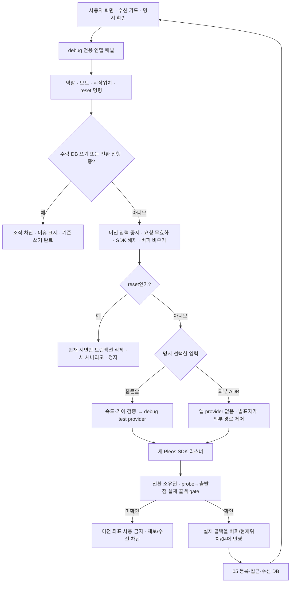

# 06. 디버그 시연 패널과 실제 SDK를 통과하는 가상 주행

상태: **06 리뷰이 수용 B1/P1/P2 반영 / 독립 재검토 대기 / 구현 전**. 코드 기준 `fdd9bbf`, 부모 정본 `2ca00c0`(별도 커밋·푸시 후 기능 병합).05 독립 재검토 PASS·기존 P2 두 스레드 해결·리뷰어 직접12 JVM PASS(원 ACK 반례 포함)는 사용자 전달 결과다. 실제 기기 검증은 NOT_TESTED로 유지한다.

읽기: [00 전체 계획](00-overview.md), [정본](../../plans/implementation-plan.md), [05 계약](05-proximity-and-receipts.md), [고정 조사 근거](lessons-learned.md). 기존 로컬 `docs/work/pleos-road-notes-wireframes.md`는 미추적 사용자 기획으로 읽되 수정/커밋하지 않는다. 이 문서는 필요한 내용을 자체 서술하므로 미게시 와이어프레임 링크를 필수로 삼지 않는다. §12 정책을 리뷰이 판단대로 부모에 동기화했으며 독립 재검토 전에는 구현하지 않는다.

## 1. 결과와 단계 경계

한 debug 앱·한 에뮬레이터·한 Room에서 A가 쪽지를 심고 B가 600m 뒤에서 접근해 한 번 수신한다. 발표자는 제품 화면과 분리된 인앱 패널로 역할·출발점·입력 모드·시연 데이터만 조작한다. 가속/감속/일시정지의 원천은 Pleos 웹콘솔이며 패널에 별도 가속 페달이나 주행 재생기를 만들지 않는다.

포함: 작은 debug 오버레이, A/B 및 시작 위치, 시연 reset, 시나리오 소속/보존·migration, 웹콘솔→mock GPS→실제 SDK, 명시 외부 ADB 모드, 전환 캐시 gate, 합성 진행축, 가시 상태 화면 유지. 제외: Gleo/TTS·서버·지도 SDK·실차 대응·새 디자인 시스템·OS 전역 오버레이·가짜 위치를 제품 데이터로 직접 주입·프로세스 사망 뒤 자동 주행 복구·07 실제 시연 실행/완료 판정.

현재03 단발 저장/TTL600초/수락쓰기 수명,04 `currentCandidates()`/400m·5초,05 등록16/150m·2초/합성 자격/명시 ACK/Failed 세션 유지,`fdd9bbf`의 저장전용 dataSync와 ACK 관찰 소유 토큰은 유지한다.

## 2. 제품 UI와 패널의 분리

제품 영역은 기존 수집/권한/저장 결과·수신 한 건과 **명시 확인 ACK**를 유지한다. A/B·시나리오 ID·mock 권한·좌표/거리/버퍼·입력 경로·행 수는 debug 영역만 표시한다. 제품의 저장 성공/수신 카드는 패널을 닫아도 유지한다. 오래된 제보 결과를 새 역할의 결과로 옮기지 않는다.

패널은 앱 window 안 오른쪽에서 겹쳐 열리는 작은 Compose 영역으로 제안한다. 전체/분할/좁은 창에서는 같은 기본 조작을 세로 배치하고 상세 진단만 접는다. 닫기를 항상 찾을 수 있게 하며 패널 내부만 필요 시 스크롤한다. 패널이 열린 동안 가려진 제품 버튼은 터치를 받지 않게 한다. 자동 스크롤·자동 ACK·수신 팝업·TTS는 없다. 여닫기/상세 접기는 추적·GPS 입력·DB에 영향을 주지 않는다. 설정이 금지돼도 읽기 전용 진단 진입과 닫기/중지는 유지하며 설정 컨트롤만 비활성·이유 표시한다.

진입은 debug 빌드에만 작은 ‘시연 도구’ 버튼을 두는 안이다. 와이어프레임의 제목 길게 누르기는 필수가 아니며 숨은 제스처보다 명시 진입을 제안한다. 제품 레이아웃 전면 개편은 하지 않는다. 실제 구동에는 기존 Material 테마/버튼을 재사용할 계획이며 Figma 변수·정식 아이콘·크기/간격/대비를 확인했다고 주장하지 않는다. 기존 Figma 접근 불가 상태를 그대로 기록한다. 디자인 시스템 준수/주행 적합/실물 가독성 판정은 미검증이다.

현재 Manifest에는 DO 선언이 없으며 이번06에서 새 선언하지 않는다. 기본 제품/패널 구조를 유지하되 실제 `CarUxRestrictions` 신호에 따른 기능별 제한을 적용한다. 같은 UI/정차/속도0/P를 허가로 간주하지 않으며 시스템의 앱 표시 제약을 우회하지 않는다. 규제 미연결/조회 오류는 **시연 설정 불가**·이유 표시이며 전체 앱이나 recipient 수신함 조회를 일괄 잠그는 정책은 아니다.05의 전체 이력·명시 ACK와 수락 쓰기를 보존한다.

### 2.1 요구사항·기능별 규제 매핑

공식 [Pleos 규제 가이드](https://document.pleos.ai/docs/pleos-only/vehicle-app-developer-guide/driving-restriction-development-guide)의 실제 신호 적용 의무와 [CarUxRestrictions](https://developer.android.com/reference/android/car/drivingstate/CarUxRestrictions)의 플래그/상한을 근거로 한다. 아래 버튼 분류·보수적 표시 대응은 프로젝트 매핑이다. DO가 필요한 상태의 실제 ActiveRestrictions를 반영하며 유효한 baseline과 미연결/오류를 구분한다. 새 일반 규제 엔진을 만들지 않고 이 화면의 기능에만 적용한다. **표 전체는 문서 매핑이며 실행 검증이 아니다.**

| ID / 근거 | 대상과 적용 | 확인할 조건 |
|---|---|---|
| UX01 · Pleos 연동/변경 콜백 | 현재 값 조회·리스너 변경을 Main에 반영. requiresDistractionOptimization/ActiveRestrictions/플랫폼 상한과 연결 상태를 함께 보관. 해제 대칭 | 첫 연결 전/끊김/조회 오류를 허용 baseline으로 꾸미지 않음. 실제 API/연결은 구현 시 확인 |
| UX02 · NO_SETUP | 역할·모드·출발점/reset/입력 시작을 시연 설정으로 분류. 진입 UI와 Main 명령 수락 직전에 차단 | NO_SETUP 또는 미연결/오류에서는 설정0회·이유 표시. 이미 Ready인 SDK 수집을 단순 설정 금지 신호만으로 자동 초기화하지 않음 |
| UX03 · LIMIT_STRING_LENGTH | 제품 본문·상태·패널 문자열에 `getMaxRestrictedStringLength()` 상한 적용. 표시만 축약/보류 | DB 원문 불변·숨긴 항목 자동 ACK0회. 축약으로 의미 손실이 우려되면 일반 안내로 보류, 임의 숫자 상한 없음 |
| UX04 · LIMIT_CONTENT | 제품 한 건 큐와 패널 탐색에 `getMaxContentDepth()`/`getMaxCumulativeContentItems()` 적용 | 한 작업의 탐색/항목 상한을 넘기지 않음. 패널 재개폐로 상한을 초기화해 우회하지 않음. 다음 항목 표시 보류 시 DB 큐/ACK 불변 |
| UX05 · NO_KEYBOARD/NO_FILTERING/NO_DIALPAD | 자유 텍스트 입력·문자 검색·전화 기능은 이번 범위에 없음 | 해당 조작 없음 정적 확인. 설정은 고정 버튼/프리셋이며 향후 입력 추가 시 재매핑 |
| UX06 · NO_VIDEO | 동영상/애니메이션 없음. 제한 시 debug 진행축은 숨기는 보수적 표시안 | 실제 SDK/버퍼 처리까지 멈추거나 표본을 버리지 않음. 닫기/중지 유지 |
| UX07 · NO_TEXT_MESSAGE/NO_VOICE_TRANSCRIPTION | 타인 제보 본문은 보수적으로 텍스트 내용으로 분류해 NO_TEXT_MESSAGE에서 본문/그 항목 확인을 보류하고 일반 수신 상태만 표시. 음성 전사 UI는 없음 | 원본·recipient 전체 큐 보존, 보류 자체로 ACK하지 않음. 메시지 분류/실제 플랫폼 효과는 재검토·기기 확인 대상 |
| UX08 · 연결 오류/미확인 및 제한 변경 | 설정만 불허하고 제품 조회·기존 로컬 ACK 계약은 보존. 마지막 유효 제한을 연결 오류만으로 완화하지 않음 | 새 기능을 허가된 것으로 추정하지 않음. 금지된 미수락 전환을 취소·토큰 무효화·입력/SDK 정리, 수락 쓰기는 완료. 비동기 결과 적용/최종 gate 개방/reset DB 수락 직전도 재검사 |
| UX09 · 프로젝트 중단 가능성 | 중지·취소·패널 닫기는 설정 제한/미연결에서도 유지 | 제한 해제만으로 자동 전환/주행 재개 없음. 외부 ADB 재생기를 앱이 중지했다고 하지 않음 |

제품 큐의 존재/정렬·DB 확인 권한과 표시 가능한 콘텐츠는 구분한다. 알려진 콘텐츠 제한으로 본문을 보류해도 수신이력은 지우지 않는다. 미연결이라는 이유만으로 모든 제품 데이터와 로컬 확인을 잠그지 않는다. 실제 시스템이 Activity 자체를 표시하지 않으면 그 결정을 따른다. Figma/디자인 시스템·실주행 준수를 표 작성만으로 통과 판정하지 않는다.

## 3. 패널 조작과 활성 조건

| 조작 | 결과·제약 |
|---|---|
| 역할 A/B | 현재 시나리오의 가상 수신자/작성자 선택. 이전 입력/SDK 세션을 정리하고 역할·관찰 소유권 교체, 버퍼/등록 격리. 원본·이력 유지. 역할 선택만으로 SDK/GPS를 자동 시작하지 않고 정지·위치 미준비로 완료한다. 새 위치 확인 전에는 제보/신규 수신 금지. 수신함 조회는 선택한 역할 기준 |
| 시작 위치 설정 | 현재 역할의 출발점으로 새 비동기 위치 확인 절차. SDK 콜백 확인 전 ‘출발 위치 확인 중’. B는 대상 쪽지 기준 정확히600m 뒤. 외부 모드는 앱이 위치를 움직였다고 표시하지 않음 |
| GPS 입력 모드 | WEB_CONSOLE / EXTERNAL_ADB 중 하나. 기존 입력 종료·provider 정리가 확인된 뒤 교체. 두 소스를 동시에 수락하지 않음. 모드 선택 후에는 정지 상태이며 명시 시작/위치 설정으로만 재개. 실패 시 자동 전환 없음 |
| 구덩이 테스트 제보 | debug의 기존03 경로 사용, A와 gate 통과·신선한 anchor가 필요. 첫 표본부터 가능·30초 대기 제한 없음. 저장 결과와 실제 offset 표시. 입력은 고정 짧은 fixture, Gleo 코드 없음 |
| 새 시연 초기화 | 현재 시연의 원본·연결 이력 삭제와 새 시나리오 생성을 확인 문구로 고지. 두 번째 명시 확인 후만 실행. 성공하면 A/정지·빈 버퍼, GPS 모드는 선택값만 유지하고 자동 주행하지 않음 |
| 수집 시작/중지 | 기존 제품과 같은 서비스 명령. 시작은 현재 역할/모드/시나리오에서 출발점을 새로 결정하고 gate 수행(시작 위치 설정과 동일 경로). 이미 수집 중인 중복 시작은 무시. 중지는 언제든 허용하며 수락 쓰기는 끝냄. 외부 스크립트를 중지했다고 표시하지 않음 |

**시연 설정 명령만 UX02 허용을 먼저 검사한다. 중지·취소·닫기는 예외로 유지한다. 역할/시작 위치/모드/방향/reset은 수락된 제보·수신·ACK DB 쓰기가 하나라도 있으면 차단**한다. 버튼 비활성뿐 아니라 Main 명령 진입에서 다시 검사한다. 전환/초기화도 한 번에 하나이며 이중 클릭은 새 작업으로 큐잉하지 않는다. 차단 시 ‘저장 완료 후 변경할 수 있어요’처럼 이유를 표시한다. 자동 수신 수락과 경합하지 않도록 idle 검사→전환 소유권 설정→신규 제보/수신/ACK 수락 차단을 같은 Main 진입에서 suspend 없이 수행한다.

일반 ‘중지’는 이 잠금과 다르게 항상 가능하다. SDK·입력·신규 제보/수신은 정지하되03/05에서 수락한 쓰기를 취소하지 않고 서비스가 끝낸다. 마지막 쓰기 뒤 foreground/started 종료 판단을 유지한다. 위치 수집은location, 중지 후 로컬 저장은dataSync이며 새 ACK는 승격 성공 후 수락한다. 수신 실패 세션은 null 복구·패널 개폐·DB 이벤트로 복구하지 않고 명시 stop→새 start에서만 재허용한다.

## 4. 경로·대상 선택·B 600m 출발

05의 R1/P0=(37.5000,127.0200), 경도 끝127.0500·20m 경로 띠·동쪽 증가 progress를 그대로 사용한다. 미터→경도는05 투영식의 역함수이며 위경도 degree를 미터로 표시하지 않는다. direction은 합성 설정이고 SDK heading/accuracy가 아니다.

B 대상은 활성 시나리오의 **최근 성공 저장·미만료·A 작성·유효 R1 문맥·현재 합성 방향(+1) 일치** 원본을 createdAt 내림차순→noteId 순으로 한 건 결정한다. 후보400m 조회에서 고르지 않고 별도 시나리오 원본 조회를 사용한다. B가600m 밖에 있어도 대상 표식은 사라지지 않아야 한다. 결정한 noteId/문맥을 전환 시작에 고정하며 IO 뒤 현재 시나리오/전환 소유권·TTL을 다시 확인한다. 전환 도중 새 제보가 생겨도 목표를 임의 교체하지 않는다.

`B.progress = target.progress - 600 * directionSign`. 범위 밖이면 실패를 명시하고, 시작점을 clamp하거나 300m/현재 쪽지 위치로 바꾸지 않는다. 대상 없음/만료/메타데이터 없음은 출발점 설정 불가 이유다. B가 이미 받은 대상도 원본은 유지하며 ‘이미 받은 쪽지’ 표시, 재접근해도 수신1행 유지. 다시 받으려면 명시 reset이 필요하다. 수신함 과거 이력 조회와 B 위치 준비는 별개다.

**채택한 출발점:** A 기본 목표는 progress610m다. 목표±5m gate를 통과한 첫 실제 anchor는605~615m이고 B 요청점=anchor−600은5~15m라서 R1 안이다. A 목표610m가 이후 모든 선택 anchor를 보장하는 것은 아니므로 실제 저장 anchor로 계산한 B 요청점이 범위 밖이면 여전히 명시 실패한다. clamp·경로 확장·30초 의무 대기·추가 gate는 없다.

10m/s로60초 진행한 설명 예시는 현재1210m·anchor약910m·B약310m,150m 접근까지약45초다. 실제 SDK 주기/선택offset/속도에 따라 달라진다. **요청 목표는 저장 anchor에서 정확히600m 뒤**이며 수락된 SDK 출발 표본과의 실거리에는 gate 오차가 있을 수 있다. debug는 목표와 수락 SDK 좌표를 구분한다. 역방향 부호 계산은05 계약을 유지하지만06 콘솔은 D 방향에 한정한다.

## 5. 비동기 전환과 stale SDK cache gate

새 SDK 리스너를 만들었다는 사실이나 콜백 진입 단조시각이 새롭다는 사실만으로 **새 출발점의 새 측정**임을 보장하지 못한다. SDK 캐시는 이전 A 위치를 새 B 리스너에 줄 수 있다. SDK timestampMillis는 차량 벽시계 영향이 있고 source/command ID도 없으므로 전환 nonce로 쓰지 않는다. confidence를 미터 오차로 바꾸지 않는다.

전환은 `Stopped → Preparing → AwaitingProbe → AwaitingStart → Ready`, 실패 시 명시 Error/정지로 제안한다. 모든 비동기 응답은 전환 작업 자신의 소유 토큰과 SDK 인스턴스/추적 세션을 Main에서 처리 직전에 검사한다. 같은 역할·같은 목표로 다시 전환해도 옛 HTTP/주입/SDK/DB 결과는 새 상태를 변경할 수 없다.

1. 수락 쓰기0과 전환 가능 조건을 확인하고 새 전환 소유권을 만든다. 신규 수락을 막는다.
2. 이전 콘솔 poll·주입 Job을 취소/종료 확인한다. 취소 시각 이후 돌아온 HTTP 결과는 주입하지 않는다. 소유 mock provider를 제거하고 접근 등록→위치 리스너→finally release를 정리한다. 오류가 있어도 다른 정리를 시도하며 정리 실패를 숨긴 채 새 소스를 시작하지 않는다.
3. 새 역할의 관찰 소유권/빈 버퍼·후보·등록을 준비한다. 역할/모드 선택만인 명령은 여기서 정지·위치 미준비로 완료하고 이력 조회만 허용한다. 명시 시작/위치 설정에서는 선택 모드의 권한/연결을 확인한 뒤 새 SDK를 초기화/등록한다. 아래 gate를 통과하기 전 raw 콜백을 buffer/currentPosition/04/05에 넣지 않는다. 제품에는 위치 확인 대기, debug에는 마지막 확인 좌표와 목표 좌표를 구분한다.
4. **채택한 두 점 확인:** 목표와 마지막 SDK 확인 좌표에서 각각25m 이상 떨어진 R1 준비점(probe)을 선택한다. 경로 범위 안 후보가 없으면 실패한다. 웹 모드는 probe를 주입하고 외부 모드는 안내된 probe의 실제 SDK 콜백을 기다린다. 새 리스너·명령 후 수신 단조시각·probe 허용범위가 맞아야 다음 단계로 간다. 단순 ‘첫 콜백 버림’/고정시간sleep은 확인 수단이 아니다.
5. probe 확인 후 목표점을 주입/외부에 안내한다. 그 다음 순서의 실제 SDK 콜백이 목표와 진행값 차이5m 이내·기존20m 경로 띠를 만족하면 gate를 연다. 이5m는 합성 출발점 일치 기준이며 측정 accuracy가 아니다. probe/목표 사이에는 콘솔 이동 적분을 시작하지 않는다. 동일 목표의 과거 캐시가 먼저 와도 probe 전에는 수락하지 않는다.
6. 확인된 목표 콜백 하나부터 실제 수신시각 그대로 버퍼/현재 위치를 갱신하고 수집/수신을 재개한다. 목표 좌표를 앱이 직접 LocationFix로 만들어 버퍼에 넣지 않는다. 그 후에만 웹콘솔 이동 적분을 시작한다.

각 확인 단계 제한시간은15초다. timeout/null·SDK오류/목표 불일치/권한실패는 확인 완료로 바꾸지 않는다. timeout 후 늦은 콜백도 소유권 검사로 차단한다. null은 준비 완료가 아니며 기한 내 새 유효 콜백을 기다릴 수 있지만 오류는 정리 후 명시 재시작을 요구한다. 명시 중지는 전환을 취소하고 소유권을 무효화한다.

SDK가 임의 과거 두 점을 순서대로 재생하는 상황까지 식별할 정보는 없다. 이 gate는 통제된 단일 입력 시연에서 이전 최신 캐시/명령 경합을 막는 절차이며 측정 원천 인증·실도로 freshness 증명이 아니다. 실제 SDK가 같은 위치 반복 주입을 어떻게 콜백하는지도 NOT_TESTED다. 25m/5m/15초는 리뷰이 수용값이며 실제 SDK에서의 효과는 NOT_TESTED다. 측정 원천 인증/새 측정 보장이 아니다.

## 6. 웹콘솔→debug mock GPS→실제 SDK

입력 경로는 `웹콘솔 속도·기어 → debug 어댑터의 단조시각 적분 → Android test GPS provider → Pleos FusedLocation1.1.3 onChanged → 전환 gate → 기존 buffer/후보/수신`이다. provider 호출 성공과 실제 SDK 수신 성공을 각각 표시한다. 그림의 현재 위치/거리·제보 anchor는 마지막 **수락된 SDK 좌표**만 사용한다.

ae11722의 로컬 경로는 `http://127.0.0.1:8088/vehicle/state`, `controls.speed_kph`, `gear.actual.value`였다. 환경별 공식 안정 API로 보장하지 않는다.06 구현 전 해당 형식의 보존 fixture와 설치 환경 차이를 확인하고 다르면 별도 명시 설정으로 고친다. 임의 LAN/임의 URL 입력 UI는 만들지 않는다. debug 전용 loopback cleartext/INTERNET 설정만 검토하고 release에 확장하지 않는다.

제안 계약:1초 간격 단일 순차 HTTP 읽기, 연결/읽기 각각1초 timeout, 최대본문64KiB, HTTP200·필수필드·유한 속도0..240km/h 검증. IO 뒤에도 전환 소유권/취소를 확인한 다음에만 주입한다. 정상 tick 간 단조 경과시간으로 `Δprogress=(speedKph/3.6)*Δt`를 계산한다. 마지막 성공 입력부터2초 초과 공백이면 적분을 중지하고 연결오류로 둔다. 실패 구간을 누적해 순간이동시키지 않고 마지막 속도로 계속 달리지 않는다. 폴링/주입 실패는 sticky 입력 오류이며 명시 재시작만 허용한다.

메인 시연은 D/정방향이다. 확인된 Drive 값은 양의 진행값, 속도0은 이동0이다. 주차/중립 wire 값은 실제 콘솔 형식을 확인해 명시 매핑한 경우만0으로 처리한다. 임의 기어 문자열을0으로 조용히 삼키지 않는다. Reverse는 현재 단방향 시연에서 지원하지 않는 입력으로 노출하고 자동 방향 변경/기존 버퍼 재해석은 하지 않는 범위다. 역방향 자격의05 순수회귀는 유지한다. 경로 끝을 넘으면 명시 경로종료 오류로 정지하며 clamp/자동 루프/방향 반전 없음.

mock은 debug의 에뮬레이터 시연에만 허용한다. SDK 위험 권한과 앱의 mock app-op은 별개다. 상태 조회가 허용이라고 해도 실제 add/enable/set/remove 각각의 SecurityException을 처리한다. 앱이 자기 권한/app-op을 자동 승격하지 않는다. 실패 이유는 ‘mock 위치 권한 없음’/‘provider 정리 실패’/‘콘솔 연결 실패’/‘SDK 위치 미확인’처럼 구분하고 수신한 실제 SDK 좌표가 오류 메시지를 지우지 않게 한다.

Android `Location`에 필요한 시각/합성 provider 필드는 해당 API 계약대로 채우되, 주입용 합성 accuracy/bearing 값은 센서 측정이나 Pleos confidence의 해석 근거가 아니다. 실제 사용자 시계/차량 UTC를 바꾸지 않는다. 단일 앱 소유 provider만 관리하고, 다른 주입기의 소유권이 불명확하면 제거/덮어쓰기를 시도하지 않고 입력 정렬을 요구한다. 프로세스 종료 후 남은 debug 소유 표시를 정리하는 경우도 명시 소유·권한 확인과 오류 노출이 필요하다.

## 7. 명시 외부 ADB 모드

EXTERNAL_ADB에서는 콘솔 poll/앱 mock provider/위치 주입이 없어야 한다. 전환 전에 앱 provider 정리가 확인돼야 하며 권한회수 등으로 정리 실패하면 외부 모드 활성 성공을 표시하지 않는다. 앱은 경로 재생 시작/중지·외부 속도 설정을 수행하지 않는다. 발표자가 외부 스크립트를 별도로 제어하고, 앱은 동일 probe→목표 실제 SDK gate를 거친다.

준비 화면은 예상 probe/출발점 좌표와 현재 ‘외부 입력 대기’를 debug에만 표시한다. 단순모드선택·현재캐시·화면표식이동을외부주입성공으로표시하지않는다. ADB명령은공식샘플의 `adb -s <serial> emu geo fix <longitude> <latitude>` 순서를 참고하며 추후허용된환경에서재현한다. 이번세션에서는어떤adb명령도실행하지않는다.

웹콘솔/mock 실패에서 외부 모드·앱 직접 REPLAY·가짜 성공으로 자동 대체하지 않는다. 외부 소스를 선택했어도 동시 웹콘솔 주입을 허용하지 않는다. 실제 SDK 콜백이 없으면 제보/수신 불가 상태로 남기고 실행 근거는 NOT_TESTED다. 외부 재생기가 계속 돌 때 역할/출발점 확인은 발표자가 probe와목표 순서를 맞춰야 하며 앱이 외부 입력을 멈췄다고 보장하지 않는다.

## 8. 시나리오/Room v4·reset과 전체 수신함 보존

05의 v3에는 scenarioId가 없다. 기존 원본을 삭제하거나 현재 시연 소속으로 추정해 채우지 않는다. **3→4 명시 migration**으로 road_notes에 nullable scenarioId를 추가하고(scenarioId,h3CellId) 인덱스를 둔다. 기존 v1/v2/v3 행은 null로 보존하며 기존 조회/보존 계약과 구분한다. 신규 debug 제보만 Main 수락 순간 활성 시나리오 ID를 고정한다. receipt의 복합PK(noteId,recipientId)/FK/ACK 시각은 바꾸지 않고 시나리오는 원본 JOIN으로 판별한다.

활성 시나리오 ID는 Room의 작은 단일 상태행(id=1, activeScenarioId)으로 저장하는 안이다. 초기값은 없으며 첫 명시 ‘새 시연’에서 생성한다. 역할·모드·전환 단계는 메모리이며 재실행 때 A/정지·입력 미준비로 복귀한다. 원본/이력과 활성 시나리오 ID는 보존한다. **제품 수신함은 활성 시나리오 유무와 무관하게 recipient 전체 JOIN의 같은 한 건 큐로 유지한다.** null legacy·다른 시나리오의 보존된 모든 PENDING/이력을 debug/release 모두 조회하고 기존 원래 키로 명시 ACK할 수 있다. 받은시각→noteId 정렬·멱등 ACK·STOPPED dataSync 수명은05 그대로다. 옛 항목이 먼저면 같은 큐에서 먼저 확인하며 별도 legacy 화면/소속 부여/이관 UI는 만들지 않는다. A/B 역할 선택은 GPS 준비와 분리하므로 대상이 만료돼 B 출발점 설정이 불가해도 B 이력은 조회할 수 있다.

reset은 명시 확인 후 수락 쓰기0·전환 잠금 → 입력/SDK 정리 → DB 트랜잭션 순으로 진행한다. 삭제 대상은 **reset 시점의 활성 시나리오 원본과 FK 이력만**이다. 같은 트랜잭션에서 새 UUID 활성 상태행을 갱신한다. 다른 시나리오와 null legacy는 삭제하지 않는다. 실패 시 롤백해 기존 소속/원본/이력을 유지하고 완료로 표시하지 않는다. 메모리 추적은 정지 상태로 남기며 명시 재시도를 요구한다. 시나리오 전체 청소/만료행 자동 삭제/legacy 소속 배정 UI는 추가하지 않는다.

**후보/등록·신규 수신 자격/대상·진행축·시연 카운트만** 활성 시나리오로 한정한다. 제품 수신함 전체 PENDING 수와 현재 시연 카운트는 구분한다. 제품 JOIN에는 scenario 필터를 넣지 않는다.04의 빈 후보와 사용 불가 구분·실거리/현재 소비 재검사는 유지한다. 수신 INSERT 트랜잭션도 수락한 시나리오와 원본 소속을 재검사한다. 제품 쿼리는 recipient만으로 한정하되 관찰 소유 기간은 역할/reset 전환 때 갱신해 같은 B라도 옛 직접 UI 결과가 새 상태를 덮지 않게 한다. 실제 DB 변경이 정상 JOIN Flow로 보이는 것은 차단하지 않는다.03·05 수락 쓰기 중에는 reset/시나리오 전환이 불가하므로 쓰기와 삭제의 경합을 만들지 않는다.07 통합 전 v1→2→3→4 보존/migration·reset 원자성·FK/조회 범위를 계측으로 검증해야 하지만 오늘은 실행하지 않는다.

이 보존/범위는 부모 정본에 동기화했다. 광범위 전체 삭제/자동 청소를 하지 않는다. 기존 무자료 v1 삭제 허락을 현재 영속 DB 삭제 허락으로 재사용하지 않는다.

## 9. 소유권·저장소·release 경계

| 책임 | 소유/인터페이스 |
|---|---|
| 제품 Compose/기존 ViewModel | 기존서비스상태·저장결과·현재역할수신한건·명시확인. DAO/SDK/HTTP직접호출없음 |
| debug 패널/진단 | debug source set의UI·명령, ViewModel/서비스로전달. 새전역Controller/이벤트버스없음 |
| 서비스 | 역할/시나리오·전환소유권·명령잠금·SDK세션·수락쓰기수명. 메인직렬화, debug 입력은 서비스수명에연결 |
| debug 입력 어댑터 | 콘솔IO·검증·적분·소유provider주입/정리. SDK 콜백을우회하지않음 |
| Room | 원본/이력·활성시나리오행. 기존Repository/Store의좁은계약을확장하며서버/새DI프레임워크없음 |

열림/닫힘은화면로컬상태이며재생성시기본닫힘이다. 시나리오·역할·SDK수집은Activity재생성/패널닫기와독립이다. 프로세스가살아있는동안홈/다른앱전환에도사용자시작수집과활성웹콘솔입력은서비스가유지한다. 중지/프로세스사망후자동주행재개는없다.모든늦은IO/SDK/DB/UI결과에전환/관찰소유권을적용한다.

release에는패널/진입버튼·역할/reset테스트명령·mockprovider·localhost HTTP·mock권한/앱특례cleartext설정이포함되지않아야한다. source set과빌드별작은연결점을사용하고main에서debug클래스를직접참조하지않는다. release에동작을조용히가짜로성공시키는stub은두지않는다. 공통DBmigration/기존진짜SDK수집·recipient전체JOIN큐/legacy포함명시ACK는debug/release모두유지하고,06실제위치데모입력으로보장하지않는다. 새공유schema는정식서버구조/배포준비완료판정이아니다.

## 10. 진단/진행축/화면 유지

기본패널: 현재역할·시나리오·GPS모드·전환단계/실패·쓰기busy·활성제어. 상세: SDK지원/권한과mock권한별도, 최근SDK수신경과·버퍼표본수/실제offset,04후보/05pending/등록/초과,원본/현재역할수신수·대상noteId/거리·최근오류종류. ‘미확인/관찰대기’와유효0을구분한다. 표시를위해주기적으로SDK캐시를조회하고새수신시각을만들지않는다. 기존사용자polling실험은이번명세근거나신규진단의필수기능으로흡수하지않는다.

경로도식은선택시나리오전체원본의progress와마지막수락SDK위치를같은미터축에표시한다. 파란현재위치·빨간대상쪽지와역할/라벨을함께써색상만으로구분하지않고같은좌표에서도겹쳐숨지않게한다. 후보400m와도식조회는분리해B600m뒤에서도빨간점유지. probe/목표가확인전이면현재위치로대체하지않고별도목표표식/대기문구. ‘합성경로·실제지도아님’명시,지도SDK/타일/원시궤적영속화없음.

가시Activity에서활성시연동안FLAG_KEEP_SCREEN_ON을적용하고중지/비가시/해제시원복하는안이다.서비스생존/주행허가/화면강제깨움과구분하고wake lock·시스템레이어우회없음.공식[화면유지](https://developer.android.com/develop/background-work/background-tasks/awake/screen-on)와기존정본을따른다.제품/패널실제배치·대비·물리크기·주야간·전체/분할/작은창·가림/확인버튼조작은NOT_TESTED다.

## 11. 나중에 실행할 재현 절차와 수용 기준

**아래는계획이며오늘실행하지않는다.** 사용자금지에따라앱/Studio/adb/기기/에뮬레이터/계측을한번도조작하지않는다. 문서검사PASS를실행PASS로대체하지않는다.

1. 허용된환경에서debug/release구성·mock앱선택/권한·콘솔주소를확인한다. 새시연확인→활성ID/시연원본0/시연이력0,legacy/다른시연제품이력조회·확인보존을확인한다.
2. WEB_CONSOLE 선택→A역할/출발점설정→SDK probe/목표확인후Ready. 준비중이전A/다른좌표·지연HTTP를흘려도제보/수신0인지확인한다.
3. 웹콘솔D·약36km/h로진행한다. 패널닫힘중에도실제SDK→버퍼/현재위치가변해야한다.30초이상주행은offset연출이며첫표본제보도별도확인한다.
4. A610m목표gate확인뒤약60초후고정구덩이제보:원본좌표/offset/시나리오를확인한다. 저장중role/reset/모드변경은DB와UI양쪽에서차단,일반중지는수락저장을끝낸다.
5. B역할→목표선정·600m뒤출발gate. A캐시가새리스너로와도수신0. 같은축의파랑/빨강이약600m분리됐음을SDK확인자료로본다. 첫접근150m전에는수신0.
6. 같은제품화면에서주행해150m/합성방향/TTL/미수신조건충족시Breceipt1행. 패널유무와무관하게제품한건유지·명시확인ACK만다음건으로전환. 재진입/같은B출발점설정은기수신을지우지않음.
7. 명시 EXTERNAL_ADB 전환:앱provider/poll종료확인→외부probe/목표순서→같은SDK콜백경로. 웹콘솔주입동시0,연결실패시조용한대체0.
8. mock app-op거절/회수·HTTP잘못된형식/오류·provider제거실패·timeout·오래된onRegistered/ACK결과·reset DB실패를확인한다. 실패를보여주고자동성공/자동가짜위치/원본무단삭제없음을기록한다.
9. release APK에서debugUI·주입/콘솔/특례설정·테스트진입점이없는지정적/나중실행검사한다. 실제폼팩터/FGS/마지막unbind/주행규제는별도기기증거를남긴다.

| ID | 이후 허용 검증/수용 기준 |
|---|---|
| D01 | Fake/JVM: A/B/모드/출발점/reset Main잠금·늦은결과격리·수락쓰기보존, 전환중신규수락0 |
| D02 | Fake/JVM: A610±5→anchor605..615→B5..15, 실제anchor-600·범위밖임의보정금지·대상없음/만료·기수신유지·도식조회분리 |
| D03 | Fake/JVM: 옛캐시/목표캐시/다른인스턴스/지연HTTP/timeout차단,25m/5m/15초 probe→목표후만buffer/currentPosition발행·요청목표/수락SDK오차구분 |
| D04 | Fake/JVM: 실제속도적분/기어검증·속도0·오류gap누적이동없음,권한실패시가짜수신0 |
| D05 | Room계측작성/컴파일: v3PENDING→v4·활성없음/생성/reset후recipient전체조회/명시ACK·현재시연reset원자성/FK·다른소속보존/롤백.실제DB실행은NOT_TESTED |
| D06 | 빌드/정적: release에패널/mock/localhost/특례설정없음,debug에만입력구현,기존SDK권한/FGS유형·debug/release모두recipient전체큐/명시ACK유지 |
| D07 | 실제 SDK/권한/provider 수명/콘솔/외부 ADB 주행/캐시 gate는 NOT_TESTED. 추후 실행 허용 뒤 재현한다 |
| D08 | UX01~09 Fake: NO_SETUP/미연결 설정0·stop/닫기유지·전환중제한활성화취소/수락쓰기완료·상한/자동ACK0. 실제 CarUx/UI/주행/FGS/E2E는NOT_TESTED |

작은구현순서제안:06-a시나리오/전환잠금·migration계약→06-b패널/제품분리·읽기전용진단→06-c웹/외부입력·gate/정리→06-d릴리스정적/기존회귀·재현안내. 각묶음은스펙리뷰후작은커밋/구현리뷰로진행하며이번에는하나도구현하지않는다.

## 12. 수용한 정책과 부모 동기화

리뷰이 답글4545281093/1247/1461과 사용자 지시에 따라 recipient 전체 이력 큐/명시 ACK 보존, A610m·B600m, 두 실제 SDK 입력/no REPLAY, 현재 시나리오만 원자 reset, 두 점25m/5m/15초·D 한정, CarUx 기능별 제한/NO_SETUP·미연결 설정 불가·중지/닫기 유지·현재 DO 없음/새 선언 없음을 반영했다.

부모 spec-road-note-system `2ca00c0`에 정본·분리 Mermaid·작업 기록을 별도 docs 커밋·푸시한 뒤 기능 브랜치에 병합했다. 이번 추가 변경은06/00/05의 조회 호환·요구사항 매핑과 작업 기록뿐이다. UX01~09의 구체 기능 분류/검증 항목도 독립 재검토 대상으로 제출한다. 코드·의존성·미추적 와이어프레임·기존 polling은 바꾸지 않는다. 독립 재검토 전 구현하지 않는다.

## 근거 경계

[Android LocationManager](https://developer.android.com/reference/android/location/LocationManager)는testprovider의등록/주입/제거와mock app-op/필드검증예외근거다. 같은이름provider를대체하므로소유권/배타정리가필요하다.이것이PleosSDK전달을보장하지는않는다. [Pleos권한](https://document.pleos.ai/docs/pleos-only/connect-sdk-pleos/FusedLocation/declaring-permissions)·[초기화해제](https://document.pleos.ai/docs/pleos-only/connect-sdk-pleos/FusedLocation/initialization-and-release)·[위치콜백](https://document.pleos.ai/docs/pleos-only/connect-sdk-pleos/FusedLocation/location-data-access)은기존1.1.3계약근거다. 실제연결의과거관측은ae11722의DebugGps/debug-start-positions/fix-console-gps-mode 기록이며이번코드PASS아니다. Figma내부디자인토큰·공식자산적용·실차안전보장은확인하지않았다.

## 구현 제출 상태

명세6f33659/부모2ca00c0의 독립 재검토5867895005 통과를 사용자에게 전달받아 승인 범위만 구현했다. 코드 제출과 runtime 검증 완료는 다르다. [구현 기록](../../work/step06-demo-implementation.md)에 의미별 커밋·JVM/Fake·빌드·정적 근거와 미검증을 연결한다.07 선행 구현·기기 실행은 하지 않았으며 독립 코드 리뷰 대기 상태다. 재현 절차는 §11이며 오늘 실행한 결과가 아니다.
