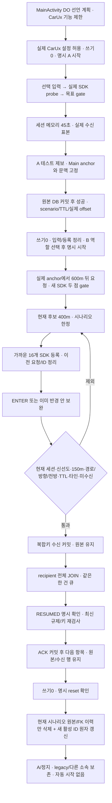

# 07. 최종 통합 검증과 시연 준비

상태: **명세 작성·독립 스펙 리뷰 요청 / 07 구현 전**. 코드 기준 `e8ef1421f6561fa39fde83414c76ad14bd3ee66f`, 공통 정본 부모 `0f0a7daa1189bcdba62cd27a58033a8659b43737`. [00 전체 계획](00-overview.md)과 [공통 정본](../../plans/implementation-plan.md)을 적용한다. 사용자가 추가한 주행 화면 보완/DO 계획은 §3.1에서06의 이전 범위를 대체하며 독립 스펙 리뷰 대상이다. 나머지 계약은 유지한다.

06 수정은 독립 재검토에서 원 반례1건·관련 JVM25건 직접 PASS, P2 스레드4545675100/4545675109만 해결된 것을 사용자 전달 및 원격 답글로 확인했다. 이는 **구현 및 허용 검사 완료·runtime 대기**다. 작성자의 JVM93/빌드 보고와 독립 리뷰어의 직접 검사 범위는 구분한다. 실제 SDK·UI·Room·JNI·FGS·CarUx·시연은 NOT_TESTED로 유지한다.

## 1. 이번 단계의 결과와 경계

목표는 기존01~06을 연결해 `제보 → 원본 저장 → 현재 후보 → SDK 접근 → 수신 저장 → 제품 카드 → 명시 확인 → 현재 시연 reset`을 검증하고, 같은 빌드로 재현할 수 있는 시연 안내와 증거 목록을 남기는 것이다. 주행 중 화면이 사라지는 문제의 최소 보완과 누락된 통합 경계/검증 근거를 함께 다룬다.

- 이번 요청은 명세·상태·작업 기록만 작성/커밋/푸시한다. 독립 스펙 리뷰와 구현 승인 전에는 테스트·시연 스크립트·앱 코드를 구현하지 않는다. 아래 명령·재현 절차는 실행 결과가 아니다.
- 승인 후에도 현재 허용 범위는 host JVM/Fake·빌드·lint·harness·스키마/리소스/APK 정적 검사다. 계측은 작성·컴파일만 허용한다. 앱/설치/Studio(build_project 포함)/adb/기기/에뮬레이터/시뮬레이터/계측은 실행하지 않는다. 향후 runtime 실행에는 별도 사용자 허용이 필요하며 스펙 승인 자체가 실행 허용은 아니다.
- **현재 명시 확인 ACK 계약 유지.** composition·카드 노출·화면 복귀·음성 요청/완료를 자동 ACK로 바꾸지 않는다. Gleo/TTS·음성 완료 연동·서버·새 지도·새 UI 디자인·자동 운행 복구·대규모 구조 이동은 제외한다.
- 실패를 발견하면 기존 계약을 만족하는 가장 작은 수정/회귀를 독립 코드 리뷰에 제출한다. 정책 변경이 필요하면 구현을 멈추고 결정안을 제시한다. 공통 정책은 부모 별도 커밋→기능 병합 절차를 유지한다.

## 2. 시작 시점의 AC·증거 인벤토리

아래는 기존 기록 대조다. 새 clean HEAD 실행 PASS 목록이 아니다. 원문 AC 전체를 유지하고, 통합 범위를 다음처럼 연결한다.

| 단계·원문 AC | 재사용할 구현/증거 | 07에서 확인할 경계와 남은 미검증 |
|---|---|---|
| [01](01-current-location.md) AC-01~09 | LocationTracking/LocationSource/Service, 수명·권한 기록 | 권한 대기 취소/연타/늦은 콜백/정리 Fake 재검증. 실제 최초·재시작 SDK/권한 팝업 재생성·화면 밖/Activity 재생성/FGS는 현 HEAD NOT_TESTED |
| [02](02-location-buffer.md) B01~17(11a~d 포함) | LocationBuffer/Tracking, 실제 표본 선택·단조시각 경계 | 45초 보관·30초 전 최근접·5초 신선도/목표 오차·null 순서·짧은 이력·불변 anchor JVM. 화면 밖 새 콜백으로 창이 계속 이동하는 현재 빌드 증거는 별도 필요 |
| [03](03-save-road-note.md) S01~12 / [03-c](03c-debug-submission-ui.md) C01~10 | Repository·Room 원본·Connection, 지연 저장 및 SubmissionSdkFailureTest | 저장 수락/커밋 전 성공 금지/연타/중지·오류 후 수락 쓰기 유지. PK/동시성·SQLite 트랜잭션·마지막 unbind/알림/종료는 실제 Room/서비스 검증 대기 |
| [04](04-nearby-candidates.md) H01~09 | H3/Room Flow·현재 소비 계약, 늦은 관찰 자신의 context 검사 | 400m/셀 경계·TTL·취소/현재 후보 소비·빈 결과와 실패 구분. host native 성공은 Android JNI 성공이 아님; 실제 .so 로드/Room 알림/SDK/Binder 대기 |
| [05](05-proximity-and-receipts.md) P01~11 | ProximityPickup/ReceiptRepository/RoomReceiptStore, RoadNotePickupFlowTest | 가까운16(pending 포함)/ENTER+이미 안/2초 신선도·경로·방향·전방·TTL·자기/기수신 제외·실패 세션·명시 ACK. 실제 등록/해제·늦은 ID·Room 복합키/JOIN/수락 쓰기 수명 대기 |
| [06](06-debug-demo-controls.md) D01~08 / UX01~09 | DemoRuntime/두 점 gate/CarUx/패널/v4 reset, e8ef142 회귀 | 역할/모드/출발·시나리오 scope·수락 잠금·캐시/늦은 IO·입력 공백·ACK 최신 정책. SDK/mock/provider/HTTP/CarUx/화면 유지·v4 migration/reset은 미실행 |

과거01/02의 계측·가상 주행 기록은 당시 커밋/로컬 변경/환경의 이력이다. 03~06 변경을 포함한 현 HEAD의 runtime PASS로 복사하지 않는다. 특히 [02 기록](../../work/step02-buffer-implementation.md)의 로컬 polling 포함 실행과 정확한 staged 코드 빌드 근거를 구분한다. [06 구현 기록](../../work/step06-demo-implementation.md)·[P2 수정 기록](../../work/step06-review-fixes.md)의 자동 검사 역시 polling dirty가 있는 작업 트리에서 수행됐으므로 §5의 clean HEAD 재검증이 필요하다.

### 남은 원격 스레드와 기존 변경

- [4541836293](https://github.com/jin-kim-240204/hyundai-and-gretel/pull/4#discussion_r4541836293): 수락 저장 후 **실제 SDK 오류 → 수집 정리/신규 제출 차단 → 마지막 unbind → 저장 완료/실패 → 서비스·알림 종료**. 4542469700 답글은 기존 Fake의 한계를 명시한다. 원격 전체 스레드 조회(페이지 누락 없음)에서 유일한 unresolved다. Fake/공유 종료 판단 PASS만으로 이 스레드를 resolve하지 않는다. 실제 오류 재현이 불가능하면 재현 방법/외부 조치와 NOT_TESTED를 남기고 독립 리뷰어에게 판단을 요청한다.
- 06 두 P2는 [입력 재검토4545793636](https://github.com/jin-kim-240204/hyundai-and-gretel/pull/4#discussion_r4545793636), [ACK 재검토4545793786](https://github.com/jin-kim-240204/hyundai-and-gretel/pull/4#discussion_r4545793786)에서 해결 확인. 이것이 다른 runtime 미검증까지 해결했다는 뜻은 아니다.
- 작업 시작 dirty: `PleosLocationSource.kt`의 polling 실험, `docs/work/pr4-implementation-feedback.md` 및 미추적 리뷰·와이어프레임·실행 기록. 원본 목록/해시를 외부 임시 파일에 보관하고 변경·stage·stash·복원·삭제하지 않는다. 관련 검증에 필요해 읽더라도 커밋 증거와 구분한다. 자동 생성물/다른 역할 문서를 묶지 않는다.

## 3. 제품 화면과 시연 조작

| 화면/책임 | 통합 수용 기준 |
|---|---|
| 실제 제품 화면 | 위치 수집/제보 결과·실패·수신 상태·recipient 전체 JOIN의 맨 앞 한 건·명시 확인. 패널이 닫혀도 수신/확인 가능. 저장/ACK 커밋 전 성공·다음 카드 전환 금지 |
| debug 패널 | A/B·명시 모드·시작 위치·시연 reset/확인·fixture 제보·버퍼/원본/등록/거리/시나리오 진단·합성 진행축. 실제 지도나 센서 정확도라고 표시하지 않음 |
| 웹콘솔 | 속도/기어 입력만 담당. 웹콘솔 숫자가 움직인 사실을 GPS 수신 성공으로 취급하지 않음 |
| release | 패널/fixture/role/reset/mock/loopback HTTP/특례 설정 제외. 기존 진짜 SDK 수집 및 recipient 전체 JOIN/legacy 명시 ACK 유지. release로 debug 시연 기능을 제공한다고 약속하지 않음 |

NO_SETUP·규제 미연결/오류에서는 역할/모드/출발점/reset/입력 시작을 UI와 Main 수락 경계에서 막는다. 중지/취소/닫기는 유지한다. 속도0/P만으로 설정 허가를 추정하지 않는다. 이미 Ready인 수집을 NO_SETUP만으로 초기화하거나 제한 해제만으로 자동 재개하지 않는다. 본문·문자·누적 항목/깊이·NO_VIDEO는06 매핑 그대로 적용한다. ACK는 VM 방문 정본 snapshot과 서비스 최신 규제로 판정하며 거절은 DB0·예산 불변이다. 현재 코드의 DO 미선언을07에서 보완할 계획이며 §3.1의 Activity 선언과 기능별 제한을 함께 적용한다. OS 주행 제한을 우회하지 않는다. 실제 플랫폼이 주행 중 표시를 막으면 성공 연출 대신 제약을 기록한다. Figma 미확인 상태에서 디자인 시스템 준수를 주장하지 않는다.

### 3.1 사용자 추가 범위: 주행 중 제품 화면 유지와 DO

주행 중 사용 가능해야 하며 달리면 제품 화면이 사라지는 문제를07 해결 범위에 포함한다.06의 ‘새 DO 선언 없음’은 당시 사실/범위로 남기되07 이후의 제약으로 적용하지 않는다. 현재 코드에는 선언이 아직 없고, 이 명세가 승인되기 전에 Manifest/Activity를 수정하지 않는다.

**공식 근거와 프로젝트 선택을 구분한다.** [Pleos 지역별 정책](https://document.pleos.ai/docs/pleos-only/vehicle-app-planning-guide/driving-restiction-policy)의 ‘주행 상황에 따른 앱 사용 여부’에서 DO 미선언 Drive 사용 불가를 확인했다. [개발 가이드](https://document.pleos.ai/docs/pleos-only/vehicle-app-developer-guide/driving-restriction-development-guide)의 CarUx 연동은 DO 이후에도 ActiveRestrictions 반영을 요구한다. [AAOS Activity 선언](https://source.android.google.cn/docs/automotive/driver_distraction/guidelines?hl=en)은 주행에 사용할 activity 자식 metadata 위치를 설명한다. 이를 근거로 기존 MainActivity에만 다음을 계획한다(앱 파일 변경 아님):

```xml
<!-- 기존 MainActivity의 activity 요소 안, application/service 아래가 아님 -->
<meta-data android:name="distractionOptimized" android:value="true" />
```

현재 namespace의 MainActivity는 debug/release 공통 진입점이다. applicationId와 혼동해 다른 Activity 이름을 만들지 않고, merged Manifest의 정규화된 `com.jinkim.hyundaiAndGretel.MainActivity`에 단일 Boolean true로 남는지 확인한다. debug overlay에만 선언하지 않으며 다른 Activity/서비스까지 무차별 DO 표시하지 않는다. source Manifest·debug/release merged Manifest·패키징 Manifest가 일치해야 한다. 이 선언을 새 권한 추가나 심사 승인으로 해석하지 않는다.

2026-11-12 `git fetch origin` 후 `b61ffd71fadc4b0d88625de85f664cdaf4e53565`(GyeongminKimGyeongminKim)의 위 metadata 추가와 `819df06fbd7508ecdc4b75691f5143d3db0999da`의 전체 UI 복원/DO 유지, 두 커밋이 origin/gm/feat-speech-to-text에만 포함되고 main/현 기능 브랜치에는 없음을 확인했다. 브랜치 전체 merge/cherry-pick이나 이전 Gleo/축소 화면/규제 모니터 복사는 하지 않는다. 필요한 선언과 현재 CarUx 계약만 최소 검토한다.

기존 제품 카드/수집·수신·명시 확인 화면을 주행 전용 축소 화면으로 교체하지 않는다. debug 패널은 별도이고 DO가 있어도 NO_SETUP/미연결 설정 차단, 본문/문자·깊이·항목·NO_VIDEO 제한 및 중지/취소/닫기를 유지한다. 제한으로 본문이 보류되는 것과 Activity 자체가 주행만으로 사라지는 것을 구분한다. 화면 꺼짐 방지 플래그/FGS 유지/DO/CarUx는 각각 다른 책임이다. 강제 재실행·시스템 화면 덮기·restrictions 위조 없이 원인을 해결한다. 주행 사용 목표를 단순 ‘OS 제약이니 완료’로 끝내지 않으며, 대상 환경/추가 정책으로 해결되지 않으면 차단 원인과 NOT_TESTED를 남긴다.

공통 정본은 부모0f0a7da에 문서만 별도 커밋·푸시 후 기능 브랜치에 병합했다.00/06/07도 같은 사용자 변경을 반영한다. 독립 스펙 리뷰 이후에만 선언/회귀를 구현하고, 실제 Drive 재현은 별도 실행 허용 후 R07에서 검증한다. 현재 DO 효과/주행 유지/안전·심사 적합성은 NOT_TESTED다.

## 4. 시스템 흐름과 보존 계약



| 경계 | 보존·실패·수명 계약 |
|---|---|
| 제보 | 첫 신선한 표본부터 허용, 30초 대기 강제 없음. 단조 기준 최근접 실제 표본·실제 offset 저장, 보간/현재점 대체 없음. anchor·작성자·scenario 수락 후 동결. DB 실패는 성공/부분 저장 아님 |
| 후보/등록 | raw snapshot 우회 없음. 04의 소비5초와05 수신2초를 구분. 가까운16개에는 pending 포함, 초과 표시. 등록 전후 onError/등록 실패·수신 StorageFailure는 해당 수신 세션 Failed 및 요청 무효화/알려진 ID 정리·미지 tombstone. 위치/수락 쓰기/기존 수신함 유지, DB/위치 신호로 자동 재시도 금지 |
| 수신 | ENTER와 이미 안 보완에 동일 조건. 수락 뒤 Room에서 원본/TTL/소속 재검사, 복합키(noteId,recipientId)로 중복 수신 방지. 중복/부적격과 저장 실패 구분. 원본은 수신으로 삭제/변경하지 않음 |
| 확인 | displayedAt은 기존 명시 확인 시각. 화면 노출/복귀/재구성·음성은 ACK 아님. 최신 규제로 거절 시 쓰기0/큐 불변, ACK 실패는 PENDING 유지·다음 명시 클릭만 재시도. 수락 ACK는 이후 규제 변화/화면 해제에도 원래 키로 끝나며 최초 시각을 덮어쓰지 않음 |
| 역할/모드/시작/reset | Main에서 쓰기0 확인→전환 소유권 확보→신규 제보/수신/ACK 수락 차단을 suspend 없이 처리. 수락 쓰기 중 설정/reset 거절, 일반 중지는 가능. 이전 SDK/IO/등록/DB/UI 결과가 같은 B로 돌아온 새 관찰도 덮지 않음 |
| 중지/SDK 오류/입력 오류 | 수집과 신규 요청을 막되 이미 수락한 쓰기는 완료/실패 정리. 수집 location/저장만 dataSync, 승격 실패는 수락 전 DB0, 이미 수락한 쓰기는 승격 실패로 취소하지 않음. 입력 전체 응답 마지막 성공+2초 초과 기한은 tick 포함, 읽기 완료 전 ERROR/SDK 중지·늦은 주입0·정리 전 새 입력0. 사용자 취소 전파 |
| 화면 이탈/재생성 | 서비스와 메모리 버퍼/입력은 화면 수명과 독립. 홈/다른 앱 중 새 위치로 창 이동, 복귀/재생성 재연결이 재등록/재제보/자동 ACK를 만들지 않음. 패널은 기본 닫힘으로 돌아와도 업무 불변. 실제 Android 관찰 필요 |
| reset/재실행 | v1→2→3→4 보존 migration, null legacy 소속 추정 없음. 원자 reset 성공은 현재 소속만 삭제/FK cascade·새 ID, 실패는 롤백. 다른 소속/legacy의 전체 수신함은 유지. 프로세스 재실행은 영속 행/활성 ID 보존·A/정지·빈 새 버퍼, 자동 주행 복구 없음 |

## 5. 정확한 커밋 HEAD 검증 계획 — 실행은 승인 후

이번 명세 작성 중에는 아래 명령을 실행하지 않는다. 별도 디렉터리에 **지정된 40자리 커밋의 detached worktree**를 만들어 원래 dirty와 분리한다. stash/임시 polling 제거/원본 파일 덮어쓰기로 clean 상태를 흉내 내지 않는다.

1. 검증 직전 PR 원격 head·로컬 commit·부모 SHA를 기록하고 코드 리뷰 대상으로 SHA를 고정한다. 문서 커밋도 포함한 최종 HEAD를 기록한다. 변경 후 새 SHA가 되면 영향 검사를 다시 평가하고 이전 SHA 결과를 새 결과처럼 쓰지 않는다.
2. 원래 작업 트리의 tracked diff와 미추적 목록/내용 SHA256을 외부 임시 기록으로 보존한다. 개인 경로/제보 원문·키/토큰을 원격 보고서에 올리지 않는다.
3. 승인 후 사용할 명령 초안(미실행):

   ```sh
   # VERIFY_SHA는 승인받은 실제 40자리 값, VERIFY_DIR은 새 빈 전용 경로로 지정한다.
   git worktree add --detach "$VERIFY_DIR" "$VERIFY_SHA"
   git -C "$VERIFY_DIR" rev-parse HEAD
   git -C "$VERIFY_DIR" status --porcelain=v1 --untracked-files=all
   git -C "$VERIFY_DIR" diff --exit-code
   git -C "$VERIFY_DIR" diff --cached --exit-code
   ```

   detached HEAD가 지정 SHA와 같고 상태가 비어 있어야 진행한다. 특히 `PleosLocationSource.kt`의 SHA256을 `git show <SHA>:<경로>` 내용과 비교해 polling dirty가 유입되지 않았음을 증명한다. `.git/hooks`/외부 init script로 임시 테스트 소스를 추가하지 않는다. Gradle은 해당 worktree 안에서 실행한다.
4. JDK21/설치 Android SDK 경로를 환경으로 지정하되 앱 소스·Gradle·local.properties를 복사/수정하지 않는다. 기존 허용 검사를 고정 HEAD 자체로 실행한다:

   ```sh
   ./gradlew :app:testDebugUnitTest :app:assembleDebug :app:assembleRelease :app:assembleDebugAndroidTest :app:lintDebug --console=plain
   python3 scripts/verify_harness.py --build
   ```

   `connectedAndroidTest`/`install*`/`run*`/IDE 실행은 포함하지 않는다. Gradle 테스트 source set/필터·환경·XML의 tests/failures/errors/skipped를 기록한다. 전체93은 이전 제출의 기준 수이지 새 테스트 개수를 고정하는 AC가 아니다. host H3 native를 썼으면 Android JNI와 구분한다.
5. schema1~4 및 migration 경로/nullable legacy/PK/FK/인덱스/recipient JOIN을 정적 대조한다. APK/merged Manifest/DEX/리소스에서 debug 경계·권한·FGS 타입·§3.1의 MainActivity DO 단일 true 선언(옳은 Activity 부모와 debug/release/최종 APK 일치), release의 패널/역할/reset/테스트 제보/mock/HTTP/특례 설정 부재, 기존 SDK·전체 큐 보존과 ABI ELF 패키징을 확인한다. 빈 release 연결점의 클래스명 존재만으로 debug 기능 포함이라고 판정하지 않는다. release unsigned 빌드 성공은 서명된 제출 APK/설치·기동 성공이 아니다.
6. 지정 SHA·원문/빌드 설정·명령·결과 XML·APK SHA256·정적 결과를 `docs/work/step07-integration-verification.md/.json`에 기록할 계획이다. runtime 열은 계속 NOT_TESTED. 검증 후 tracked diff 없음 및 원래 작업 트리의 dirty 해시/목록 불변을 확인한다. 원래 worktree/사용자 파일은 삭제하지 않으며 새 검증 worktree 정리는 해당 검사 종료 후 안전성을 확인한 범위에서만 한다.

## 6. 허용된 host 통합 보강 계획

기존 RoadNotePickupFlowTest·SubmissionSdkFailureTest·DemoRuntimeTest·ReceiptAdmissionTest·Repository/후보/Fake SDK를 우선 재사용한다. 범용 DI/새 coordinator/SDK 두 번째 소유자를 추가하지 않는다. 테스트를 위해 서비스의 판단 규칙을 복제하지 않는다. 단일 host 통합으로 실제 Android bind/CarUx/Room 원자성을 증명할 수 없으면 연결 가능한 production 경계와 platform 경계를 나누어 판정한다.

| ID | 입력/관찰 지점 | 기대 결과·증거 범위 |
|---|---|---|
| I01 | A gate→실제 Tracking/Buffer→제보 Repository→observable Store→B 현재 후보→Fake proximity→수신→최신 규제 명시 ACK | 원본1/수신1·실제 offset·400m 밖 등록0·안16상한·150m 보완/ENTER 멱등·ACK 전 PENDING/후 다음 항목. 도달 가능한 경계만 결합, Fake 저장소의 유일성은 SQLite 증거 아님 |
| I02 | 첫 표본/45초 이동창/표본 공백·null·stale/TTL 동일시각/역방향/자기/기수신/문맥 없음 | 기존02/04/05 경계 회귀 보존·새 데이터 신호로 만료/실패 우회0. 테스트 시계만 제어, 기기 시계 변경 없음 |
| I03 | DB를 대기시키고 stop 또는 Fake SDK error, 화면 연결 해제·교체/동일 B 복귀 | 신규 수락0·수락한 원래 키 쓰기 완료·새 UI 직접 결과 격리·카운트/onFinished/공유 종료 판단. Android 알림/마지막 unbind 생존은 증명하지 않음 |
| I04 | 옛 조회/늦은 등록 ID/ENTER/onError/HTTP 완료와 새 세션 경합, 입력 전체 기한/취소 | 현재 작업만 영향·옛 ID는 원 소스에서 정리·release 뒤 SDK 호출0, timeout은 IO 종료 전 오류·수집 중지. 자동 fallback/재시작0 |
| I05 | 역할·모드·시작/reset과 제출/수신/ACK/reset 수락 쓰기 경합 | Main 수락 잠금·설정0/일반 stop 가능·수락 쓰기 유지. reset 성공 후 같은 B 관찰 결과도 새 소유권. Fake scenario scope 보존과 실제 Room rollback 증거 구분 |
| I06 | raw 규제 업데이트 후 UI Flow 미진행, 최신 visited snapshot·본문/깊이/항목 예산 변경 | 명시 ACK 거절 DB0·큐 유지·거절 방문 증가0, 수락 뒤 규제 변경은 원래 ACK 완료. NO_SETUP/미연결 설정0·중지/닫기 유지·노출 자동 ACK0 |
| I07 | legacy/다른 scenario PENDING이 새 시연 항목보다 앞, 활성 없음/reset 이후 | recipient 전체 한 건 순서·명시 확인·원본 보존, 후보/신규 수신/시연 카운트만 현재 소속 제한. 실제 DAO JOIN/SQLite concurrency는 아래 R 항목 |
| I08 | 정적/XML: MainActivity metadata 및 debug/release merged·패키징 Manifest, 기존 UI 분기/규제 명령 회귀 | 정확한 Activity 자식·이름/true/중복/variant 유지. application/service 아래·false·debug에만 있음·누락의 반례 fixture는 검사 실패. release는 DO를 유지하면서 debug 도구/권한은 제외. 원래 DO 부재 검사만 삭제해 무검사로 두지 않고 위치/값 긍정 검사로 대체 |

기존 회귀로 이미 입증되는 중복 테스트를 늘리지 않는다. 누락된 연결만 한 작은 테스트씩 추가하며, 실패 시 원래 production 반례 RED→최소 수정→GREEN을 남긴다. 실제 Room migration/동시성·rollback 계측은 기존 ScenarioMigrationTest/RoomReceiptStoreTest 등 보강·컴파일까지만 허용한다.

## 7. 향후 실제 환경 재현 대본 — 지금 실행 금지

다음은 나중에 별도 실행 허용을 받은 뒤의 순서다. 스크립트를 작성하더라도 실행하지 않는다. 07 승인 전 runnable 스크립트를 구현하지 않고 아래 대본/명령 초안만 리뷰한다.

### 7.1 준비와 시작

- 노트북1·Pleos 에뮬레이터1·동일 앱/Room DB·고정 APK를 사용한다. 설치/실행 허용 후 APK 해시/커밋·SDK1.1.3·AVD/OS·ABI·applicationId·권한/CarUx·웹콘솔 형식·기준 경로·입력 모드를 기록한다. 새 코드로 runtime을 고쳤다면 새 SHA/빌드로 재검증한다.
- 첫 실행부터 이전 SDK 캐시가 있는 재시작까지 구분한다. 단순 callback count/최신 수신시각을 새 측정 인증으로 주장하지 않는다. 웹모드의 SDK 권한과 mock app-op/단독 provider 소유권을 별도 확인한다. 자동 권한 승격은 없다.
- 실제 CarUx가 설정을 허용할 때만 패널 reset/역할/모드/출발점을 조작한다. 허용되지 않으면 이유와 차단을 보여주고 중지/닫기를 유지한다. 시연을 위해 NO_SETUP·DO를 우회하지 않는다.
- DB를 초기화하거나 uninstall/clear-data로 legacy를 지우지 않는다. 남은 PENDING이 있으면 동일 제품 큐에서 명시 확인하거나 그대로 보존한다. reset은 현재 시나리오만 삭제하며 필요하면 삭제 전 스냅샷/행 수를 기록한다.

### 7.2 정상 시연

| 장면 | 발표자 조작 | 화면/저장소 관찰과 실패 판정 |
|---|---|---|
| A 준비 | debug 패널에서 WEB_CONSOLE 선택·명시 reset 확인·A 시작 | A/정지→probe→목표610±5m·실제 SDK Ready, 파랑은 수락 좌표만. gate 전 버퍼/후보/신규 수신0. 권한/HTTP/SDK 실패는 성공 연출 금지 |
| A 심기 | 웹콘솔 D·예시36km/h. 첫 표본 즉시 제보를 별도 확인하고, 주 시연에서는 약35초 주행 후 fixture 제보 | 30초 대기는 필수 제한 아님. 제출1건·커밋 후 성공, 저장 anchor/offset/현재 위치 구분. nominal 현재960/anchor660m는 설명 예시이며 실측값이 판정 기준 |
| B 준비 | 쓰기0·실제 CarUx 설정 허용에서 B 역할 선택 후 시작 위치 요청 | 기존 원본·수신 이력 불변, 실제 anchor-600m 목표·새 probe/target 통과 후 파랑. 즉시 A anchor605..615이면 B5..15m, 범위 밖은 오류이며 보정하지 않음 |
| B 접근 | 웹콘솔 D 주행, 설정 조작은 하지 않고 패널 진단 확인 후 닫음 | 600m 밖에서도 빨강 대상 표식 보존, 거리 감소·400m 후보/16등록·150m 조건에서 수신1행.36km/h 이상적 약45초 접근은 참고값, 실제 SDK/거리로 판정 |
| 제품 수신 | 패널을 닫고 실제 제품 카드 관찰 | recipient 전체 큐의 순서. 옛 legacy가 앞이면 먼저 동일 명시 확인을 진행, 새 항목을 시나리오 필터로 끌어올리지 않음. 노출/재구성만으로 PENDING 불변 |
| 확인 | RESUMED·표시 허용 상태에서 현재 카드 ‘확인’ | 수락 ACK1건·커밋 전 카드 유지·후 다음 항목, 원본/수신 행 유지. TTL 지난 과거 수신은 기록으로 구분. 연타/재진입 수신 중복0 |
| 반복/reset | 재접근/패널 재개폐·Activity 재생성을 별도 관찰, 쓰기0/설정 허용에서 명시 reset | 중복 원본/수신/자동 ACK0. reset 성공은 현재 시연/FK 이력만 삭제·새 활성 ID·A/정지. 다른 소속/legacy 보존, 자동 시작 없음 |

설정은 제한이 허용하는 구간에서, 주행·접근·수신은 같은 제품 화면에서 확인한다. 정차도 허용하며 양의 속도/기어 자체를 수신 자격으로 추가하지 않는다. KEEP_SCREEN_ON은 가시 수집 중만 적용하고 onStop/중지 시 원복한다. 이것이 OS의 주행 표시 허가를 대신하지 않는다.

### 7.3 외부 입력 대본과 실패/수명 장면

외부 모드는 **명시 EXTERNAL_ADB 선택 → 기존 앱 provider/HTTP 정리 확인 → 화면에 표시된 probe 주입 → probe 실제 SDK 확인 → 요청 target 주입 → 목표 실제 SDK 확인 → D 정방향 경로 재생** 순서다. 실패한 웹모드의 자동 대체가 아니다. 앱 중지는 외부 재생기를 멈추지 않으므로 발표자가 별도로 종료한다.

향후 외부 재생 스크립트의 입력 계약 초안: 명시 기기 serial/역할별 target·probe/R1 범위·속도·중지 방법을 받고, 경도→위도 순 `adb -s <serial> emu geo fix <longitude> 37.5`를 순차 호출한다. R1 진행값 변환은06의 지구 반경6,371,000m·위도37.5도와 같은 식을 쓰며 경로 밖 clamp/자동 loop/역방향/직접 앱 Fake 위치 입력은 없다. probe/target 전환은 SDK 단계 확인 뒤 진행하고 명령 성공만으로 확인 완료하지 않는다. 현재는 명령 초안일 뿐 adb 조회조차 실행하지 않는다.

| ID | 별도 runtime 장면 | 필요한 증거/현재 판정 |
|---|---|---|
| R01 | 위 정상 A→B→명시 확인→reset, 웹/외부 모드 각각 | 실제 SDK callback·anchor/후보/등록 ID·수신 행/ACK·화면과 APK SHA 연결. NOT_TESTED |
| R02 | 홈/다른 앱 중45초 이상 이동·새 표본, Activity 재생성 별도 실행 | 복귀 전 새 SDK 수신 단조시각/창 이동·등록 수 유지. 복귀 후 최종값만으로 화면 밖 수집 PASS 금지. NOT_TESTED |
| R03 | 수락 DB 대기 후 사용자 stop와 실제 SDK 오류를 각각 주입·마지막 unbind·DB 성공/실패 | 위치/신규 작업 차단·foreground 유지/저장 타입·원래 쓰기 마무리 후 서비스 종료. 실제 SDK 오류 재현 방법 없으면 해당 부분 NOT_TESTED/스레드 유지 |
| R04 | 실제 Room v1/2/3→4 보존, 동시 수신/ACK, reset 중 실패 | 원본/legacy/PENDING/단일 JOIN·복합키/FK/rollback·다른 소속 불변. Fake로 대체 PASS 금지. NOT_TESTED |
| R05 | mock 권한 거절/회수·HTTP 미완료/부분 응답/2초 공백·SDK null/onError·늦은 등록 ID | 오류/실패 세션·IO 완료 전 SDK 중지·정리·늦은 주입0·명시 재시작. 실제 장애의 종류별 구분. NOT_TESTED |
| R06 | CarUx 미연결/NO_SETUP/문자·깊이·항목·NO_VIDEO, raw 변경과 확인 경합 | 기능별 차단/중지·닫기 유지/숨긴 본문 ACK0/수락 쓰기 유지·OS 표시 제한. NOT_TESTED |
| R07 | 고정 APK의 P→D/속도 증가→정차, 주행 중 재진입·재생성/홈 복귀·멀티윈도우; JNI/ABI 및 debug/release 제품 UI | DO metadata 실제 효과·전체 제품 화면이 주행만으로 사라지거나 축소되지 않음·기능별 제한과 중지 유지·KEEP_SCREEN_ON 원복을 구분 관찰. OS 제약/실패는 원인 기록·최소 수정 후 재검증, 선언만으로 PASS 금지. Figma/실차/모든 폼팩터 준수 보장 아님. NOT_TESTED |

고의 오류/DB 지연은 기존 테스트 fixture/계측 경계를 사용하고 시연용 production 백도어를 추가하지 않는다. 실패 원인을 구분할 관측 수단이 없으면 성공으로 추정하지 않는다. 실제 개인정보/제보 원문/위치 로그는 합성 시연 데이터에 제한하며 외부 보고에는 비식별 상태/카운트/테스트 ID만 남긴다.

## 8. 제출 문서·PR 정리와 종료 기준

07 승인 후 수정 후보는 기존 통합 테스트의 누락 경계, 기존 계측의 관찰/컴파일, 현 브랜치에 아직 없는 재현 안내 `docs/LOCATION-DEMO.md` 작성(과거 참고 브랜치 내용을 그대로 복사하지 않고 현 PR 상태와 대조), README 실행/검증 범위 요약, 00/각 단계 상태 헤더와 검증 인덱스, step07 작업 기록이다. 주행 화면 보완의 최소 MainActivity metadata와 규제 계약 회귀를 제외한 새 사용자 기능/의존성/스키마·앱 ID 변경·Gleo 스키마 수정·불필요한 로그/전체 폴더 이동은 기본 범위가 아니다. 공통 정책이 바뀌지 않으면 부모 문서를 기능 브랜치에서 직접 수정하지 않는다.

PR4의 base는 spec-road-note-system, head는 ny/spec-driven-road-notes를 유지한다. 정확한 SHA와 허용 검사/미검증을 AI 구현자·리뷰어별 원격 기록에 연결한다. 기존 실제 SDK 스레드는 미해결을 보존하고 unrelated 스레드를 일괄 resolve하지 않는다. 현재 OPEN/DRAFT이며 이 명세로 ready/merge/배포·서명 APK 제출을 승인하거나 실행하지 않는다. 현재 PR 본문에는 최초의 ‘문서만 담고 구현은 시작하지 않는다’ 설명이 남아 있다.07 승인 후 본문을01~06 구현과 허용 검사/07 상태·runtime 대기로 갱신하고 과거 문서 전용 설명을 현재 사실처럼 두지 않는다. 실행 완료로 읽힐 다른 설명도 현 SHA 근거로 정리하되 리뷰·작업 이력을 지우지 않는다. 이번 요청에서는 리뷰 요청 댓글만 게시하고 PR 본문/ready 상태는 바꾸지 않는다.

| ID | 07 수용 조건 | 현재 상태 |
|---|---|---|
| F01 | 독립 스펙 리뷰 및 구현 승인 | 이번 명세 리뷰 대기 |
| F02 | clean 지정 HEAD·dirty 미유입/원본 보존·증거 SHA/환경 식별 | 계획만 작성, 미실행 |
| F03 | I01~08에서 필요한 통합 회귀 및 기존 전체 JVM·빌드/lint/harness/schema/release 정적 통과 | 신규07 검사 미실행; 기존06 근거는 이력으로 보존 |
| F04 | 주행 화면 보완·MainActivity DO 및 기존 CarUx/안전 명령 회귀, 명시 ACK·보존/실패/수명 유지, 독립 코드 리뷰 | 구현 전, 사용자 DO 범위 추가를 이번 명세 리뷰 대상으로 제출 |
| F05 | R01~07의 향후 재현 대본·입력 모드·오류/중지·외부 한계 문서화 | 이번 리뷰 대상; runtime은 전부 NOT_TESTED |
| F06 | 남은 스레드/미검증/PR 문서 상태가 증거와 일치 | 허용 검사 제출과 실제 시연 완료를 별도 보고; 미검증 숨김 금지 |

순서: **명세 리뷰 핑퐁 → 승인 → clean HEAD 기준선 검증 → 최소 DO 선언과 주행 UI 규제 회귀/누락 host 통합의 작은 묶음 → 독립 코드 리뷰 → 문서/PR 상태 정리**. runtime 금지가 유지되면 허용 검사와 시연 준비까지 제출하고 실제 시연 성공/전체 기능 검증 완료를 선언하지 않는다. 별도 실행 허용 후에만 고정 APK의 R 항목을 실행하고 결과별로 PASS/FAIL/NOT_TESTED를 갱신한다.
