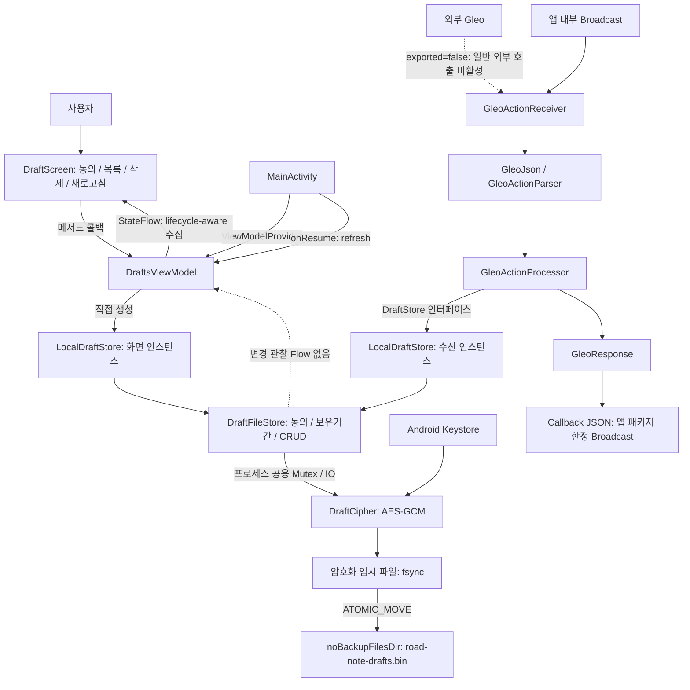
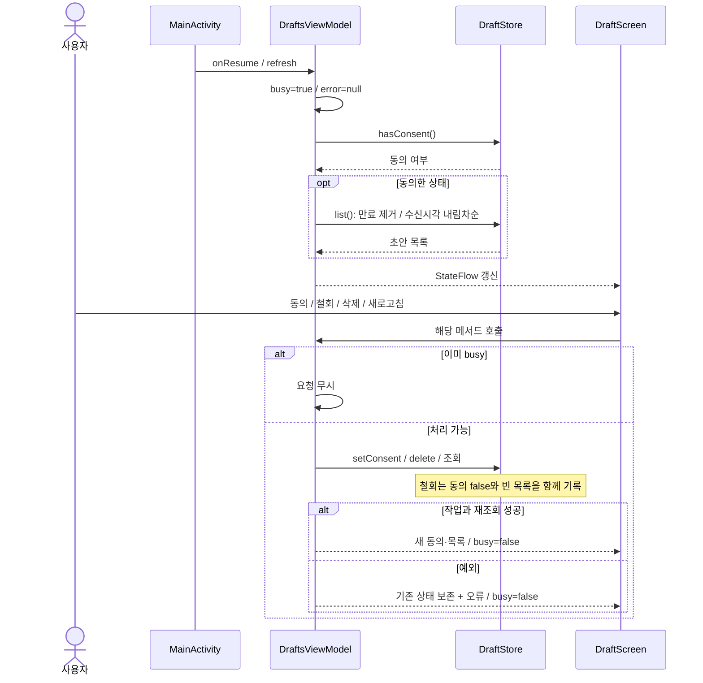
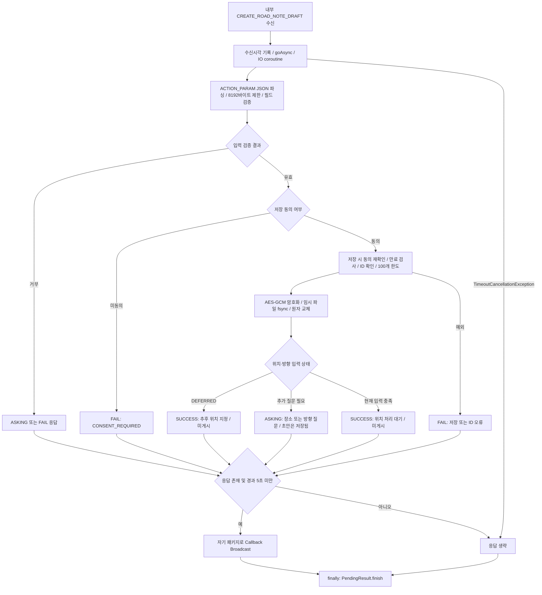

# 현재 아키텍처 검토와 시스템 흐름

검토일: 2026-11-08 · 기준 커밋: `991ca91` · 대상: 현재 작업 트리의 Android 소스·Manifest·Gradle·테스트.

## 1. 판정

**화면은 MVVM을 따르고 있다. Google Android 공식 권장사항은 일부 충족하지만 전체 준수 상태는 아니다.** View와 ViewModel, 데이터 저장 책임이 나뉘고 상태는 ViewModel에서 화면으로 흐른다. 주요 개선점은 의존성 주입, 저장 변경 관찰, ViewModel 테스트, 코루틴 취소와 시간 제한의 실제 동작 확인이다.

“Google 공식 클린코드”라는 단일 인증 기준으로 판정하지 않았다. Android 아키텍처 권장사항, Kotlin 스타일 규칙, 코루틴 권장사항을 각각 대조했다. MVVM과 Clean Architecture도 구분한다. MVVM은 현재 화면 구조에 해당하며, 별도 domain/use case 모듈이나 Hilt가 없다는 이유만으로 결함으로 보지 않는다.

요청 범위는 리뷰 문서 작성이다. 앱 코드는 수정하지 않았다. 이 파일 하나에 작업 기록·검토 결과·도식·검증 제한을 통합했다. 상태의 의미는 PASS=확인한 범위 충족, FAIL=대조 기준 미충족, NOT_TESTED=실행 증거 없음, N/A=현재 범위에 적용하지 않음이다. 권장사항의 FAIL은 플랫폼 의무 위반이나 앱 실행 불가를 뜻하지 않는다.

## 2. 검토 기준과 범위

적용 스킬: `pleos-connect`, `pleos-verify`, `ponytail`. 연결된 `android-compose-architecture` 디렉터리는 비어 있어 SKILL.md를 찾을 수 없었다. 해당 스킬을 적용했다고 주장하지 않으며, 이번 정적 리뷰는 Google 공식 원문을 직접 확인해 수행했다.

| 기준 | 성격·이번 확인 범위 | 공식 원문 |
|---|---|---|
| G-ARCH | UI/UDF, ViewModel, 생명주기, DI, 테스트 권장 | [Android architecture recommendations](https://developer.android.com/topic/architecture/recommendations) |
| G-DATA | 데이터 계층 경계와 Repository 역할 | [Data layer](https://developer.android.com/topic/architecture/data-layer) |
| G-KOTLIN | 패키지·import·파일 구성 등 스타일 규칙 | [Kotlin style guide](https://developer.android.com/kotlin/style-guide) |
| G-COROUTINE | dispatcher 주입, main-safe, 취소 전파 권장 | [Coroutines best practices](https://developer.android.com/kotlin/coroutines/coroutines-best-practices) |
| ENV-02 | 프로젝트 선택: Automotive + ComponentActivity/Compose 유지 | `AGENTS.md`, `MainActivity.kt`, Manifest |
| PRIV-01 | 아래 보안 세부 항목만 정적 확인; 개인정보 정책 전체 준수 판정 아님 | [Pleos 앱 보안 가이드](https://document.pleos.ai/docs/pleos-only/app-registration-guide/app-security-guide) |

Google 문서는 2026-11-08 온라인으로 확인했다. 기존 Pleos 문서 지도에 있는 보안 원문을 재확인했으며 신규 Pleos 문서 추가는 없다. 디자인·실차·심사 전체 리뷰는 이번 범위가 아니다.

이하 코드 경로는 `app/src/main/java/com/jinkim/hyundaiAndGretel/` 기준이며, 줄 번호는 검토 시점이다.

## 3. MVVM 및 계층별 평가

| 항목 | 상태 | 코드 근거·해석 |
|---|---|---|
| View 분리 | PASS | `ui/drafts/DraftScreen.kt:36`은 값과 콜백을 받는다. 저장소·Context·ViewModel을 직접 생성하지 않는다. |
| ViewModel 상태 관리 | PASS | `MainActivity.kt:48–82`의 DraftUiState/DraftsViewModel이 로딩·목록·동의·오류를 관리한다. |
| 단방향 상태 흐름 | PASS | `MainActivity.kt:27–36,57–58`: 읽기 전용 StateFlow → 화면, 사용자 이벤트 → ViewModel 메서드. |
| 생명주기 인식 수집 | PASS | `MainActivity.kt:27`에서 collectAsStateWithLifecycle 사용. |
| Android 의존성 분리 | FAIL | `MainActivity.kt:55–56`: AndroidViewModel이 Application을 받아 LocalDraftStore를 직접 만든다. 일반 ViewModel과 생성자 주입 권장에 미달한다. 메모리 누수를 확인했다는 뜻은 아니다. |
| 데이터 계층 경계 | PASS | `DraftStore` 계약 뒤에 LocalDraftStore/DraftFileStore가 있다. 저장·동의·만료 정책을 중앙화하므로 작은 단일 소스 앱의 Repository 역할로 볼 수 있다. 클래스 이름에 Repository가 없다는 이유만으로 실패 처리하지 않는다. |
| 데이터 변경 관찰 | FAIL | `RoadNoteContract.kt`의 DraftStore에는 조회 suspend 함수만 있다. 수신 경로 저장 후 UI 상태를 갱신하는 연결이 없다. |
| domain/use case 분리 | N/A | 현재 규모에서 별도 계층은 필수가 아니다. GleoActionProcessor는 화면과 분리된 처리 로직이지만 별도 domain 계층 전체가 구현되었다고 볼 수는 없다. |
| 테스트 가능한 의존성 | 일부 PASS / FAIL | GleoActionProcessor는 DraftStore를 주입받고 파일 저장소는 시계·교체·암복호화를 대체할 수 있다. 반면 DraftsViewModel은 구체 저장소에 고정된다. |

Google 데이터 계층 문서는 단일 데이터 소스에서는 Repository와 data source 책임의 병합을 허용한다. 따라서 현재 구조에서 불필요한 전달 전용 계층을 늘리기보다 기존 DraftStore를 주입 가능한 경계로 사용하는 것이 우선이다. [근거](https://developer.android.com/topic/architecture/data-layer)

## 4. 우선순위별 발견사항

### P1 — 저장 변경이 화면에 자동 반영되지 않음

- 근거: `MainActivity.kt:42–44,60–72`, `gleo/GleoActionReceiver.kt:23–25`, `roadnote/RoadNoteContract.kt`.
- 내부 수신 경로와 화면은 각각 LocalDraftStore를 만든다. 공유 Mutex는 파일 충돌을 막지만 변경 알림을 제공하지 않는다. 화면이 열린 상태에서 초안이 저장되면 새로고침 또는 onResume이 있어야 반영된다. busy 중 들어온 refresh는 버려진다.
- 개선: 데이터 계층에서 동의와 초안을 함께 관찰하는 Flow를 제공하고 모든 쓰기 경로가 같은 변경 통지 경로를 사용하도록 한다. ViewModel이 이를 UI 상태로 변환한다.
- 확인: 화면을 유지한 채 별도 처리 경로로 저장·철회하고 UI 자동 반영 검사. 현재는 코드 경로로 확인했으며 기기 재현은 NOT_TESTED.

### P1 — 동의와 목록을 하나의 스냅샷으로 읽지 않음

- 근거: `MainActivity.kt:69–72`, `DraftFileStore.kt:33–39,71–73,96–99`.
- hasConsent와 list는 각각 잠기지만 호출 두 개는 하나의 트랜잭션이 아니다. 두 호출 사이에 다른 인스턴스가 동의를 철회하면 화면에 예전 동의 값과 새 빈 목록이 함께 표시될 수 있다. 저장소는 save 시 동의를 재확인하므로 이것을 미동의 저장 취약점으로 단정하지 않는다.
- 개선: 동의와 목록을 함께 읽는 스냅샷 API 또는 단일 관찰 상태로 묶는다.
- 확인: hasConsent 직후 철회를 끼워 넣는 결정적 동시성 테스트.

### P2 — ViewModel의 구체 저장소 생성과 Android 결합

- 근거: `MainActivity.kt:55–56`. Processor에는 이미 생성자 주입 패턴이 있다.
- 영향: UI 상태 테스트에 Android Application/Keystore/파일 구성이 따라온다.
- 개선: `DraftsViewModel(store: DraftStore) : ViewModel()`과 수동 Factory/앱 컨테이너로 생성 책임을 옮긴다. Hilt 도입은 현재 규모에서 필수가 아니다. `DraftUiState`와 ViewModel의 파일 분리는 탐색성을 위한 후속 정리로 충분하다.
- 확인: fake DraftStore로 성공·실패·중복 요청·취소 시 상태를 검사한다.

### P2 — 코루틴 시간 제한이 저장 완료 시간을 강제하지 못할 수 있음

- 근거: `GleoActionReceiver.kt:21–31`, `DraftFileStore.kt:96–99,101–179`.
- withTimeout(5000) 내부의 동기 파일 I/O·암호화·fsync는 취소에 즉시 반응하지 않을 수 있다. 응답을 보내지 못한 요청이라도 파일 교체가 이미 끝났을 가능성이 있다. 따라서 5초 제한을 저장 롤백이나 실제 수신 처리 시간 보장으로 해석하면 안 된다.
- 일반 CancellationException도 Receiver의 catch(Exception)에 잡힌다. ViewModel과 Processor는 이를 재던지지만 Receiver는 timeout 외 취소를 별도 전파하지 않는다. Scope는 Receiver에서 직접 생성한다.
- 개선: 취소 전파를 명확히 하고 저장 성공 후 응답 누락·재시도 정책을 정한다. 종료 시 PendingResult.finish 보장은 유지한다. 주입 가능한 scope/dispatcher로 테스트한다.
- 확인: 느린 저장·파일 교체 직후 timeout·동일 요청 재시도. 자동 테스트 미실행이므로 실제 시간 특성은 NOT_TESTED.

### P2 — ViewModel 상태 전이 테스트 부재

- 근거: 현재 테스트는 GleoActionTest, DraftCipherIntegrationTest, LocalDraftStoreTest, DraftPresentationTest다. DraftPresentationTest는 표시 문자열을 검사하며 ViewModel 또는 실제 Compose 화면을 검사하지 않는다.
- 개선: 저장 실패 시 오류 표시, busy 중 행동, 철회 후 상태, 재조회 실패, 취소 전파를 fake 기반으로 검사한다. 테스트 파일 존재만으로 통과 판정하지 않는다.

### P3 — dispatcher·문자열·스타일 정리

- `DraftFileStore.kt:96`, Receiver의 Dispatchers.IO는 하드코딩되어 있다. I/O의 main-safe 분리는 적절하지만 dispatcher 주입 권장에는 미달한다. [코루틴 기준](https://developer.android.com/kotlin/coroutines/coroutines-best-practices)
- `MainActivity.kt:42–44`의 UI 재조회는 onResume override 대신 Compose 생명주기 effect나 데이터 관찰로 옮기는 방향을 검토한다. [아키텍처 기준](https://developer.android.com/topic/architecture/recommendations)
- 패키지 `com.jinkim.hyundaiAndGretel`은 대문자가 포함되어 Google Kotlin의 소문자 패키지 규칙에 미달한다. `DraftFileStore.kt:15–18` 등 import 정렬도 전체 일관성 확인이 필요하다. 파일명·타입명은 대체로 역할을 드러낸다. 자동 포맷 검사 전이므로 스타일 전체 PASS 판정은 하지 않는다. [스타일 기준](https://developer.android.com/kotlin/style-guide)
- UI와 ViewModel에 한국어 문구가 직접 들어 있다. 다국어 지원이 필요하면 strings.xml로 옮긴다. 이는 이번 검토의 유지보수 제안이며 Kotlin 문법 위반 판정이 아니다.

## 5. 현재 시스템 구조

실선은 현재 코드 호출·데이터 경로다. 점선은 비활성 경계 또는 현재 자동 연결이 없는 지점이다. 실제 음성 인식·차량 위치 조회·지도 매칭·제보 게시 구현으로 해석하지 않는다.

차량 SDK 의존성은 Gradle에 있으나 현재 Kotlin 소스에는 차량 API 호출이 없다. 서버 통신·공유·게시 경로도 없다. Receiver는 외부 Gleo 응답 대상을 향하지 않고 자기 패키지로 응답 Broadcast를 보낸다. Manifest와 소스에서 이 내부 경계를 확인했다.

## 6. 사용자 조작 흐름

작업은 성공했지만 후속 재조회가 실패하면 기존 화면 상태에 일반 오류가 표시될 수 있다. 취소는 ViewModel에서 재던지며 finally에서 busy를 해제한다.

## 7. 초안 수신·저장·응답 흐름

입력의 utteranceRecordedAt은 파서가 검증하지만 Processor가 신뢰 가능한 시각 계약 미확정을 이유로 null로 바꾸어 저장한다. 만료 기준은 최초 앱 수신시각이며 수정해도 연장하지 않는다. list/save 호출 때 7일 만료를 정리한다. 앱이 실행되지 않는 동안 정확한 만료시각에 물리 삭제하는 스케줄러는 없다. 7일과 100개는 프로젝트 정책이다.

`PENDING_LOCATION`과 `AWAITING_LOCATION`만 구현되어 있으며 게시 완료 상태는 없다. 추가 질문 응답 이후 다음 요청의 연결은 draftId 입력으로 가능하지만 실제 외부 Gleo 대화 연동은 검증하지 않았다.

## 8. 보안·저장 확인

| 세부 요구사항 ID | 상태 | 요구사항·근거·확인 한계 |
|---|---|---|
| DOC-27ac8605961f#민감정보암호화 | PASS: 정적 | 민감 저장물·임시 사본 암호화. LocalDraftStore가 encode/decode를 DraftCipher로 연결하며 write는 암호화 바이트를 임시 파일에 쓴다. 실제 Android 파일 검사는 NOT_TESTED. |
| DOC-27ac8605961f#키관리 | PASS: 정적 | 키는 Android Keystore에서 조회·생성한다. 키 값 하드코딩은 없다. 키 삭제·무효화·기기 재시작 동작은 NOT_TESTED. |
| DOC-27ac8605961f#외부노출제한 | PASS: 정적 | Manifest receiver exported=false, Callback은 setPackage로 수신 범위를 제한한다. 외부 연동 활성화 완료를 뜻하지 않는다. |
| ENV-02 | PASS: 정적 | ComponentActivity/Compose + automotive feature 유지. Car App Library로 전환하지 않음. |
| PRIV-01 전체 | NOT_TESTED | 위 세부 항목 외 동의 고지 적정성·다중 운전자·출시 정책·실기기까지 포함한 전체 준수 판정은 하지 않음. |

기존 프라이데이 기록의 “평문 저장 FAIL”은 과거 구현 시점 기록이다. 현재 코드는 Keystore/AES-GCM 연결이 있으므로 해당 과거 판정을 그대로 현재에 적용하지 않았다. [현재 대조한 공식 요구사항](https://document.pleos.ai/docs/pleos-only/app-registration-guide/app-security-guide)

## 9. 검증 기록과 남은 작업

| 확인 | 상태 | 근거 |
|---|---|---|
| 현재 Kotlin·Manifest·Gradle·테스트 소스 정적 리뷰 | PASS | 위 파일·줄과 도식 대조. 전체 공식 준수 PASS를 뜻하지 않음. |
| harness | PASS | 이번 실행: `python3 scripts/verify_harness.py`, 종료 0. 133 source pages / 27 rule gates / static Manifest. |
| 현재 코드 단위 테스트·assemble·lint | NOT_TESTED | 이번 변경은 문서뿐이므로 재실행하지 않음. 발견한 XML 결과는 2026-11-03의 이전 wakeup/seat 테스트여서 현 코드의 근거로 사용하지 않음. |
| 화면·Gleo·Keystore·timeout 기기 동작 | NOT_TESTED | 기기 실행·시간 측정·실제 화면 조작 미실행. |
| 자동 Kotlin 스타일 검사 | NOT_TESTED | 포맷터/스타일 검사 실행 없음. |
| Mermaid 렌더링 | NOT_TESTED | 코드 경로·문법 수동 대조만 수행. 렌더러 이미지 확인 없음. |
| JSON 보고서 검사 | N/A | 사용자의 Markdown 파일 하나 요청에 맞춰 결과를 본 문서로 통합. 별도 JSON 생성·report 실행 없음. |
| 실차 제어·오디오·앱 제출 심사 | N/A | 이번 리뷰와 현재 구현 경로에 포함하지 않음. |

다음 수정 순서는 **ViewModel에 DraftStore 주입 → 동의·목록을 하나의 관찰 상태로 제공 → ViewModel/동시성 테스트 → timeout·재시도 정책 확인 → 스타일 정리**를 권한다. 이 제안은 아직 구현하지 않았다. 문서 작성은 완료했으며, 발견사항 해결과 시스템 전체 검증은 미완료다.
